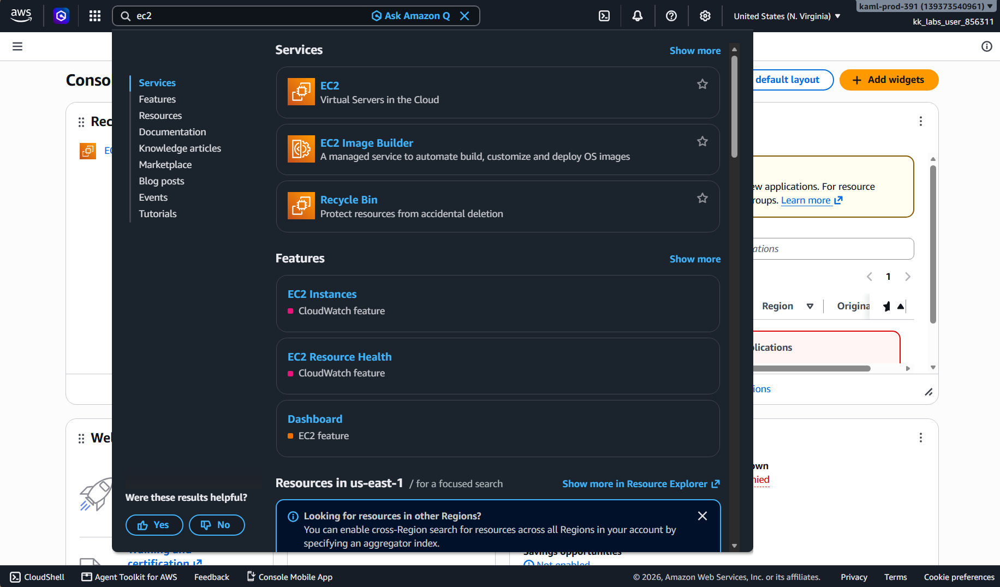
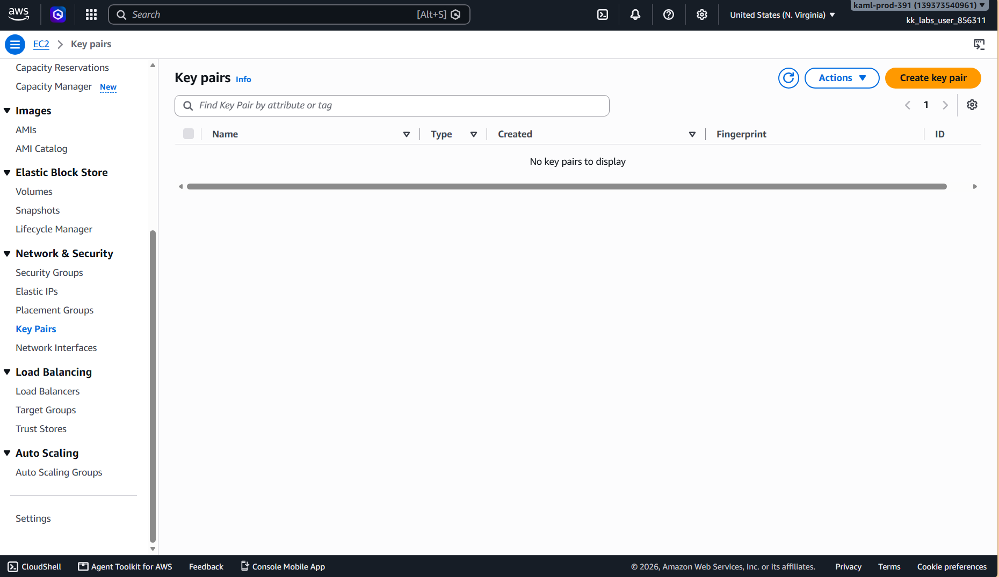
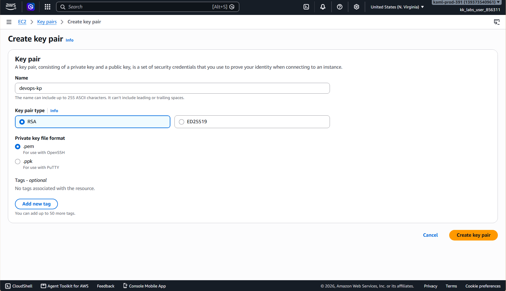
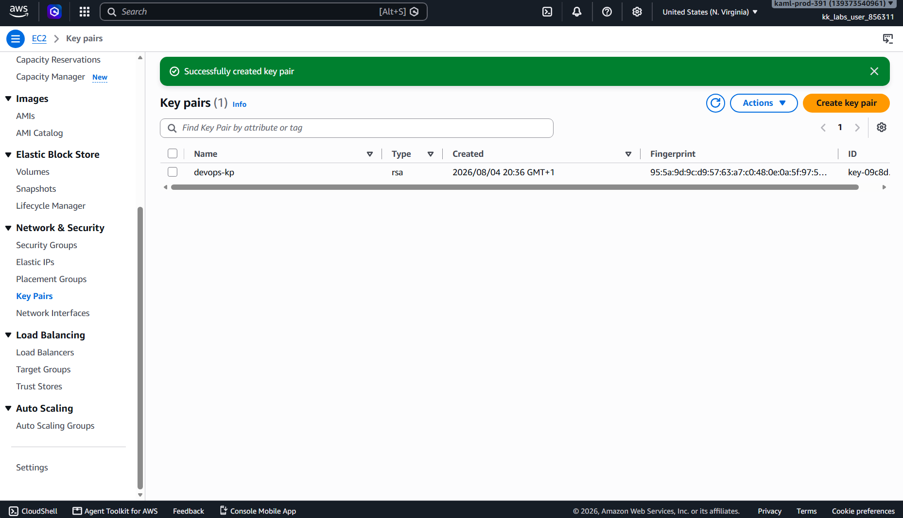

# Day 1: Create Key Pair

After logging in, I searched for EC2 section,

I went for key pairs in Network and Security section,

I clicked on create a key pair button,

I created it with the required name and type.

