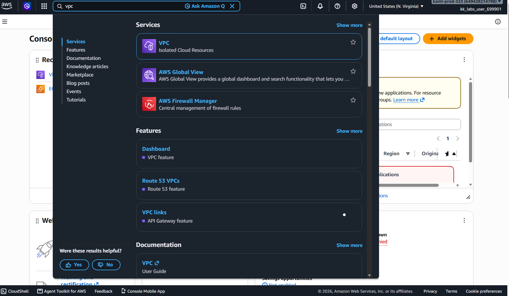
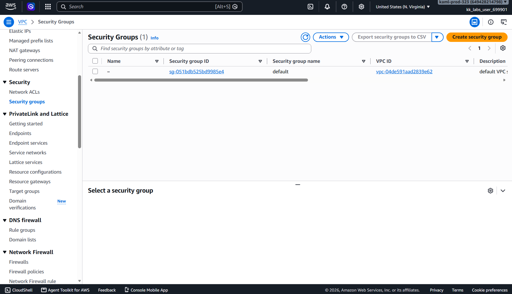
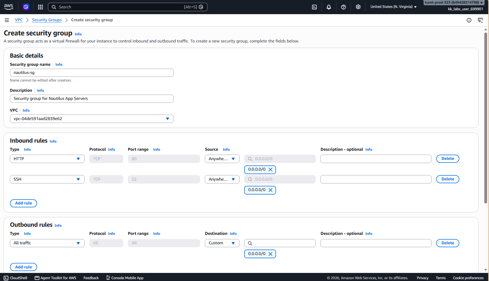
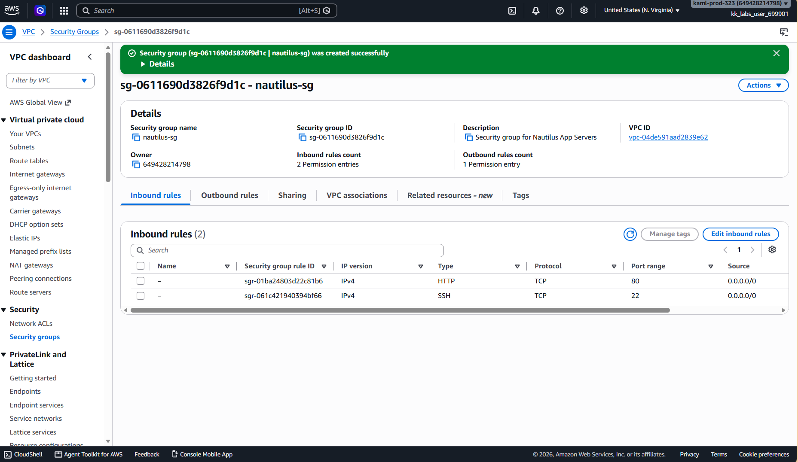

# Day 2: Create Security Group

After logging in, I searched for VPC section,

I went for Security Groups in Security section, and I clicked on create security group button

I configured the new security group as demanded

Finally my new security group is created successfully.

