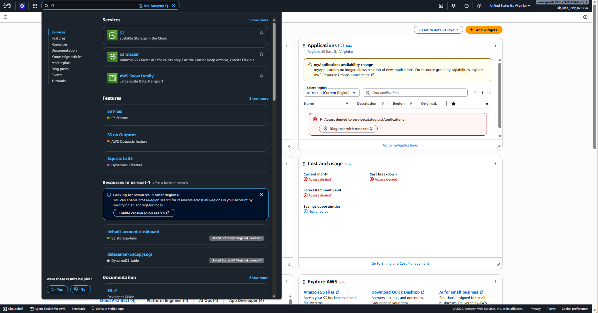
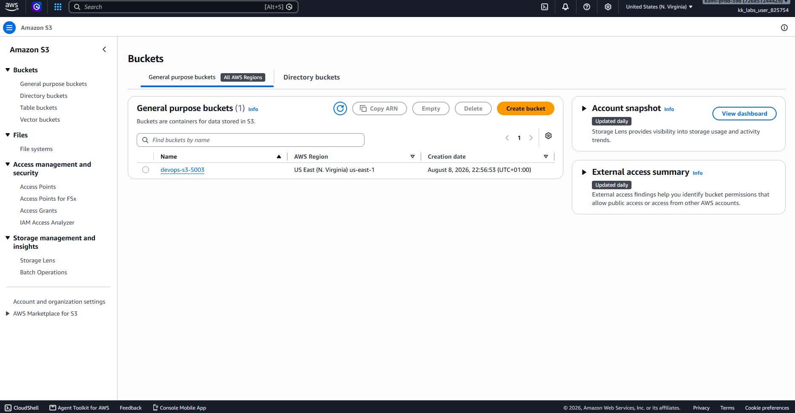
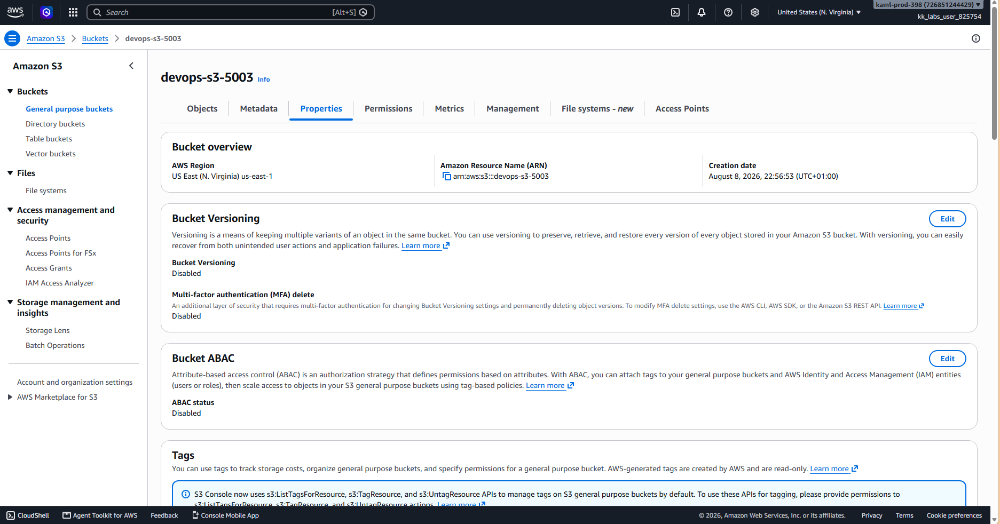
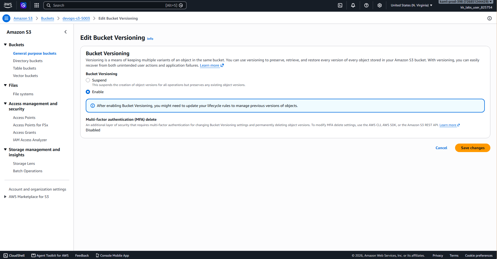
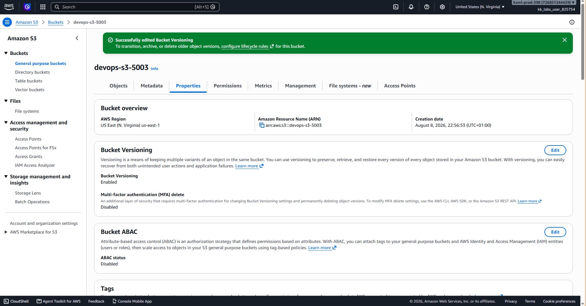

# Day 4: Enable Versioning for S3 Bucket

After logging in, I searched for S3 section,

I went for devops-s3-5003 bucket,

I went for properties sections

I clicked on edit in bucket versioning section and enabled versioning for my bucket

Finally, my bucket's versioning is enabled successfully.

