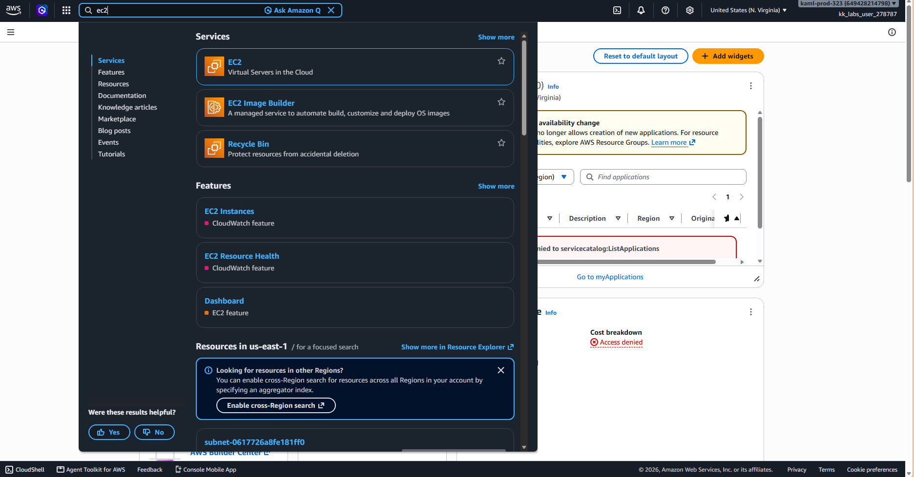
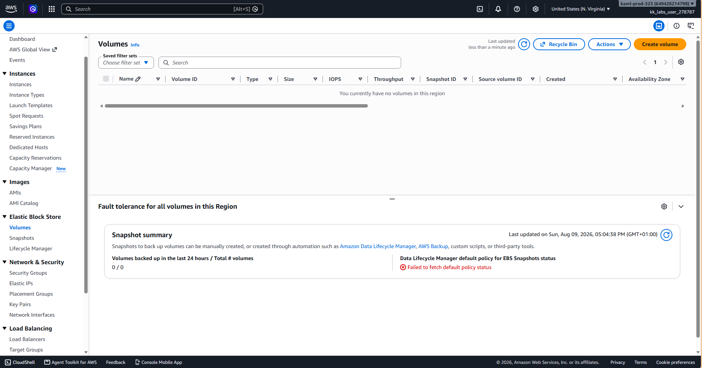
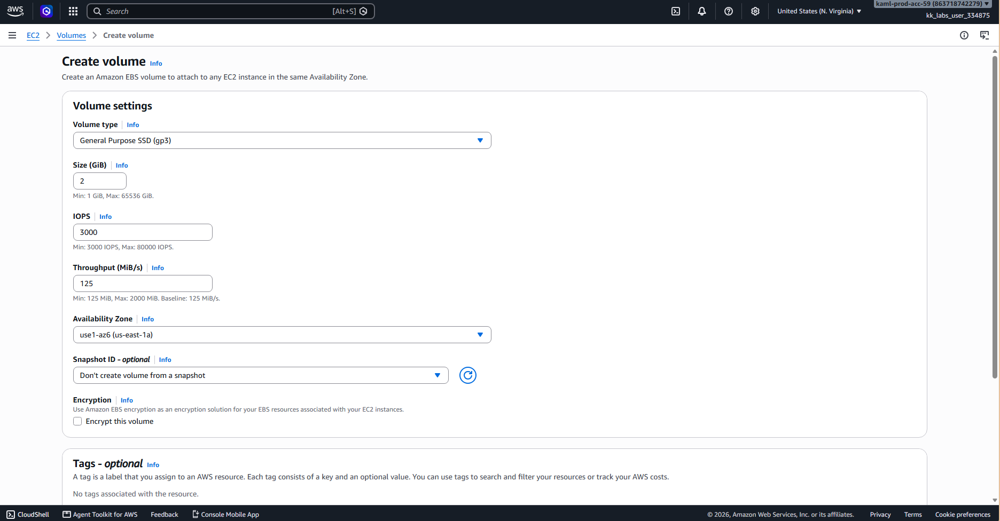
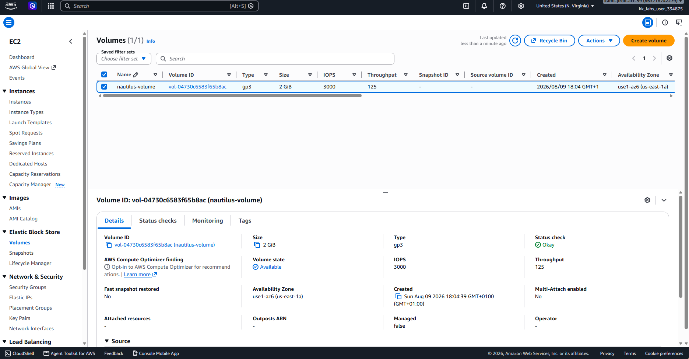

# Day 5: Create GP3 Volume

After logging in, I searched for EC2 section,

I went for Volumes in Elastic Block Store section, and I clicked on create volume icon

I configured the new valume as demanded

Finally my new volume is created successfully.

