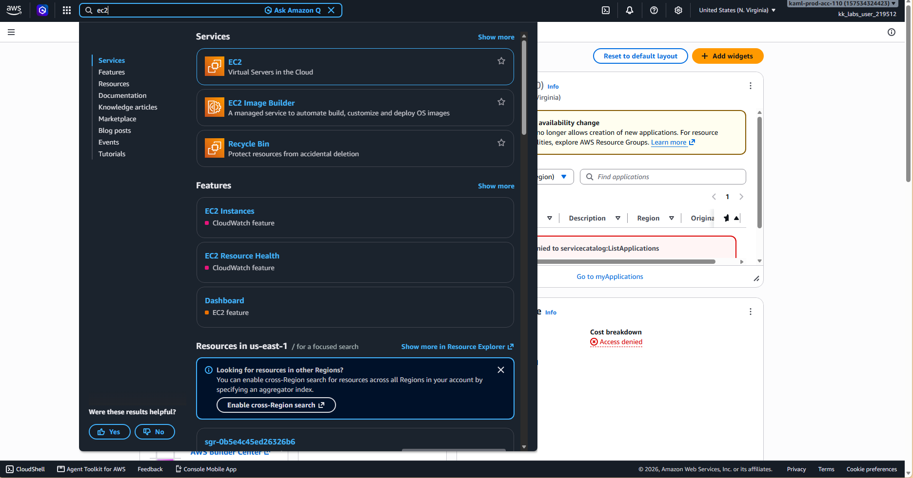
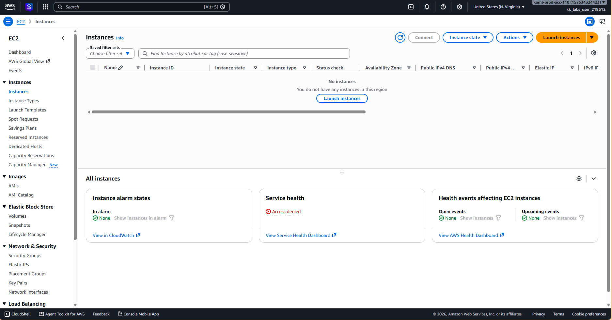
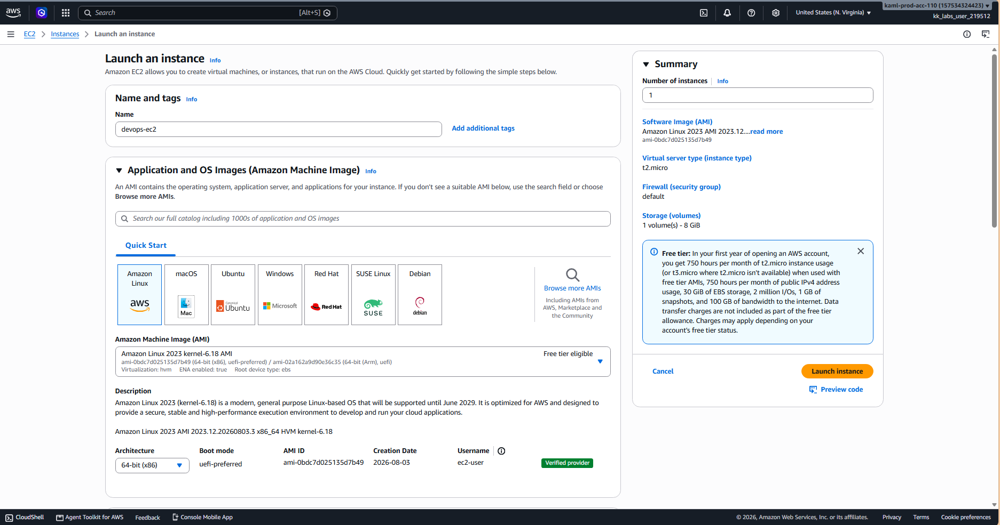
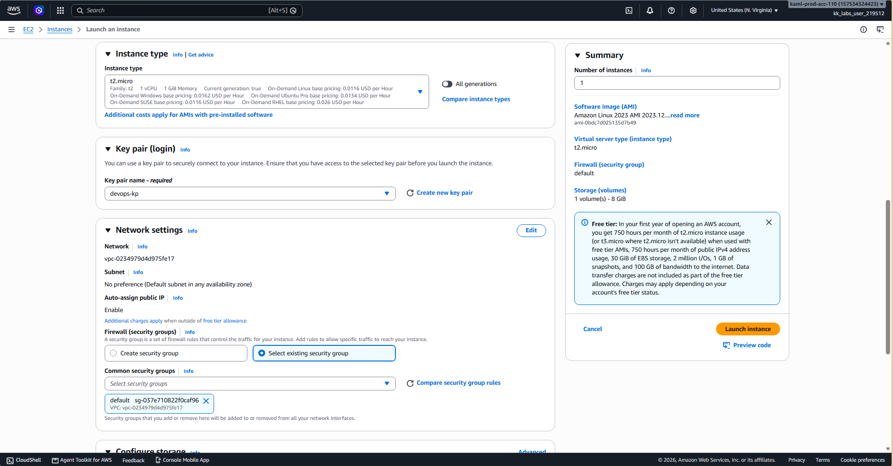
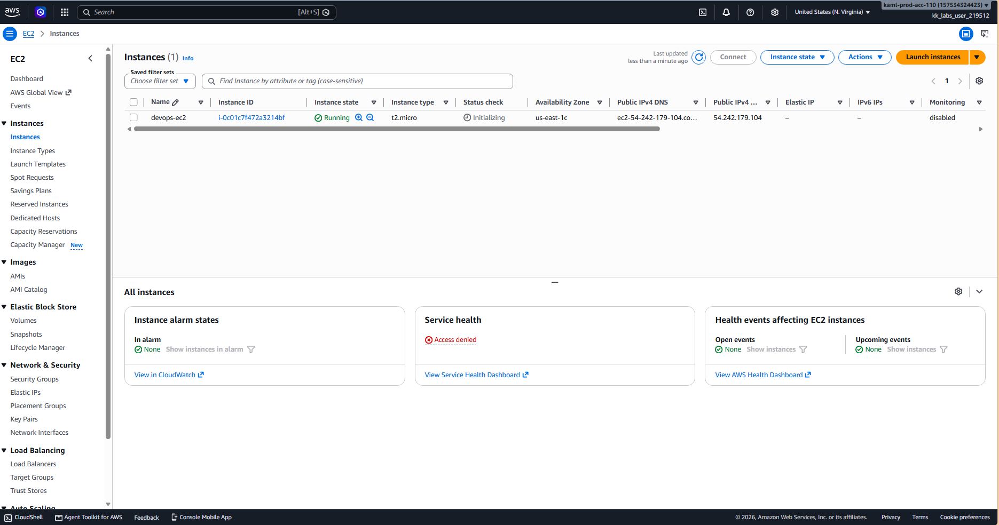

# Day 6: Launch EC2 Instance

After logging in, I searched for EC2 section,

I went for instances, and I clicked on lunch instances

I configured my EC2 instance as demanded

Finally, my EC2 instance is created successfully.

