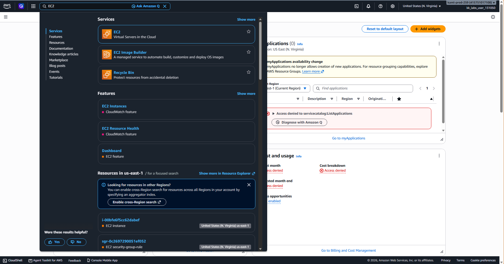
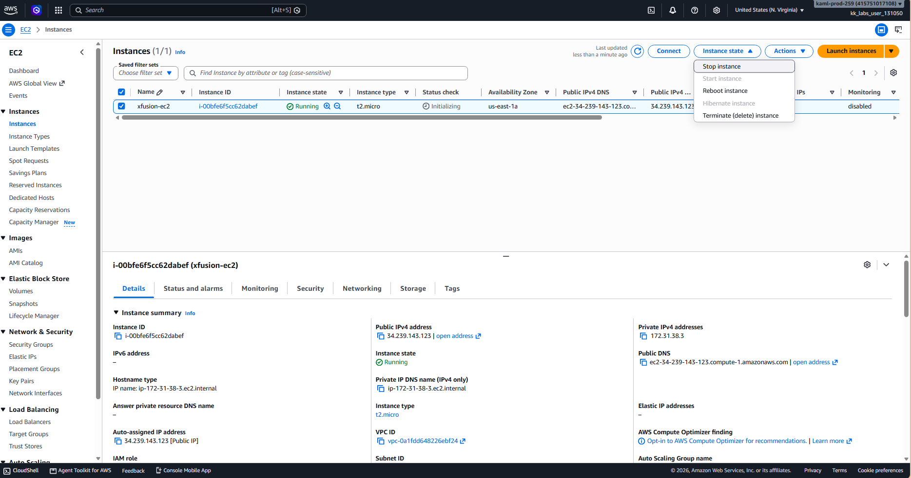
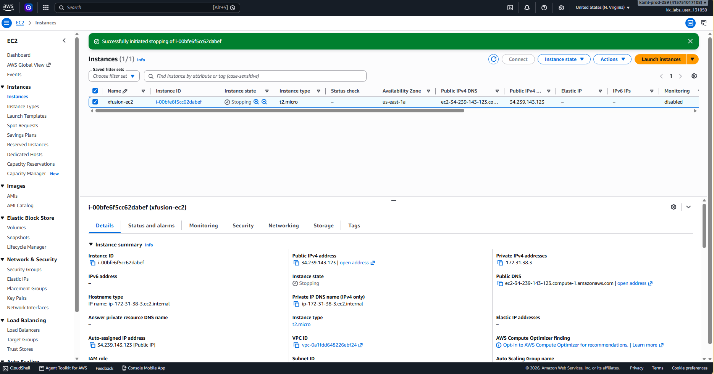
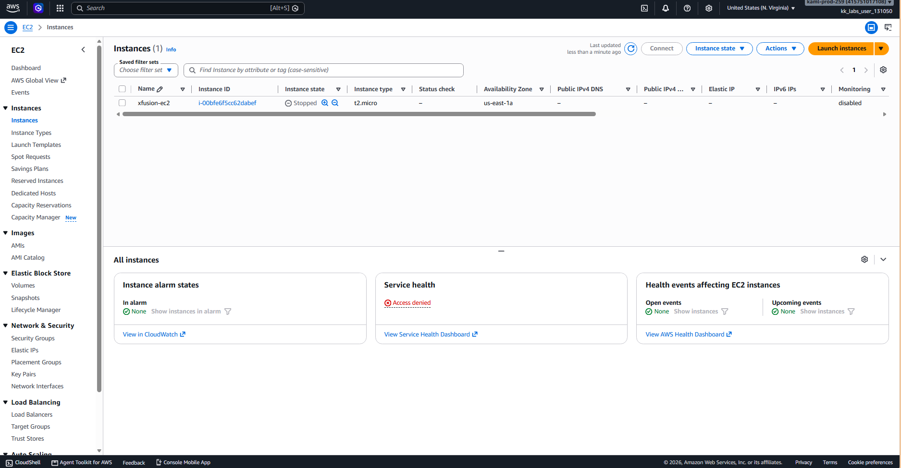
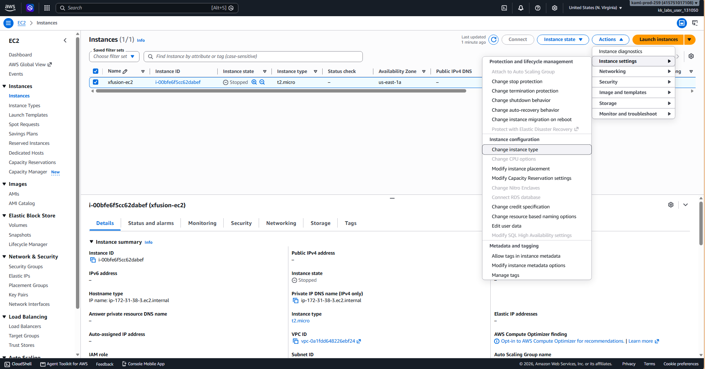
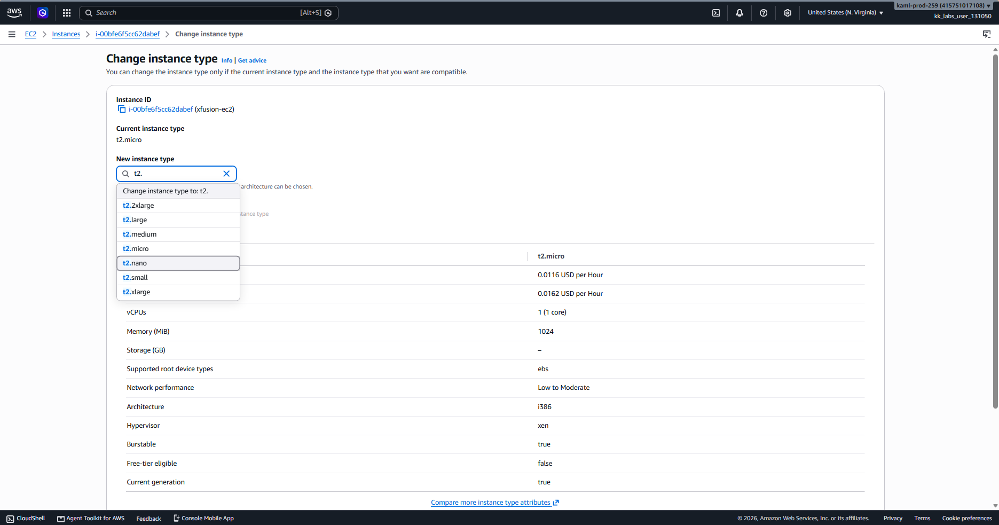
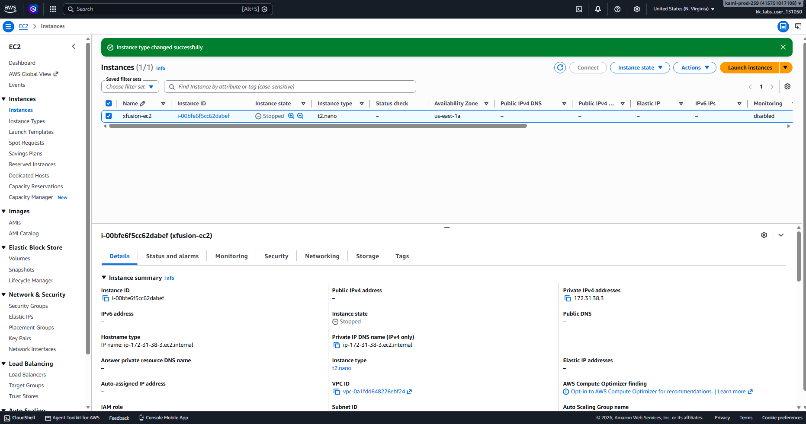
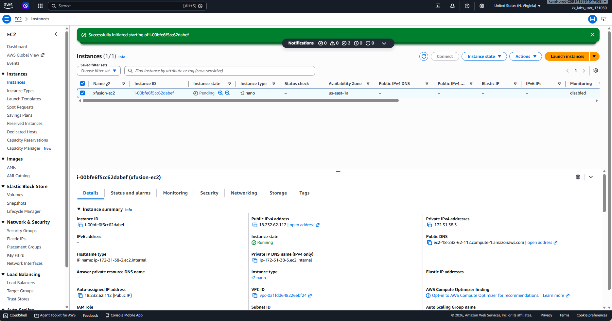
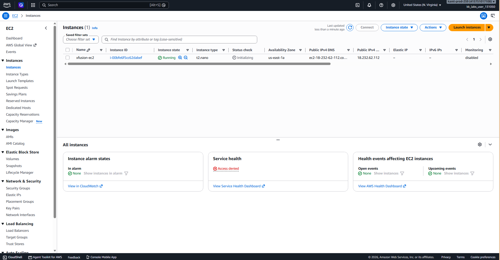

# Day 4: Enable Versioning for S3 Bucket

After logging in, I searched for EC2 section,

I went for instances section, and I stopped my EC2 instance

I waited until it's fully stopped, then I clicked on change instance type

I switched my instance's type to t2.nano

I clicked on start instance to run it again

Finally, my EC2 instance type is changed and running successfully.

