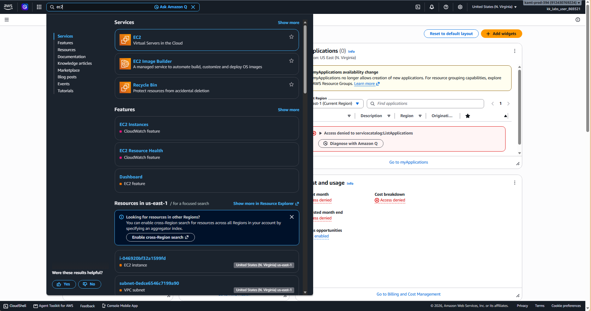
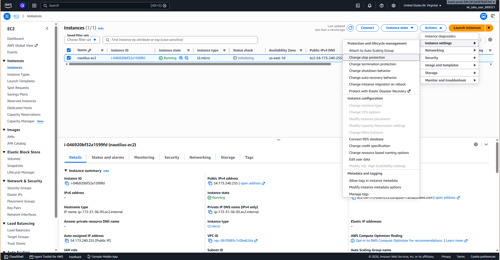
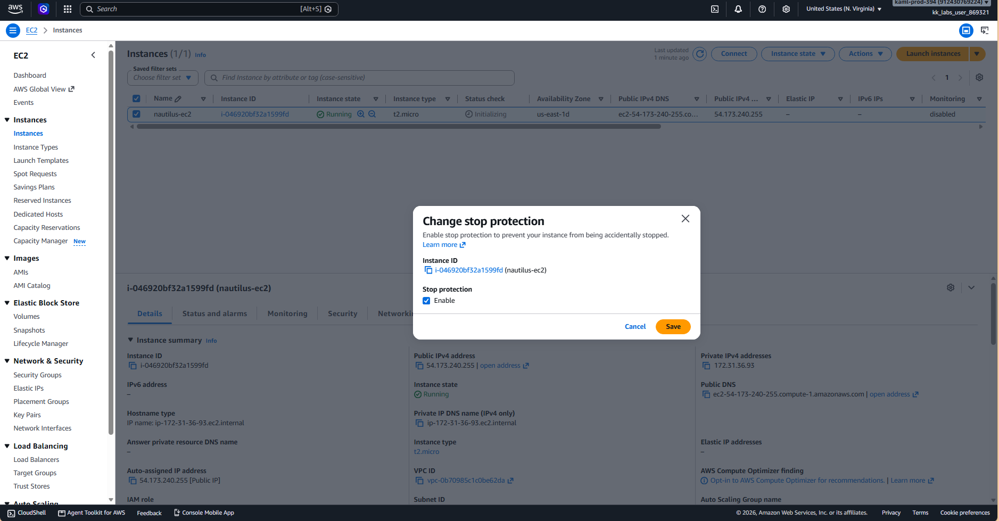
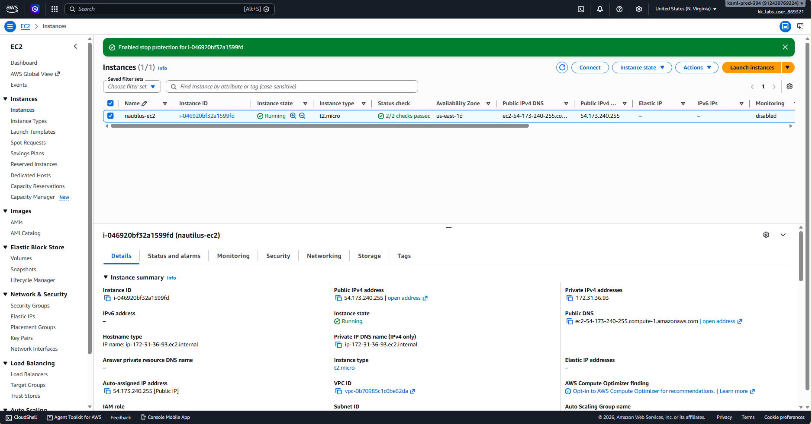

# Day 8: Enable Stop Protection for EC2 Instance

After logging in, I searched for EC2 section,

I went for instances, then I clicked on change stop protection

I enabled stop protection feature

Finally stop protection feature is activated successfully on my instance.

