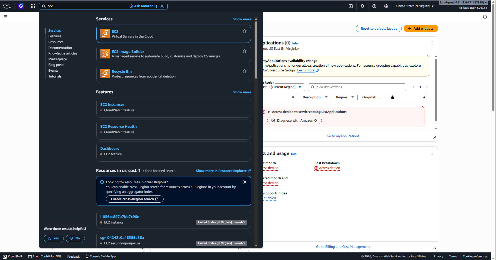
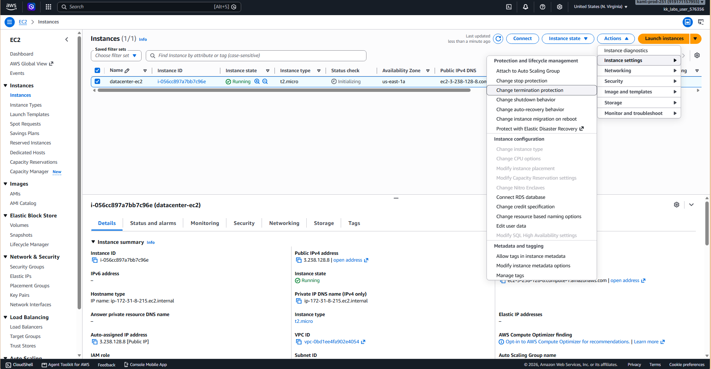
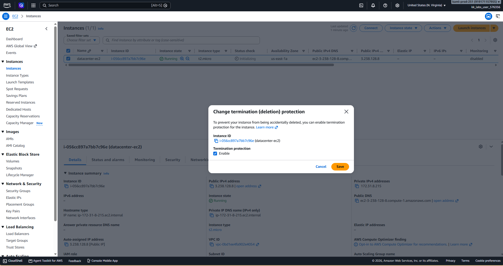
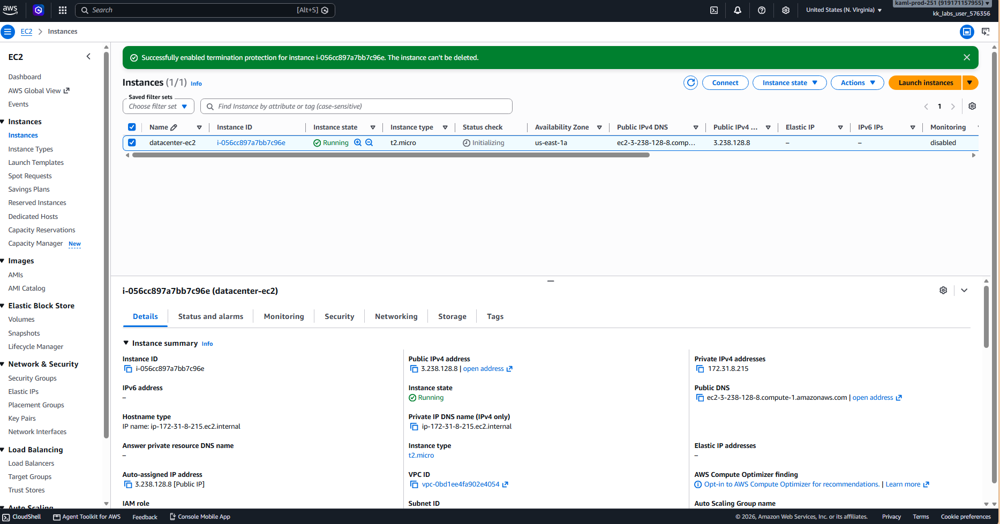

# Day 9: Enable Termination Protection for EC2 Instance

After logging in, I searched for EC2 section,

I went for instances, then I clicked on change termination protection

I enabled termination protection feature

Finally termination protection feature is activated successfully on my instance.

