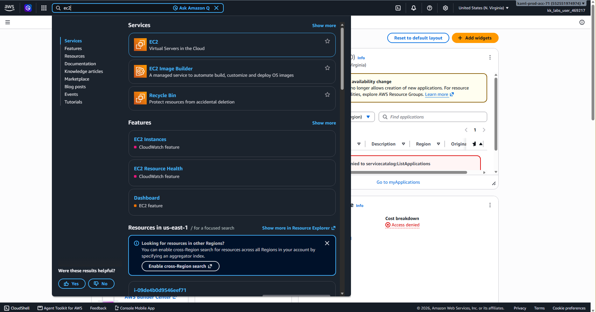
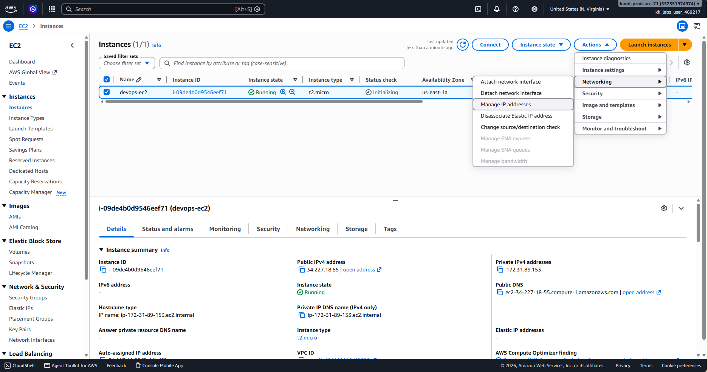
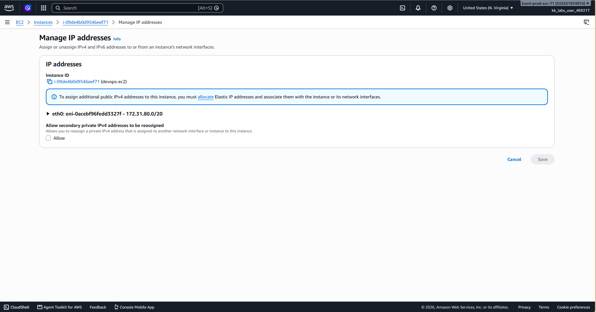
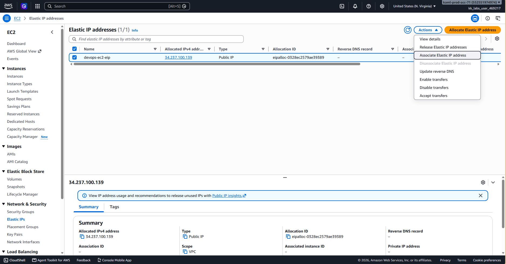
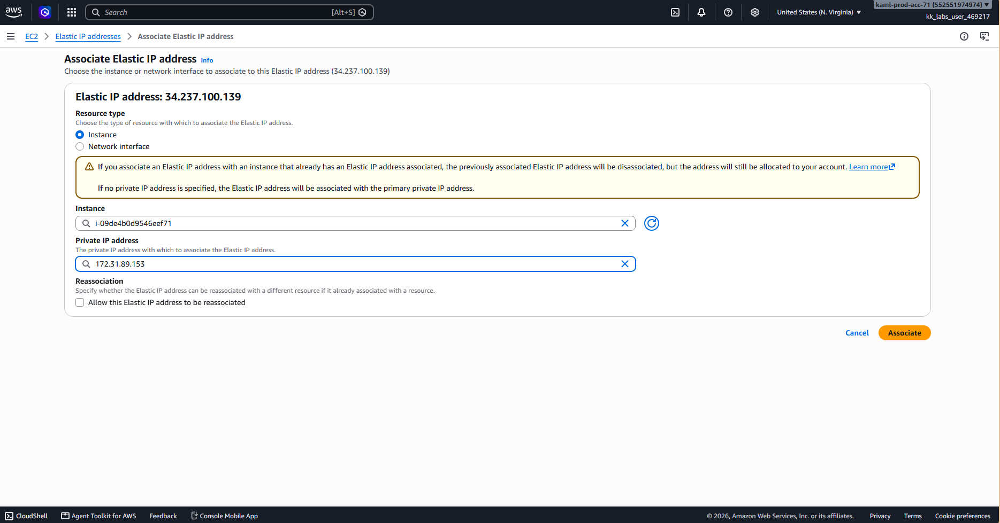
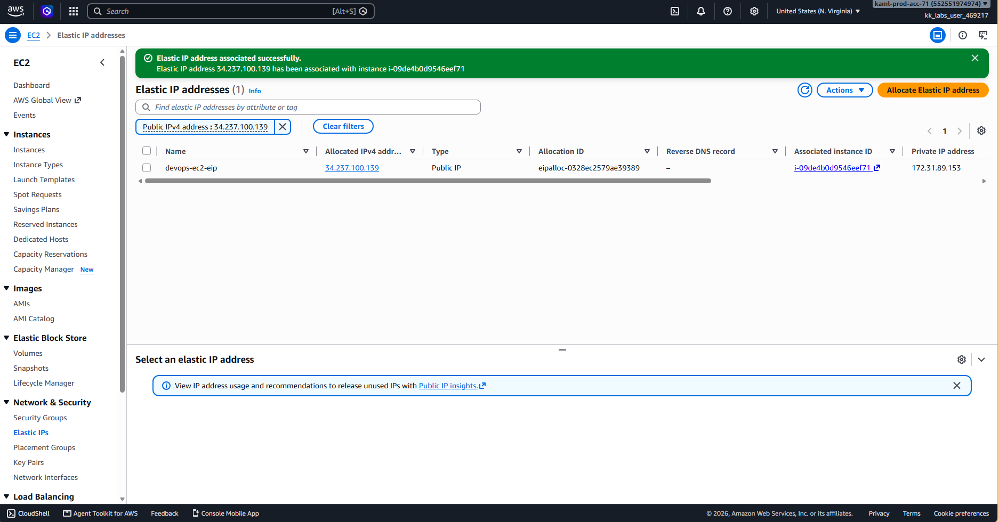

# Day 10: Attach Elastic IP to EC2 Instance

After logging in, I searched for EC2 section,

I went for instances section, and I clicked on Manage IP Adresses

I clicked on allocate

Which led me to Elastic IP Adresses list, and I clicked on Associate Elastic IP Address

I configured it, to be associated to my EC2 instance

The elastic ip address was associated successfully
