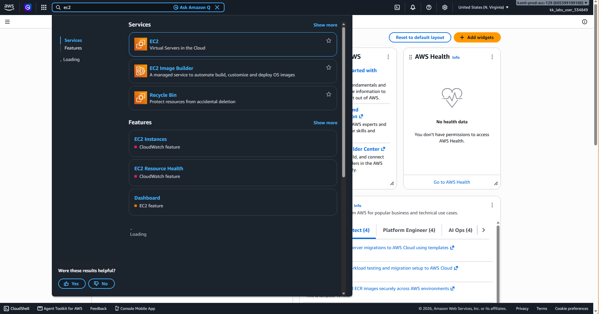
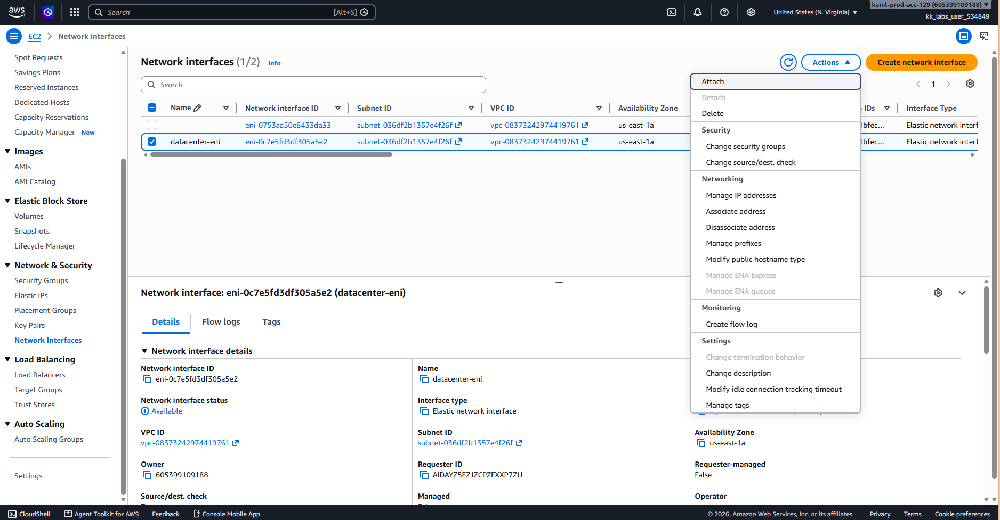
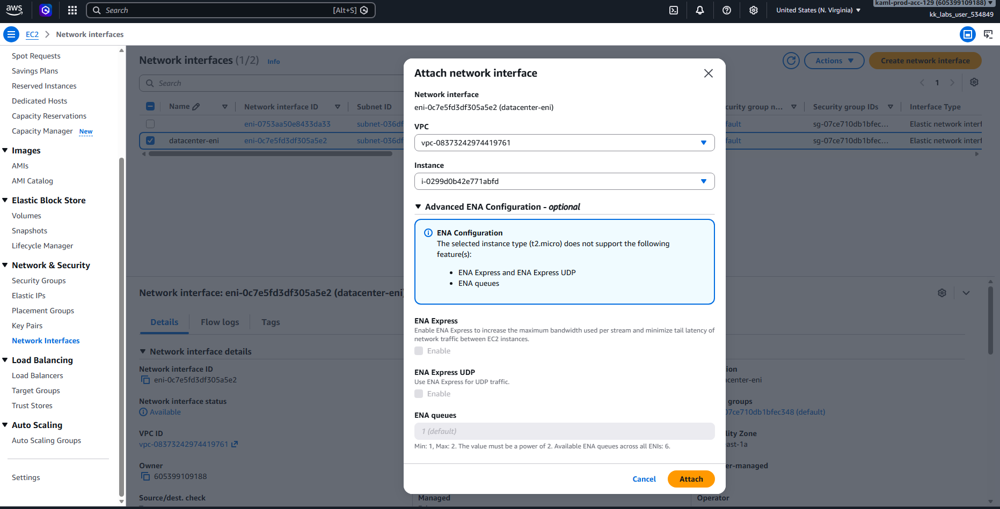
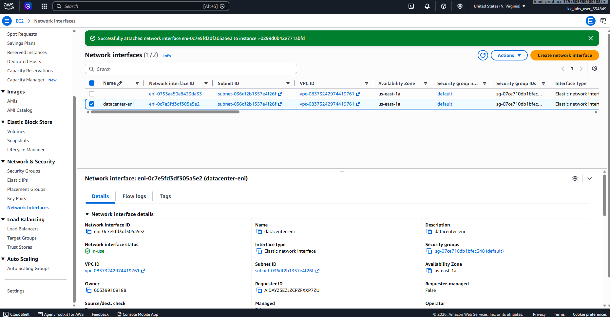

# Day 11: Attach Elastic Network Interface to EC2 Instance

After logging in, I searched for EC2 section,

I went for Network Interfaces in Network and Security section, then I choosed my network interface, then I clicked on attach

I configured my network interface on the default vpc and my EC2 instance then I clicked on attach

Finally my network interface is attached successfully on my instance.

