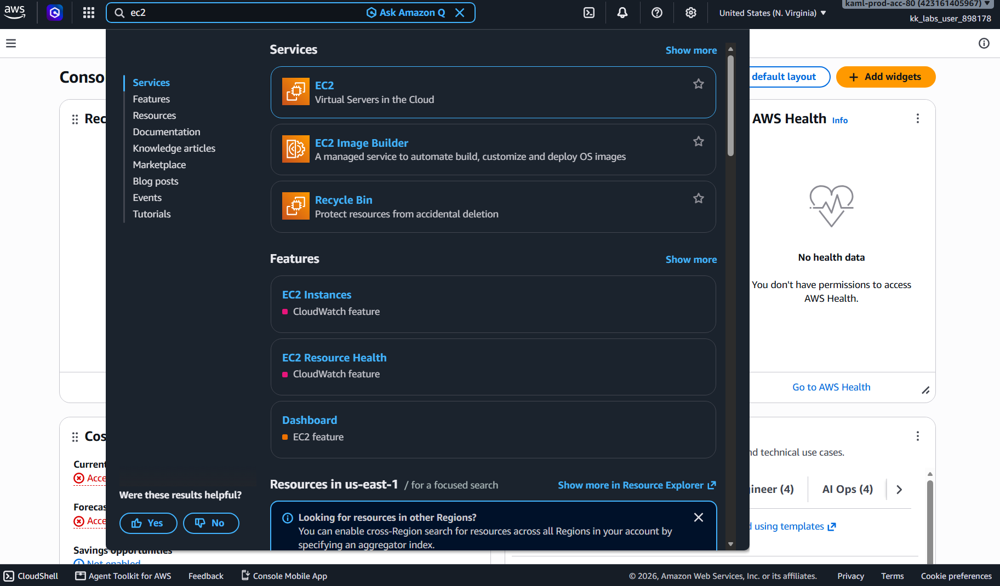
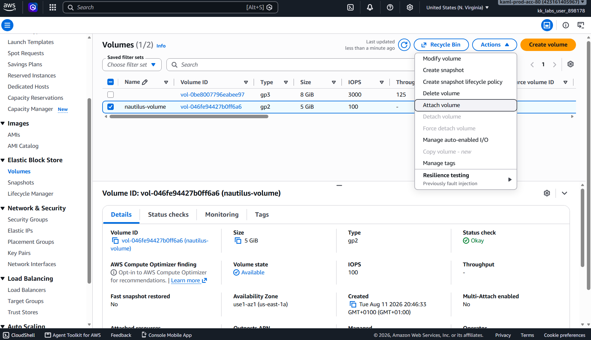
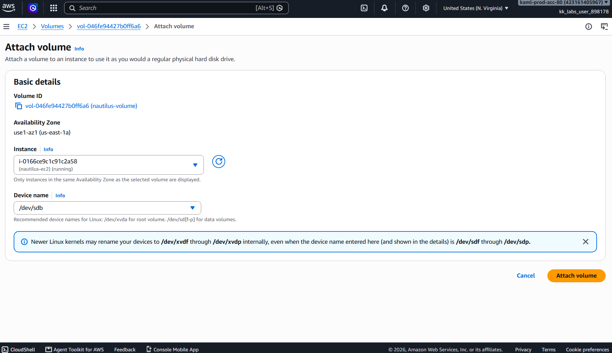
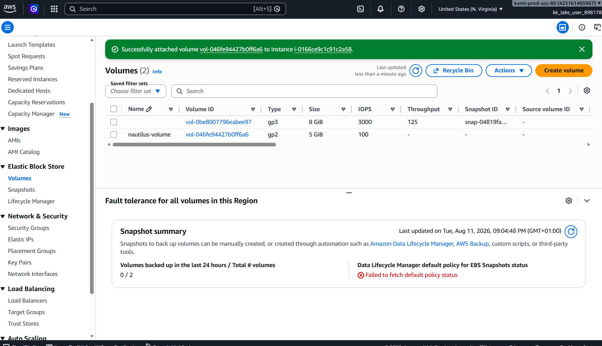

# Day 12: Attach Volume to EC2 Instance

After logging in, I searched for EC2 section,

I went for Volumes in Elastic Block Store, then I choosed my gp2 volume, then I clicked on attach

I configured my volume on my EC2 instance and proper Device Name then I clicked on Attach Volume

Finally my gp2 volume is attached successfully on my EC2 instance.

