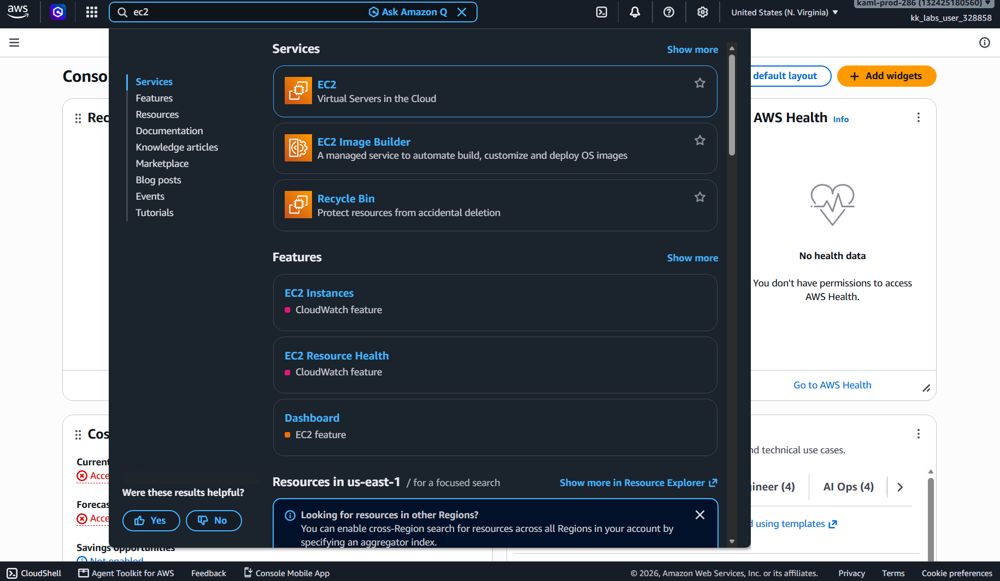
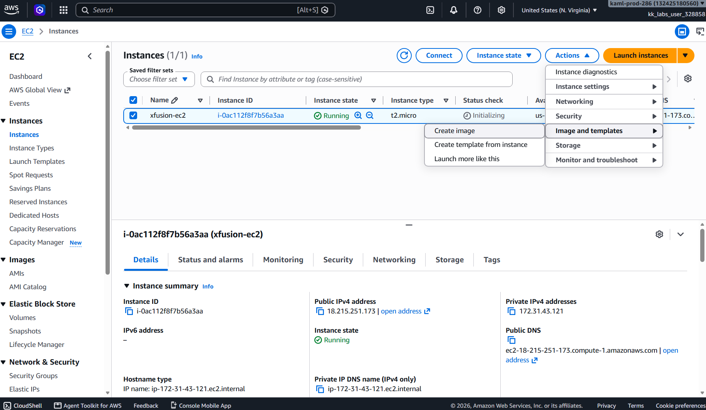
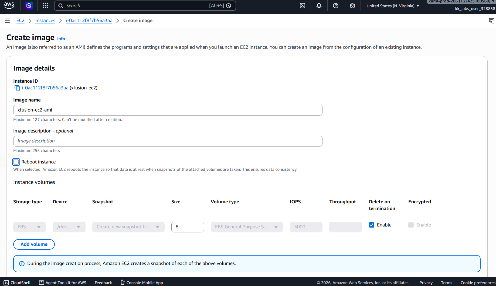
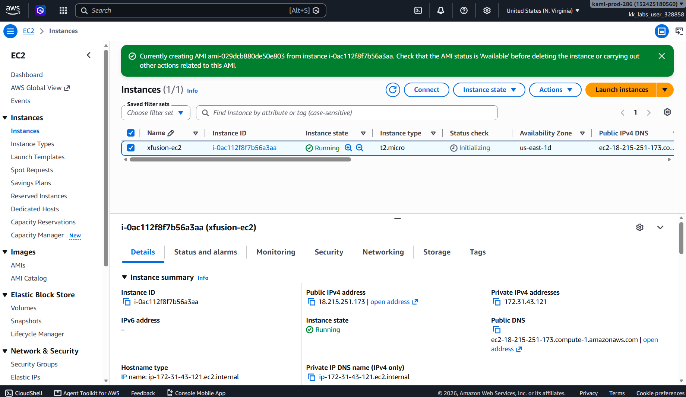
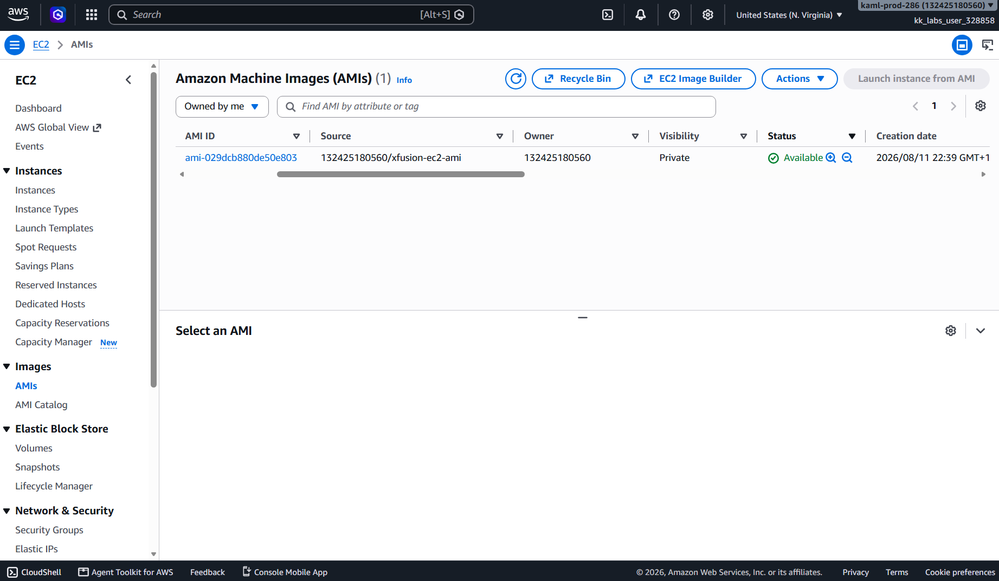

# Day 13: Create AMI from EC2 Instance

After logging in, I searched for EC2 section,

I went for instances, then I choosed my EC2 instance, then I clicked on create image

I configured my new ami based on my EC2 instance with the demanded configuration

I waited until my new ami is on available status

