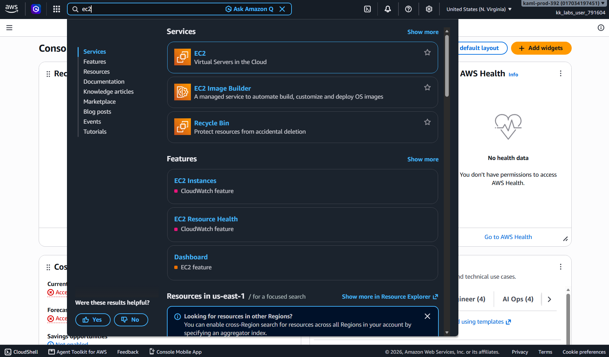
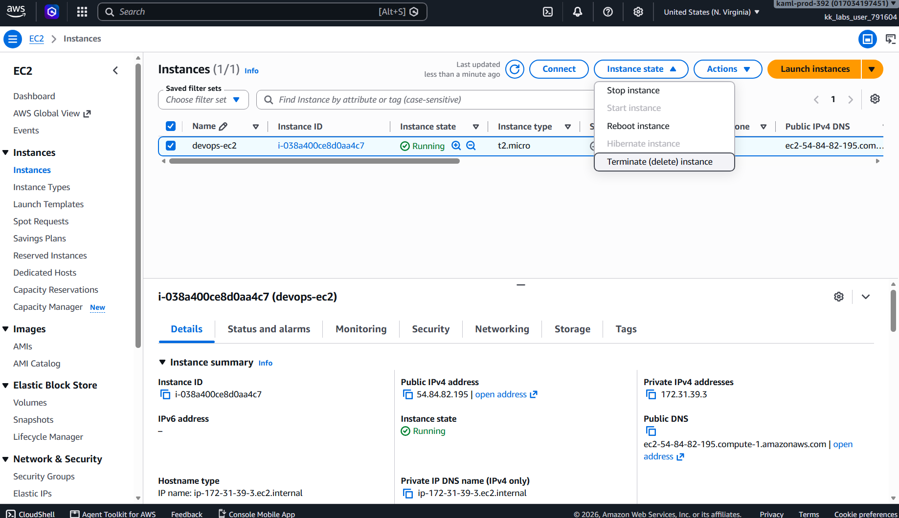
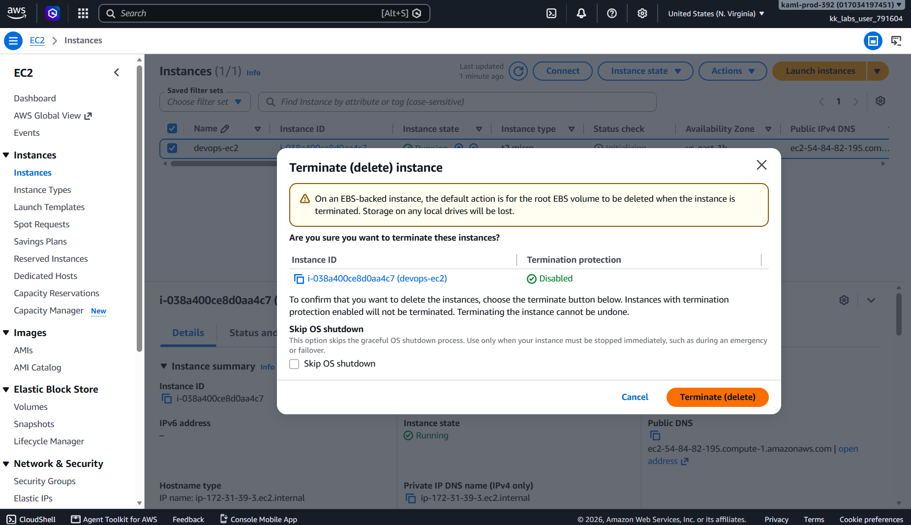
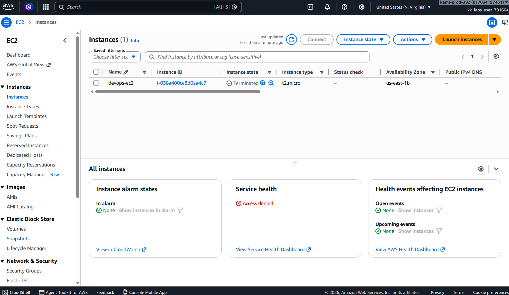

# Day 14: Terminate EC2 Instance

After logging in, I searched for EC2 section,

I went for instances, then I clicked on Terminate (delete) instance

I clicked on terminate (delete) on the pop-up window

Finally my EC2 instance is terminated successfully.

