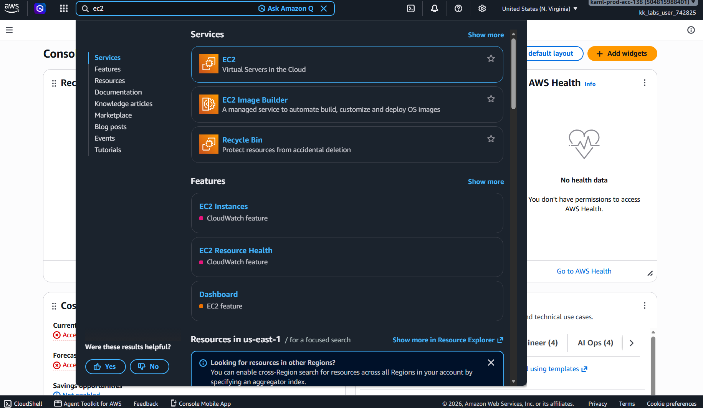
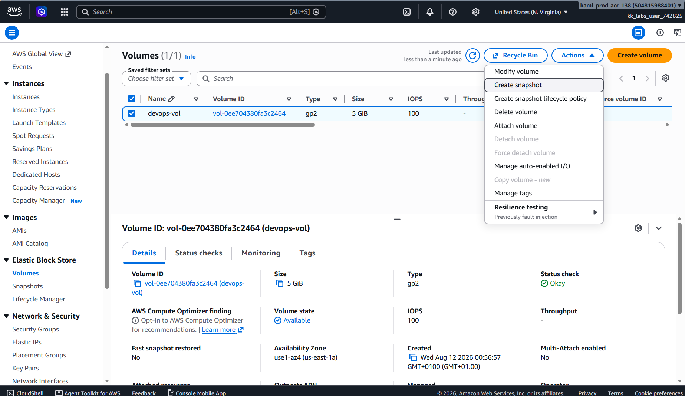
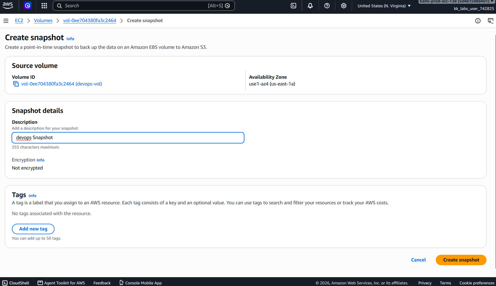
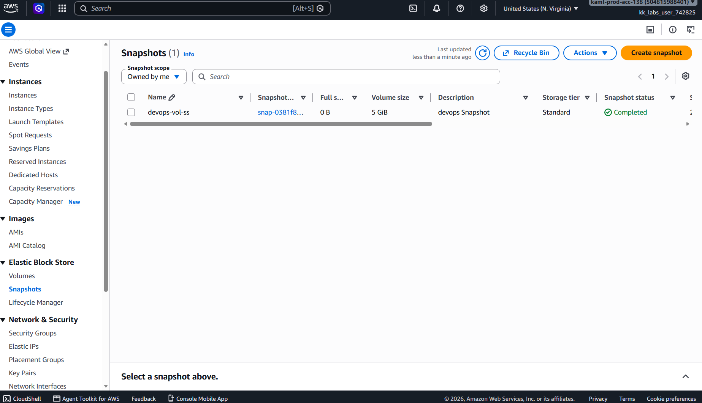

# Day 15: Create Volume Snapshot

After logging in, I searched for EC2 section,

I went for volumes in Elastic Block Store, then I clicked on Create Snapshot

I configured my new snapshot using the demanded description

Finally my new snapshot is completed successfully.

