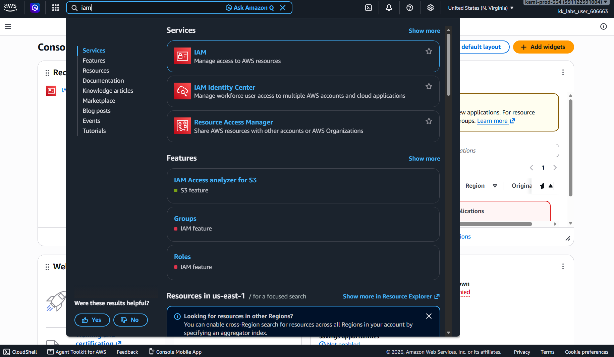
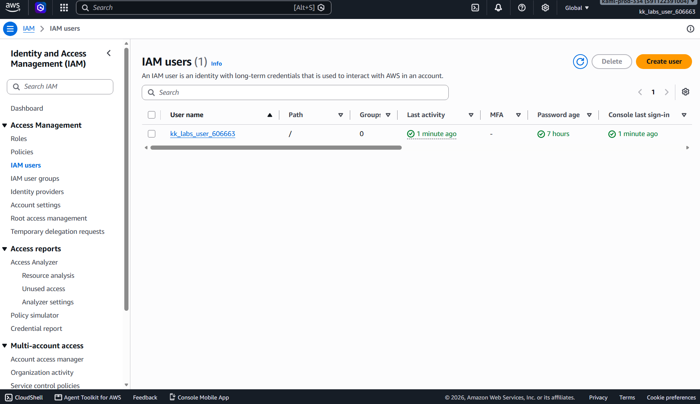
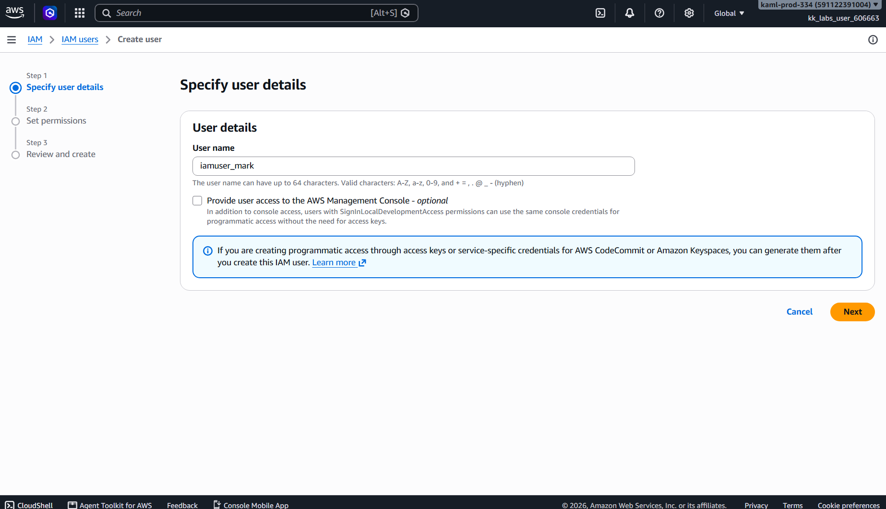
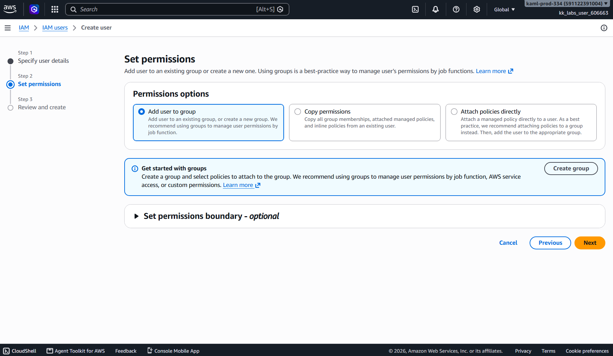
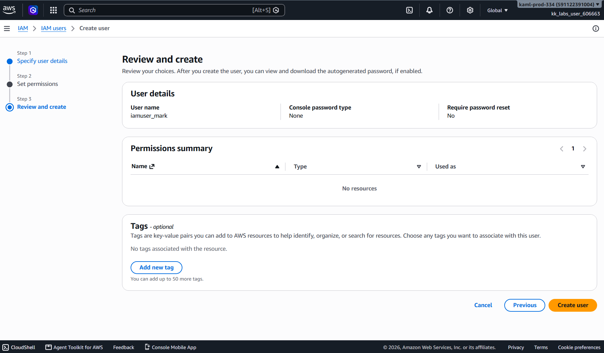
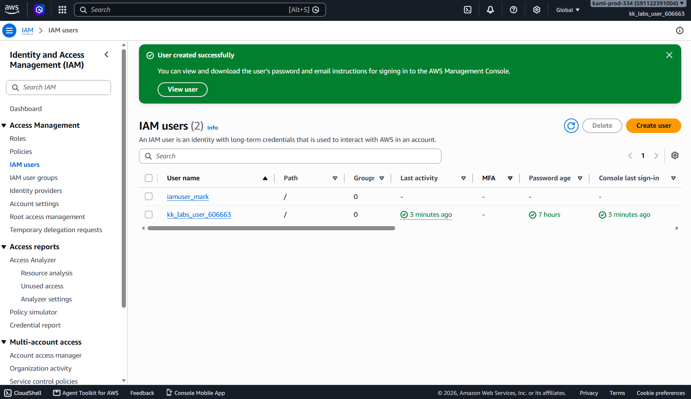

# Day 16: Create IAM User

After logging in, I searched for IAM service,

I went for iam users in Access Management section, and I clicked on Create user

I configured my new iam user with the demanded configuration

After reviewing the details, I clicked on Create user

My new iam user is created successfully

