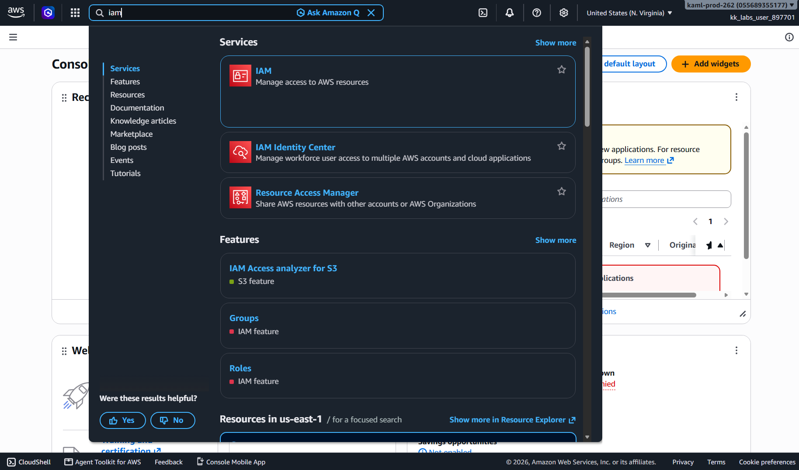
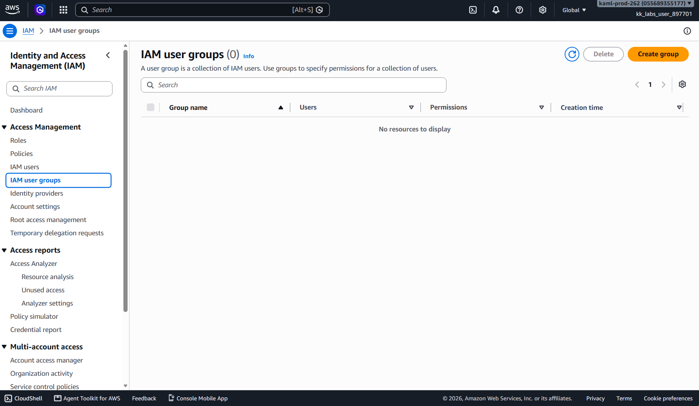
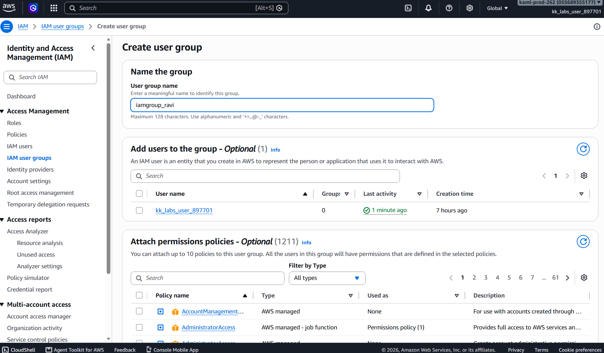
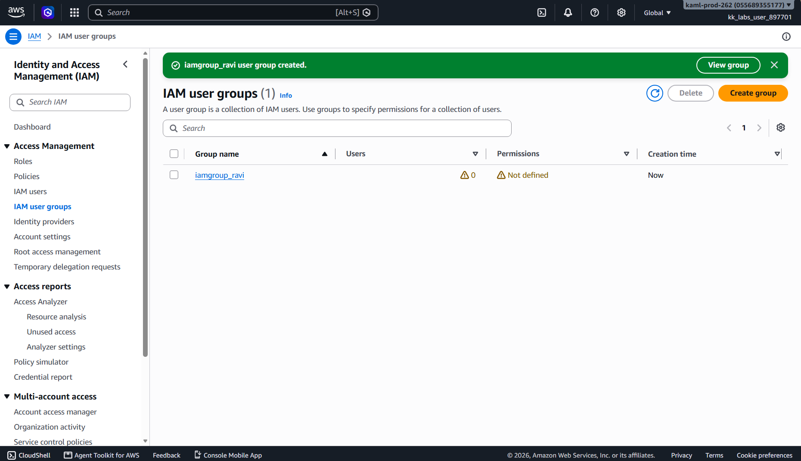

# Day 17: Create IAM Group

After logging in, I searched for IAM service,

I went for iam user groups in Access Management section, and I clicked on Create group

I configured my new iam user group with the demanded configuration

My new iam user group is created successfully

