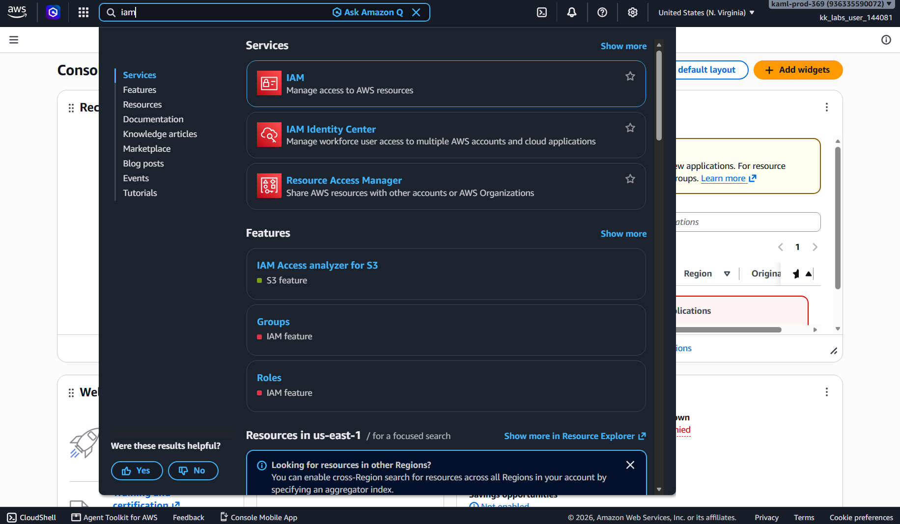
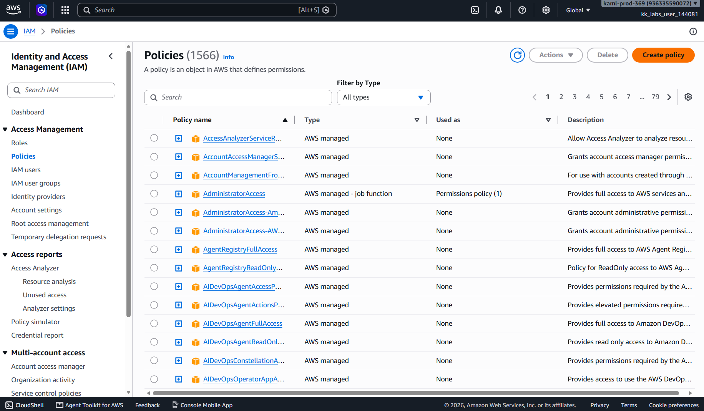
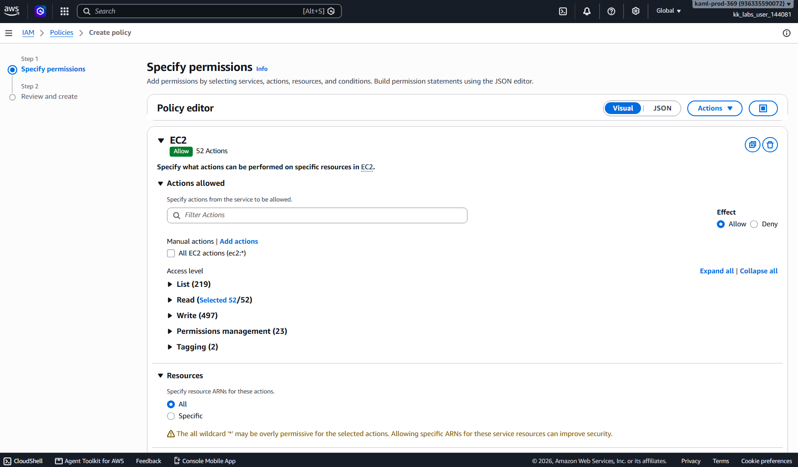
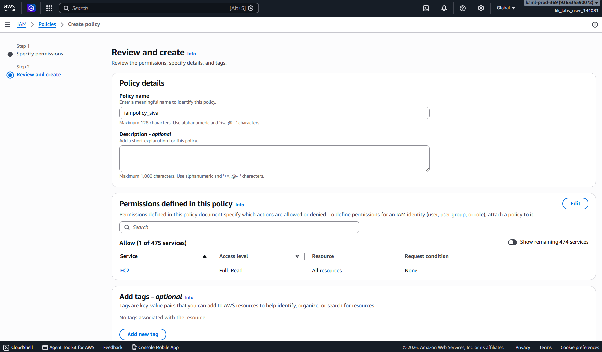
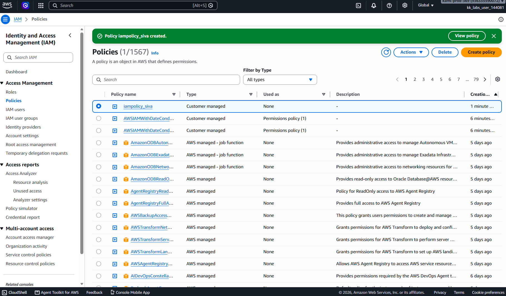

# Day 18: Create Read-Only IAM Policy for EC2 Console Access

After logging in, I searched for IAM service,

I went for Policies in Access Management section, and I clicked on Create policy

I configured my new iam policy with the demanded configuration

My new iam policy is created successfully

