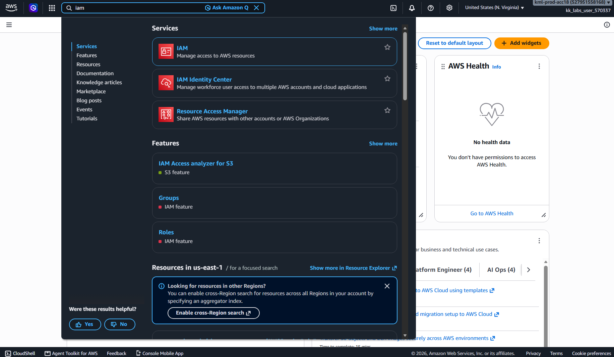
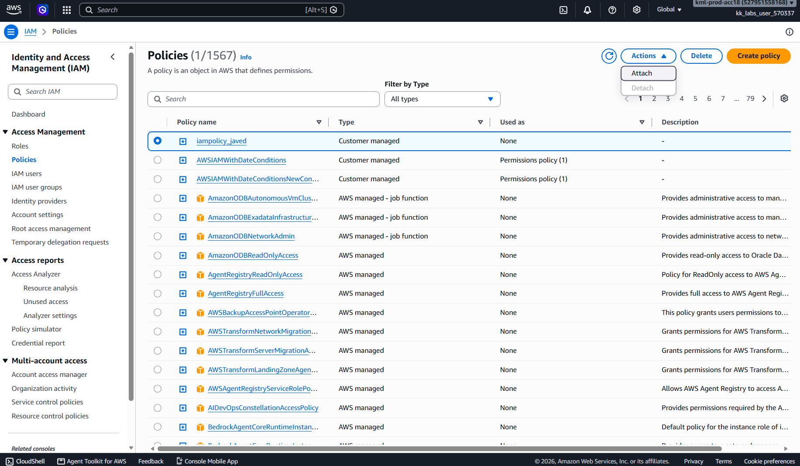
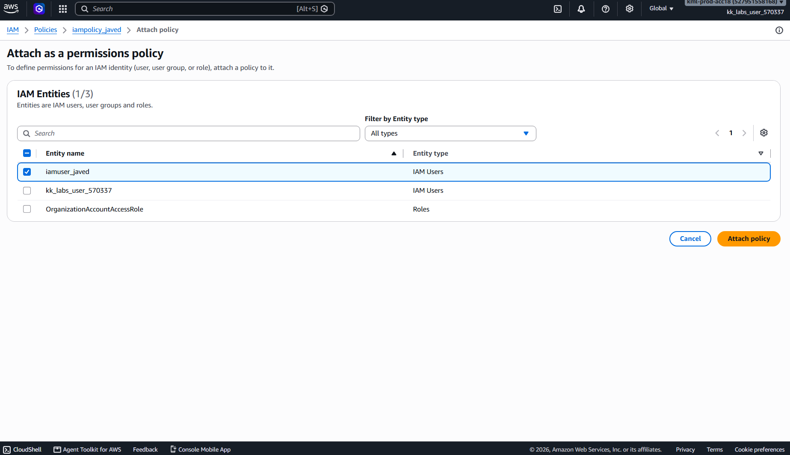
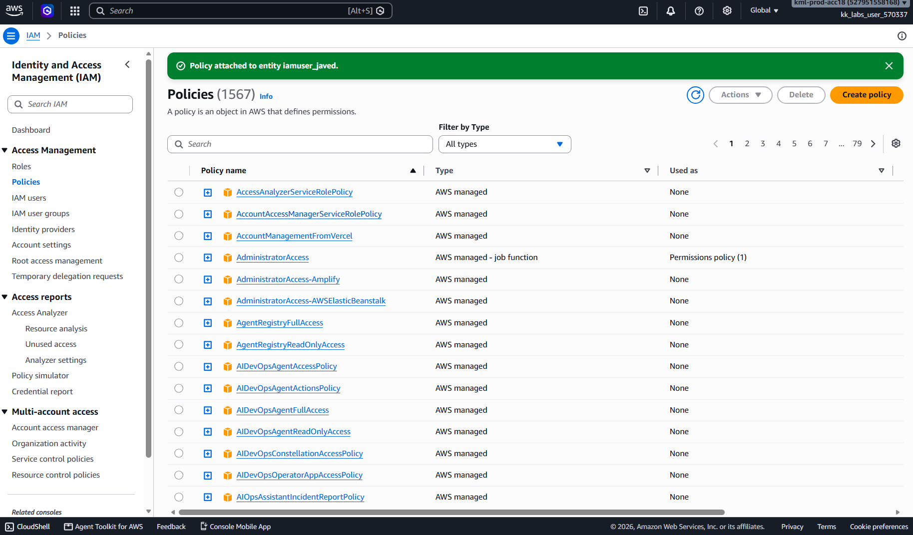

# Day 19: Attach IAM Policy to IAM User

After logging in, I searched for IAM service,

I went for policies in Access Management section, and I selected my demanded policy then I clicked on attach

I configured my policy with the demanded configuration

My policy is attached to my iam user successfully

