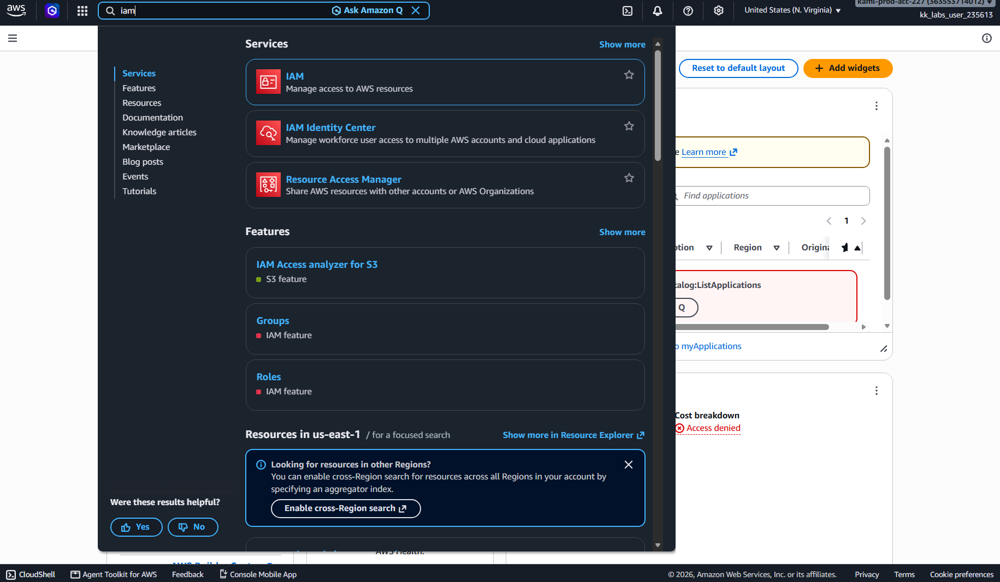
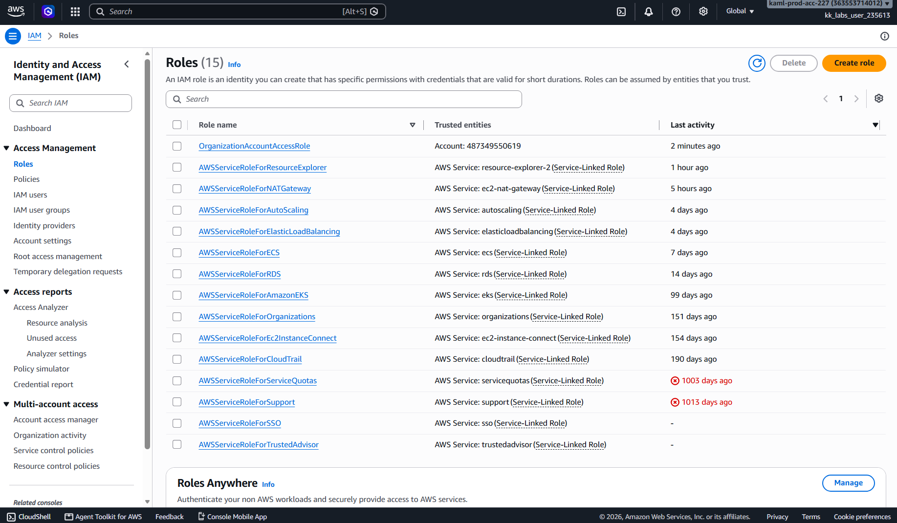
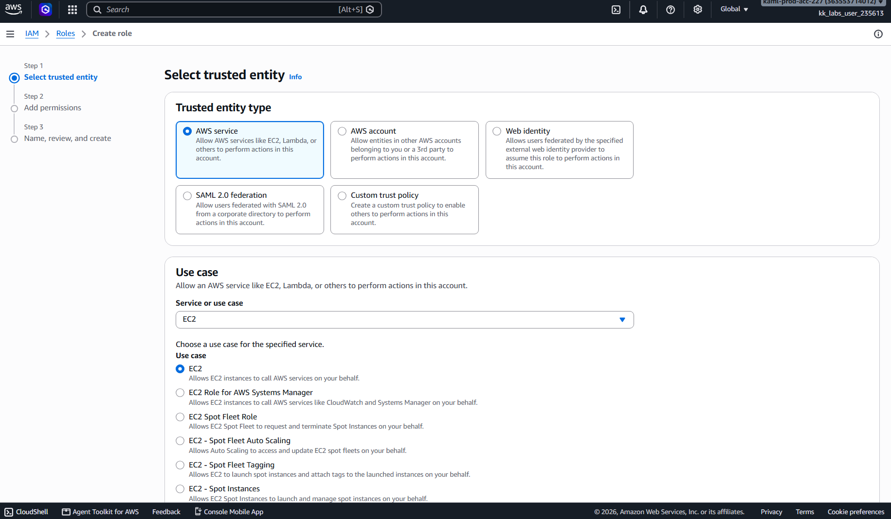
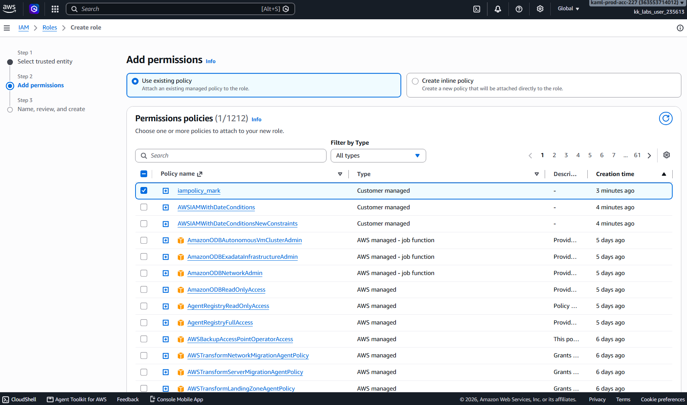
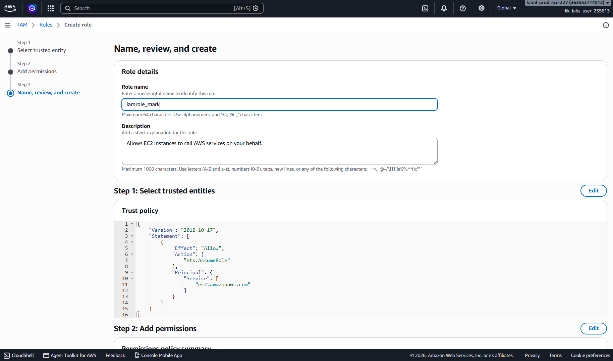
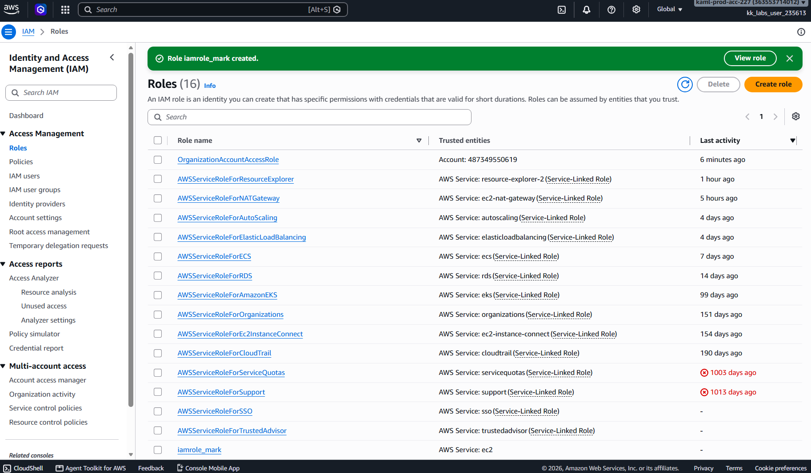

# Day 20: Create IAM Role for EC2 with Policy Attachment

After logging in, I searched for IAM service,

I went for Roles in Access Management section, and I clicked on Create role

I configured my new iam role with the demanded configuration

My new iam role is created successfully

