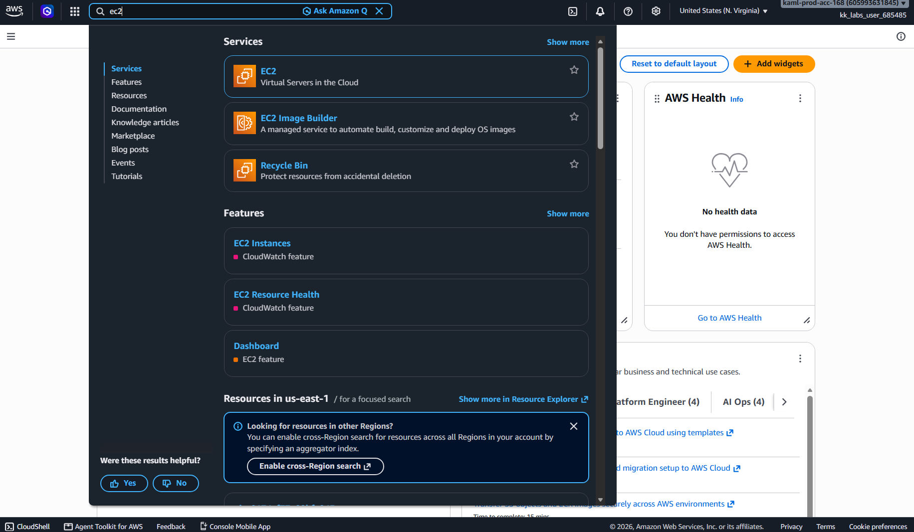
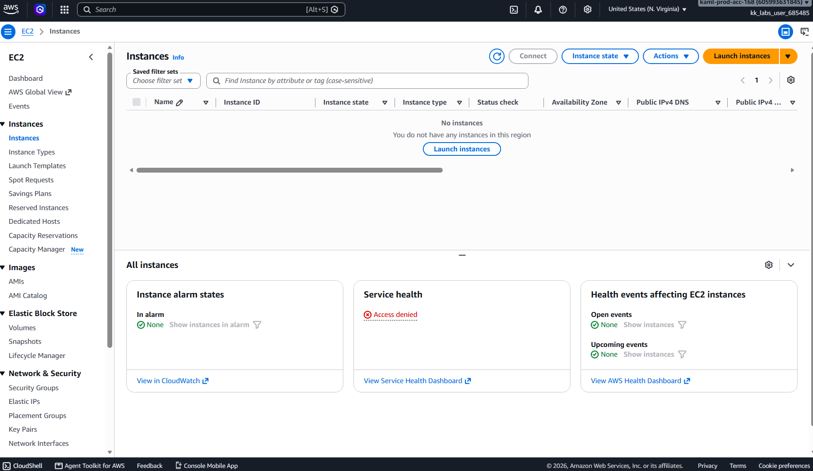
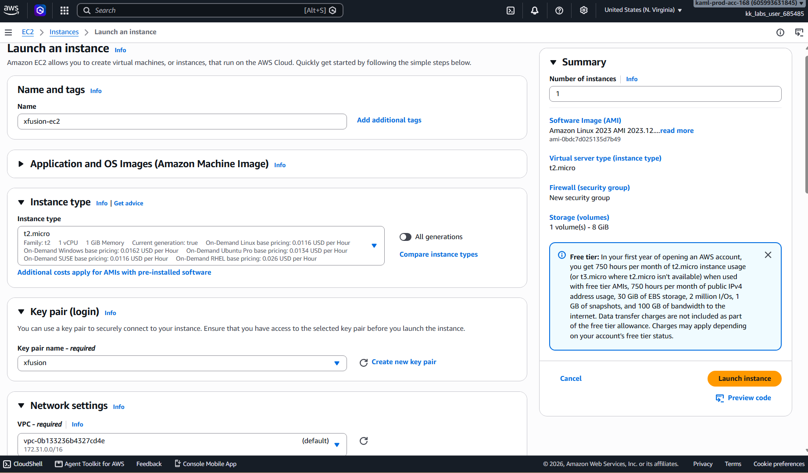
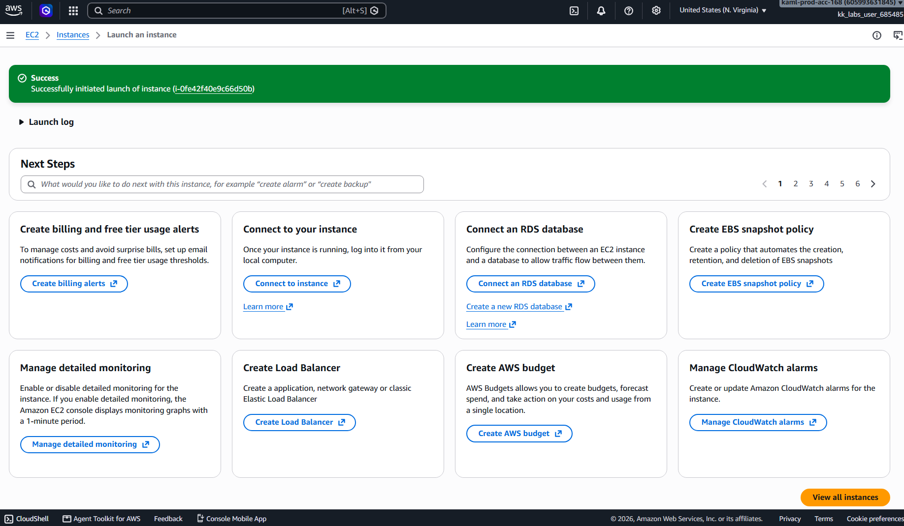
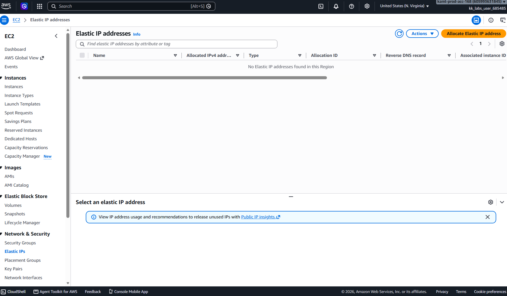
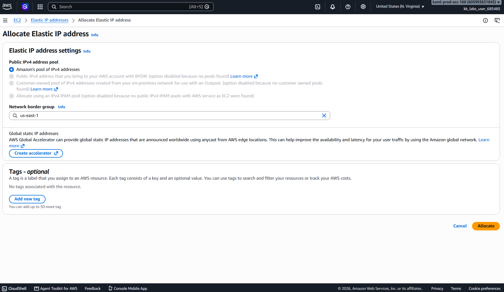
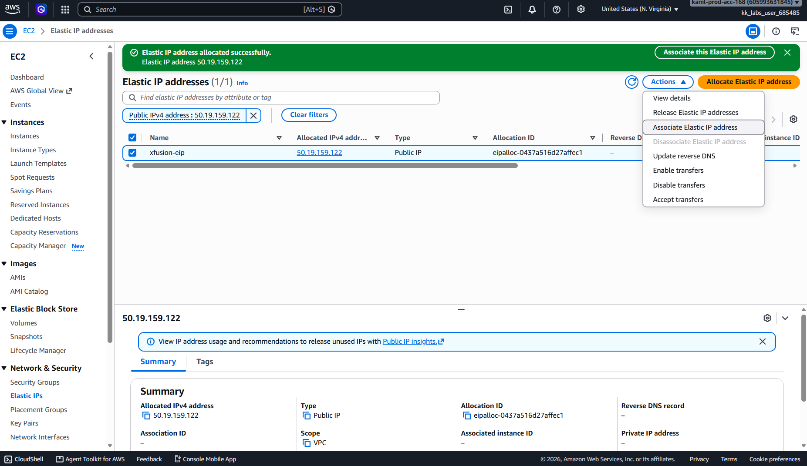
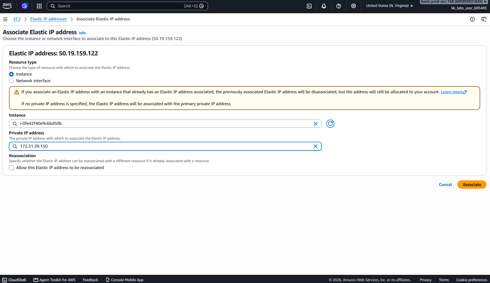
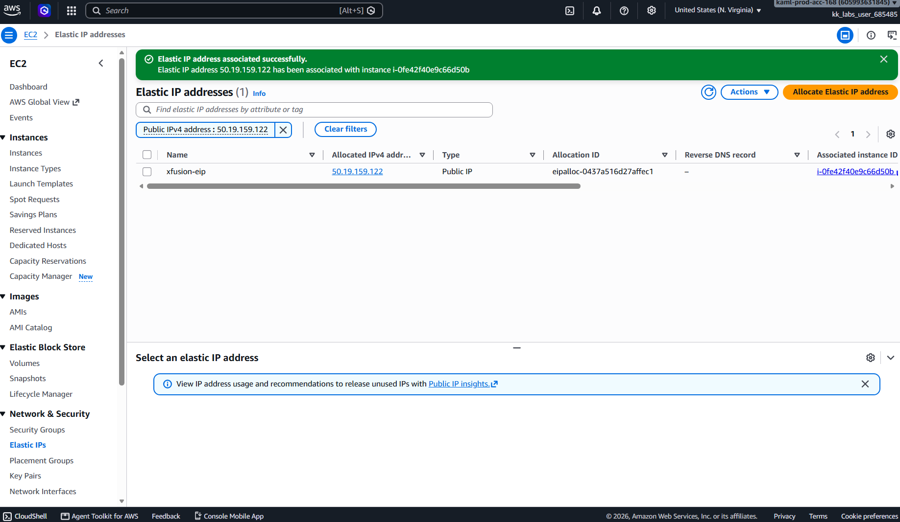

# Day 21: Setting Up an EC2 Instance with an Elastic IP for Application Hosting

After logging in, I searched for EC2 section,

I went for instances section, and I clicked on Lunch instance

I configured my new ec2 instance as demanded

My EC2 instance is created successfully.

I went to Elastic IPs in Network & Security, then I clicked on Create Elastic IP Address

I kept it in default configuration, then I clicked on Allocate

After allocation of my elastic IP address, I clicked on Associate Elastic IP Address 

I configured it, so it could associate to my new ec2 instance

Finally my new elastic ip address is associated with my new ec2 instance

