# Day 22: Configuring Secure SSH Access to an EC2 Instance

After logging in, I searched for EC2 section,

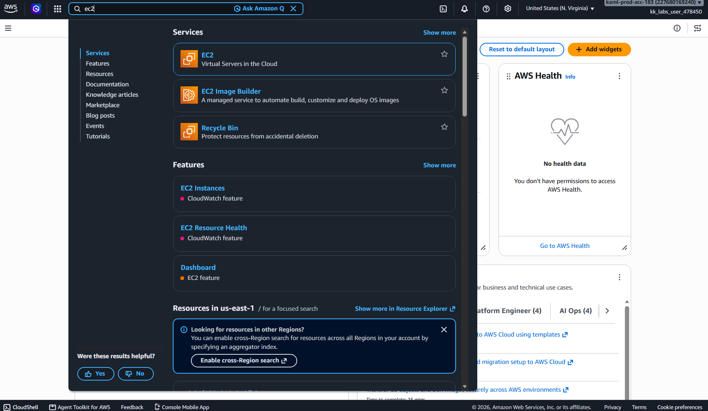

I went for instances section, and I created my new EC2 instance

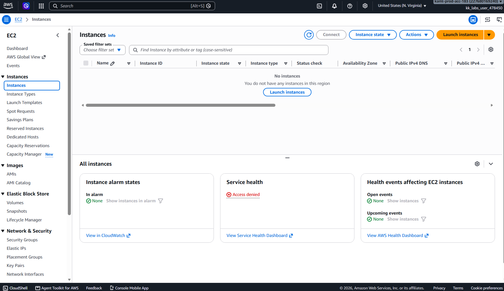

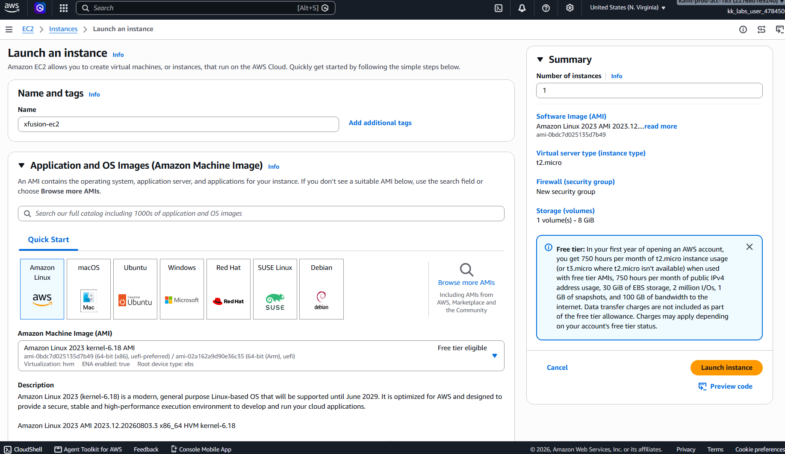

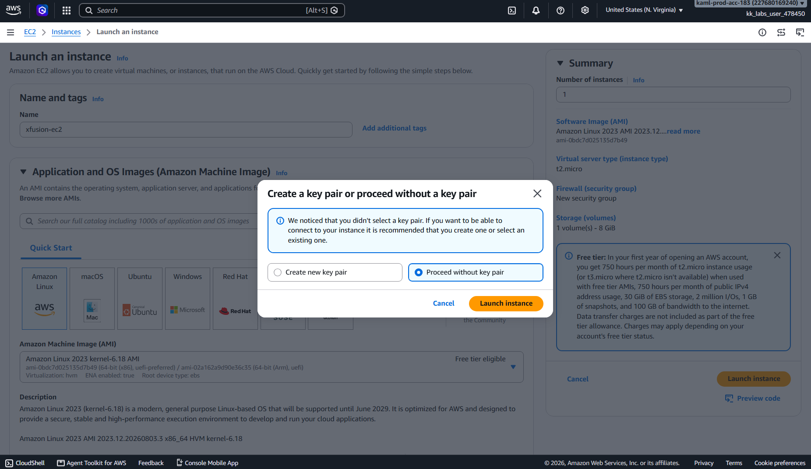

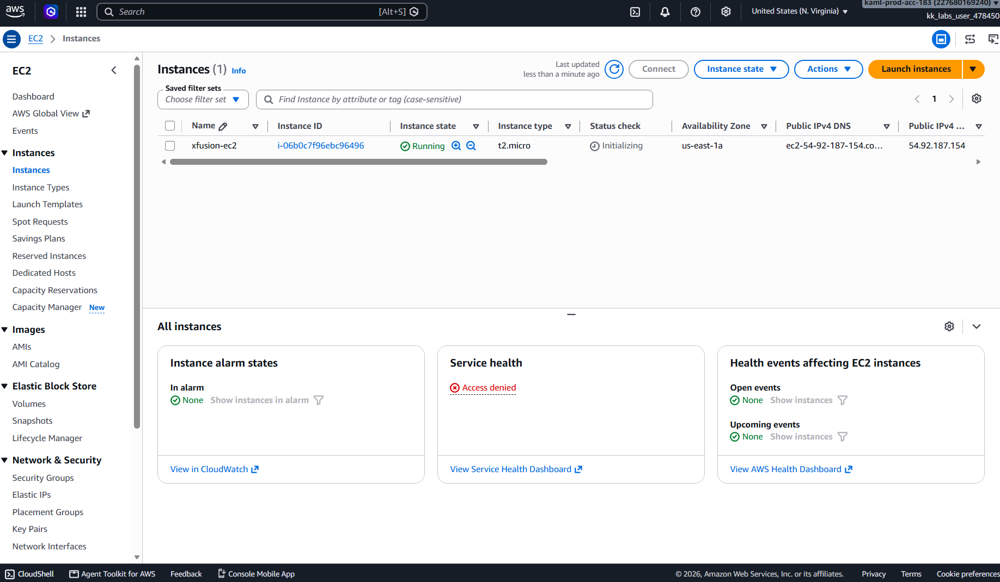

I generated my ssh key pair in client machine, then copied my generated public key

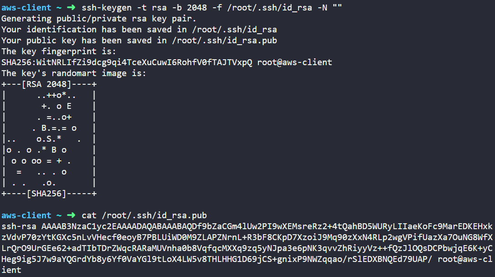

I connected to my new EC2 instance

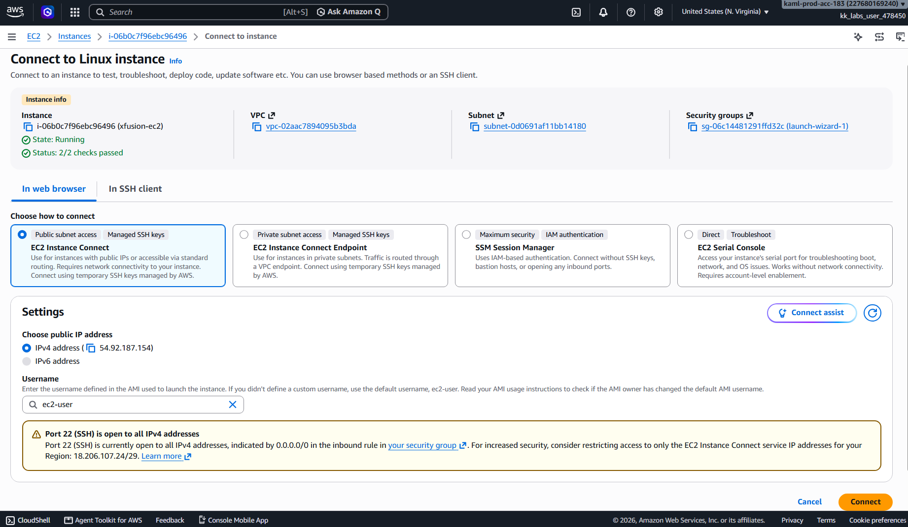

I added my copied public key from client machine to  /root/.ssh/authorized_keys file in my server

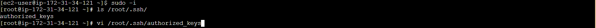

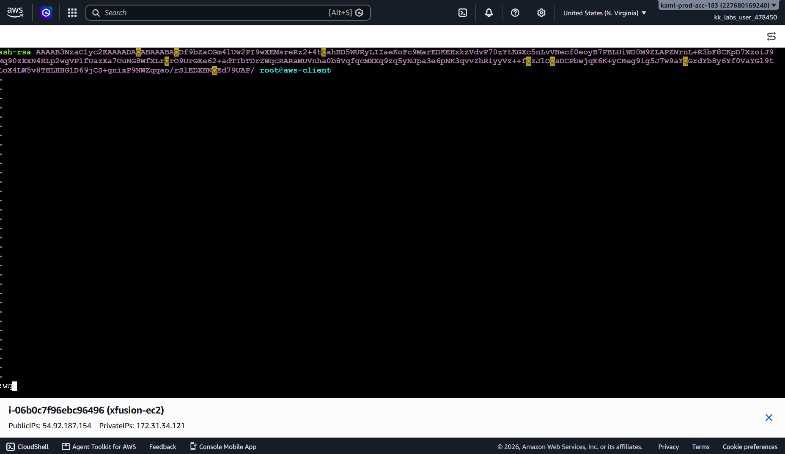

I fixed the permissions for my directory and file of ssh keys for security measures

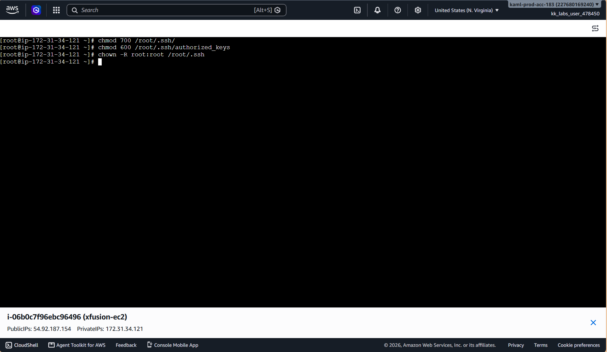

Finally, using my generated ssh key pair, I did a ssh connection to my ec2 instance from my client machine

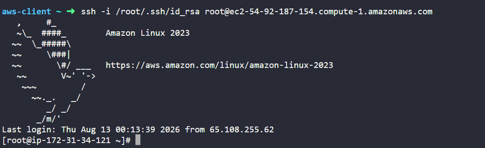
