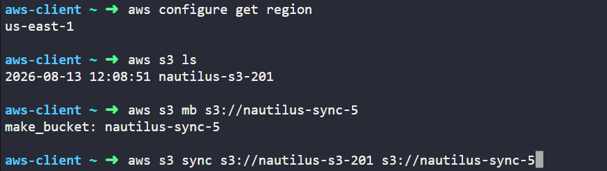
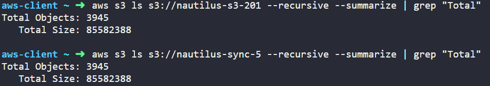

# Day 23: Data Migration Between S3 Buckets Using AWS CLI

Using aws cli, I identified my current region, listed my s3 buckets, created a new one using demanded name, then I synchronised the content of old bucket with my newly created one

To verify that the synchronization went successfully, I compared the number of files and storage of each, which turned out to be equal, which means the synchronization went successfully

