# Day 24: Setting Up an Application Load Balancer for an EC2 Instance

After logging in, I searched for EC2 section,

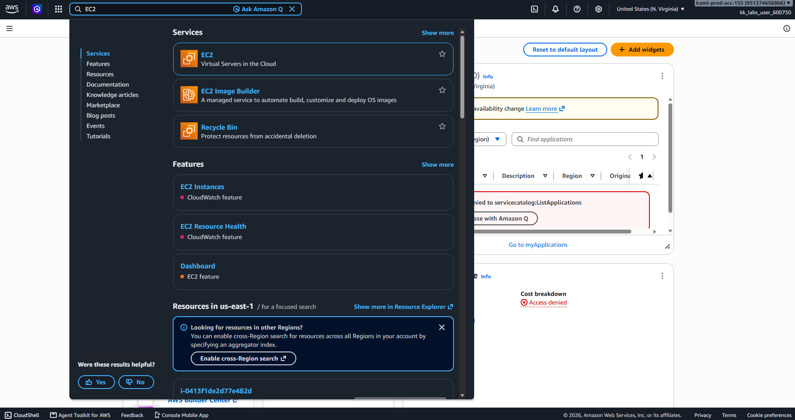

I went for security groups, and I created my new security group

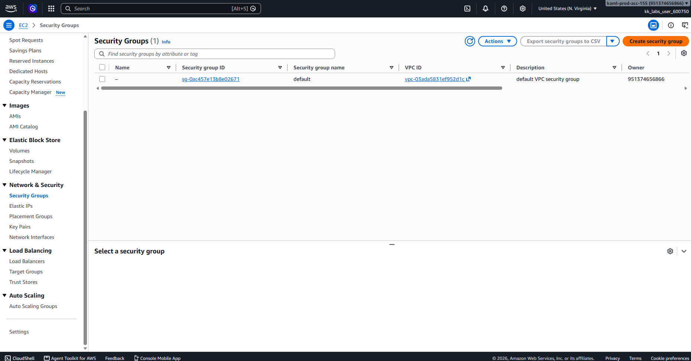

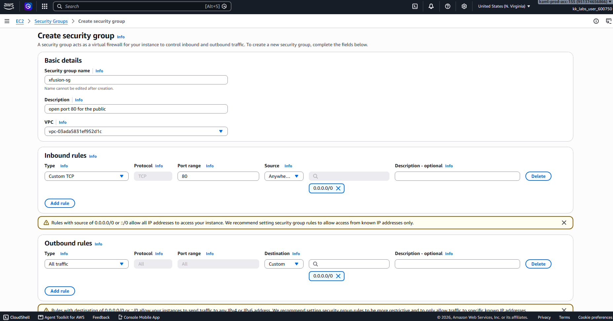

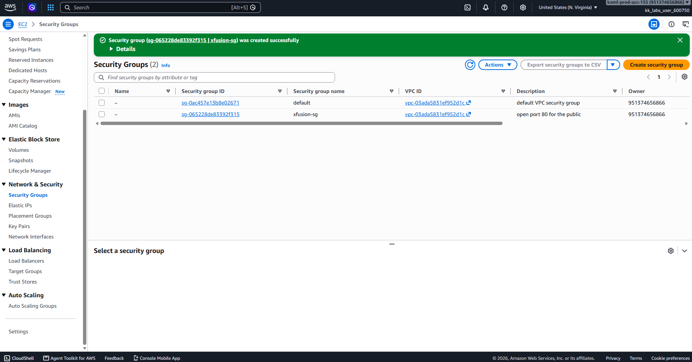

Then I went to target groups, and I created my new target group taht includes my ec2 instance

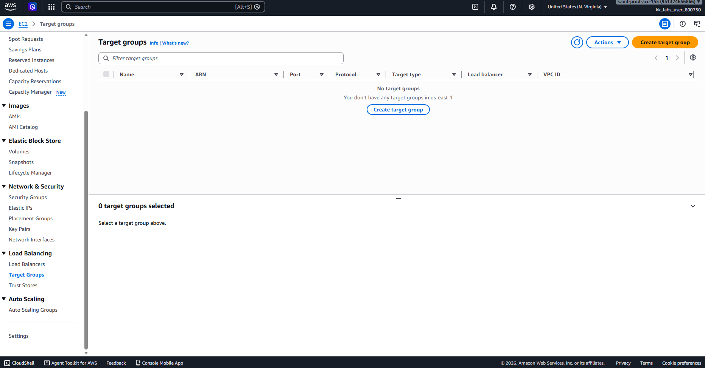

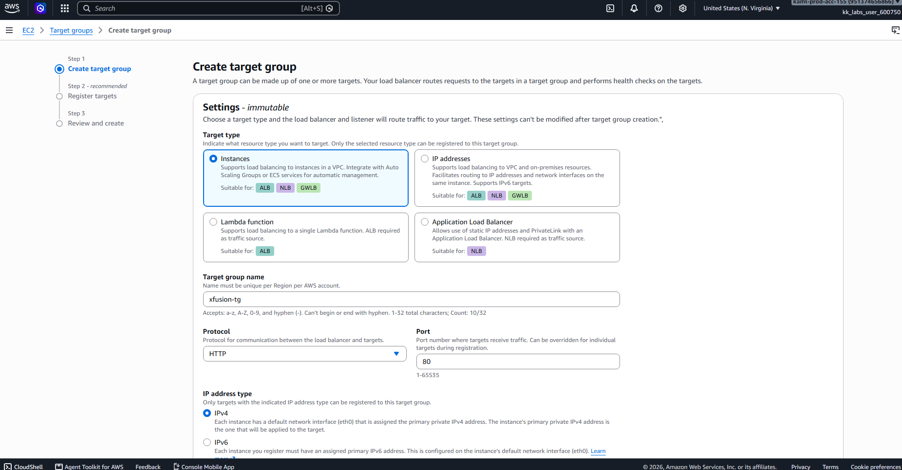

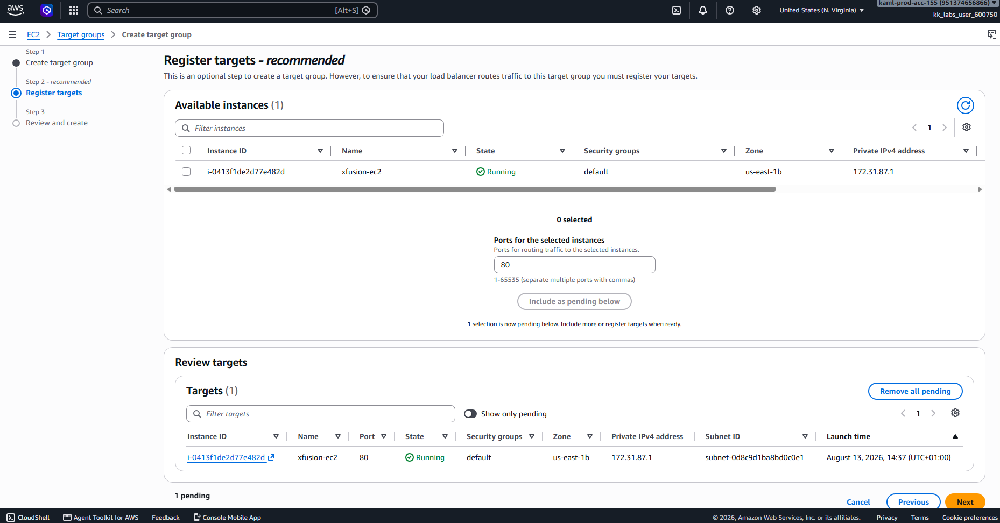

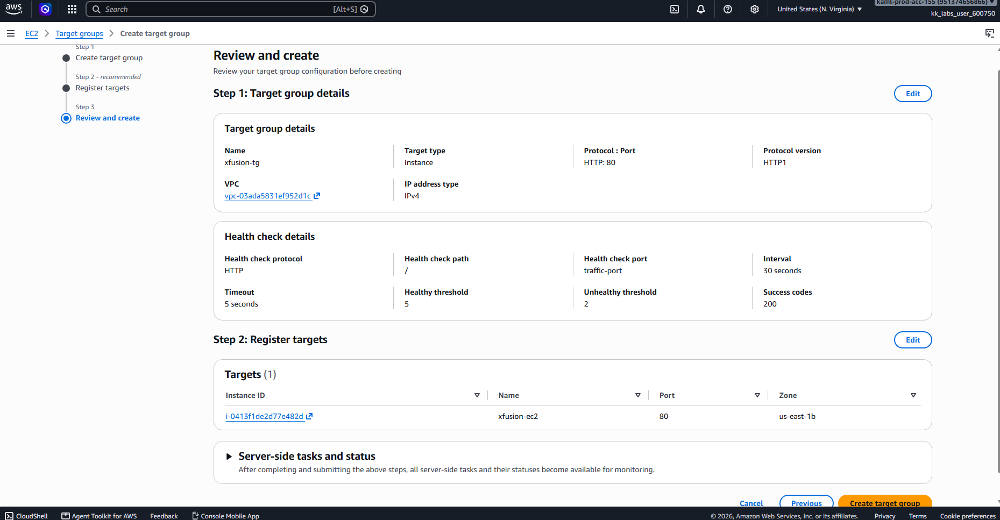

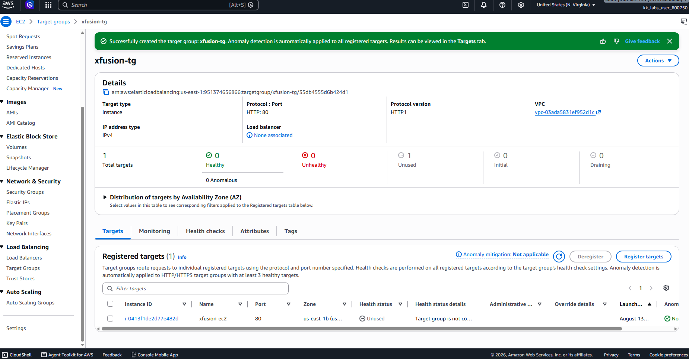

Then I created my new application load balancer with my security group and target group that I already created 

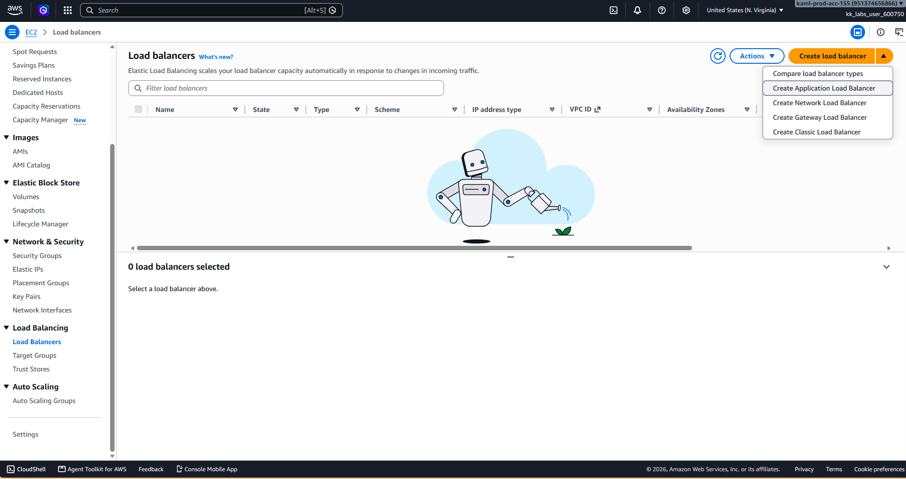

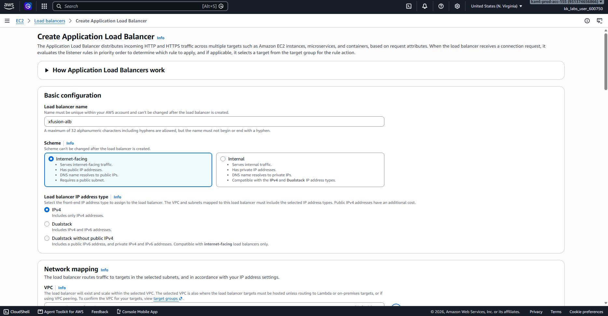

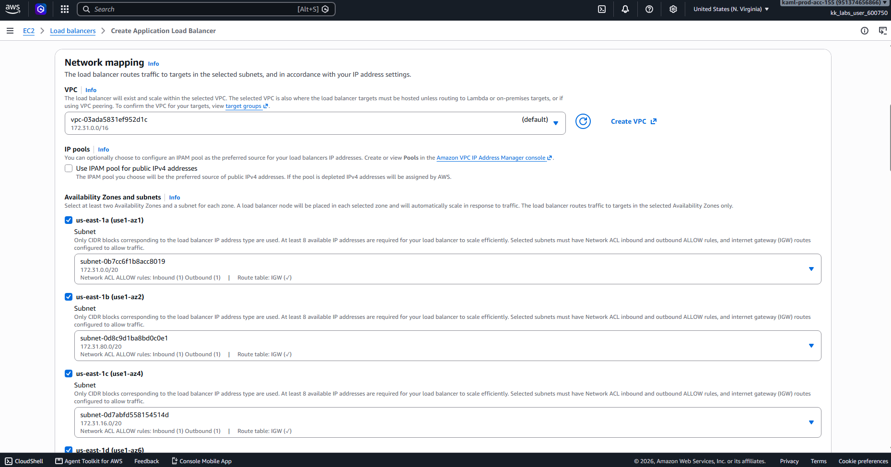

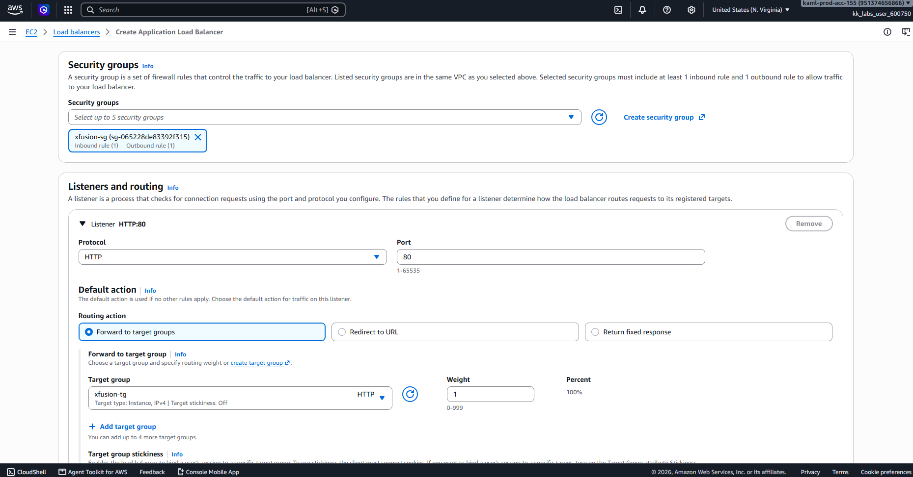

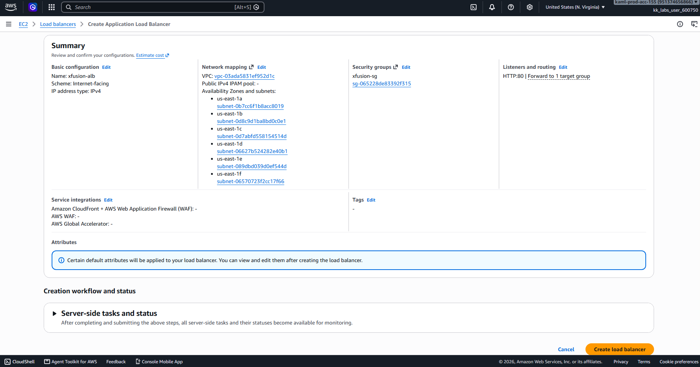

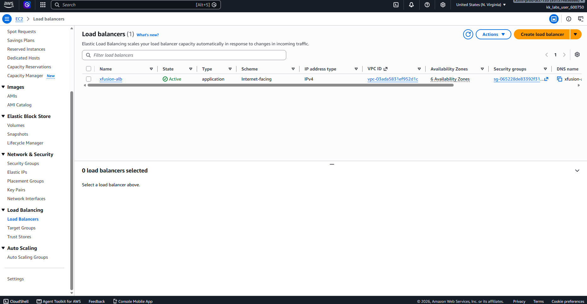

Then, I reconfigured default security group of my ec2 instance with changing its inbound rule to accept only hhtp request from my newly created security group

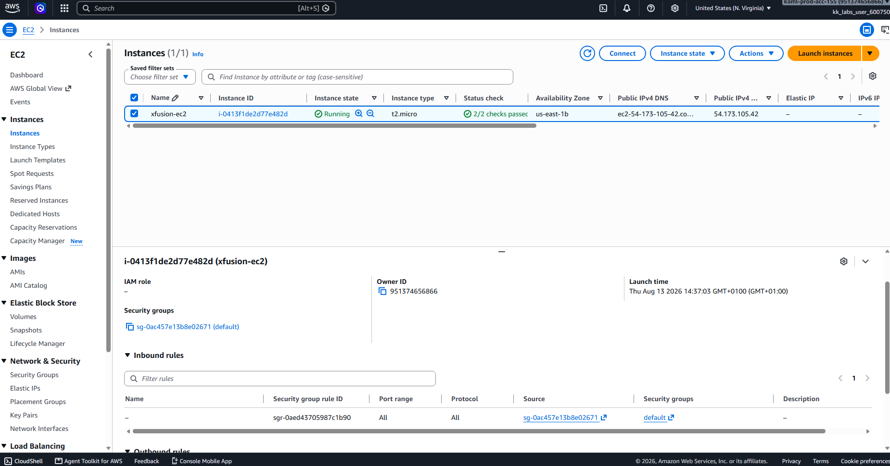

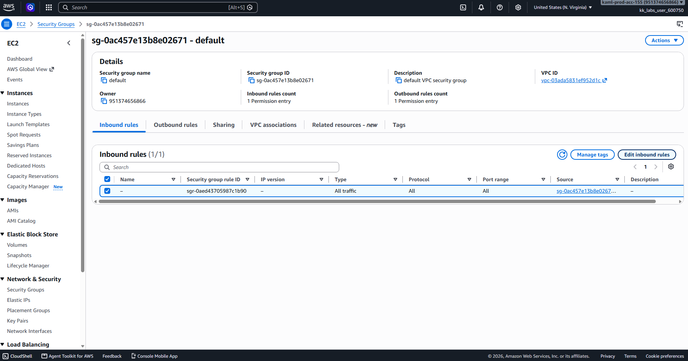

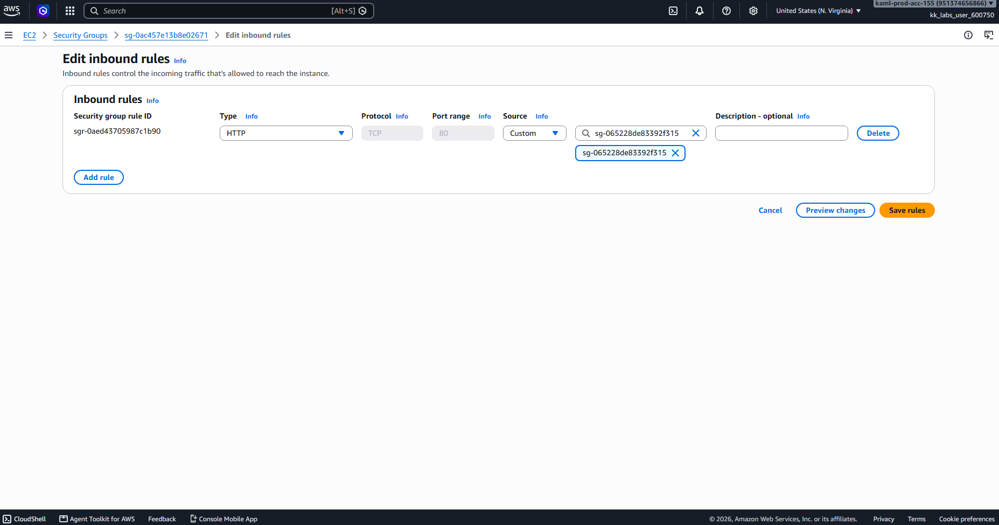

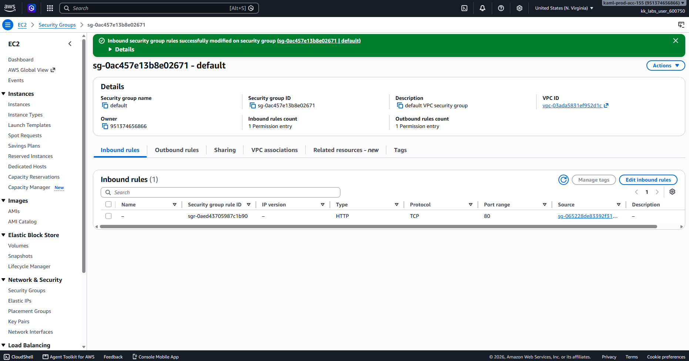
