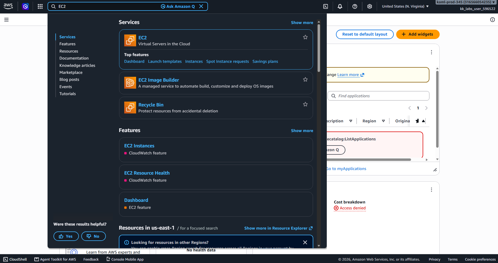
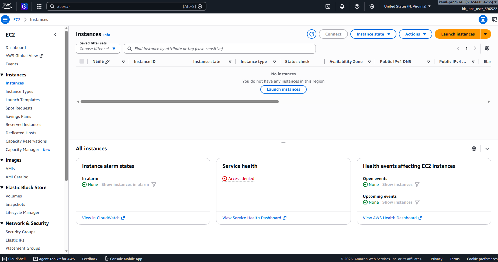
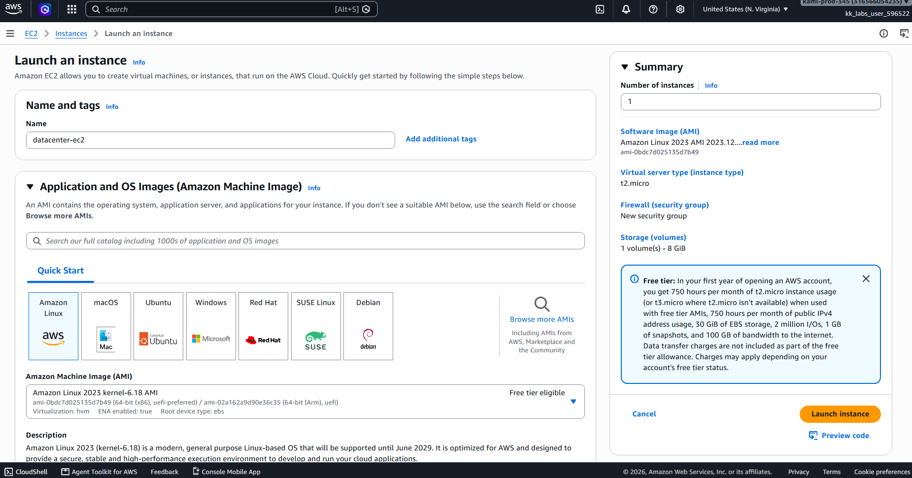
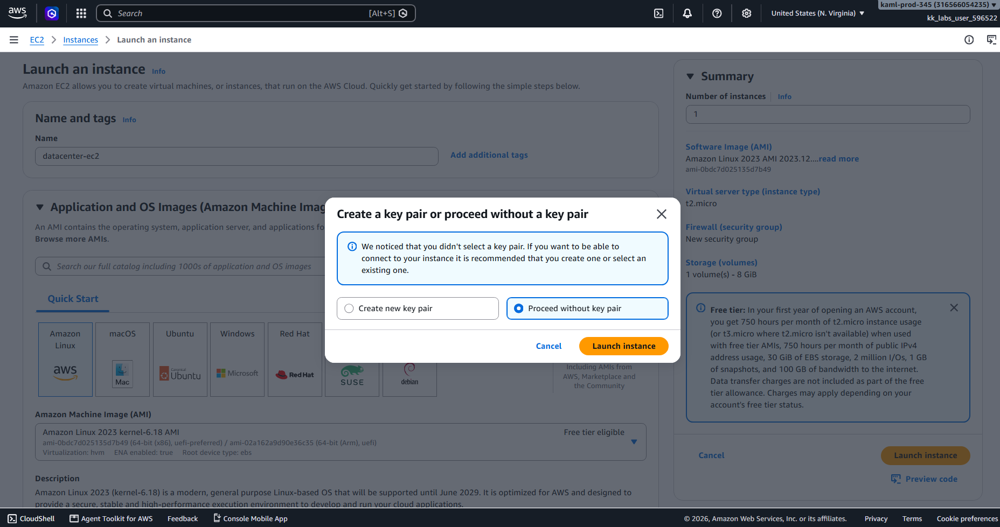
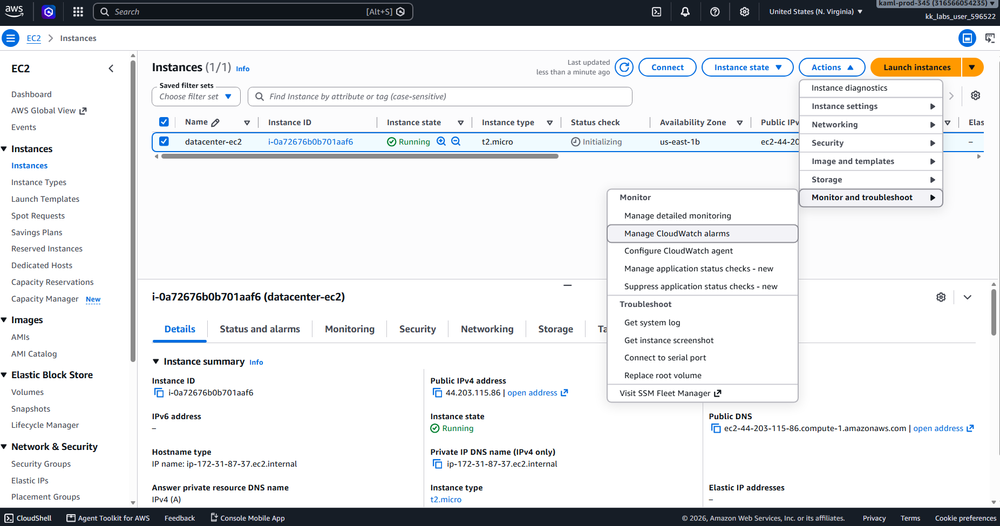
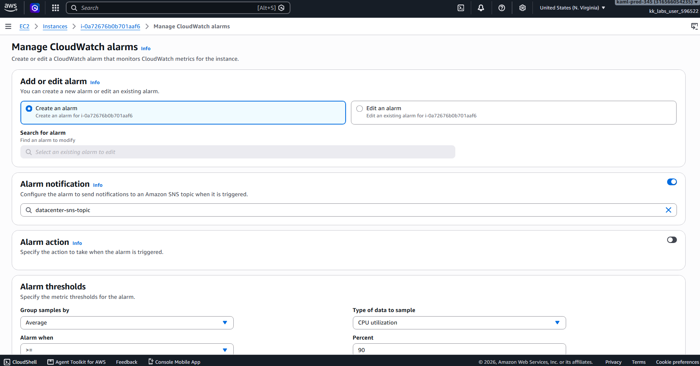
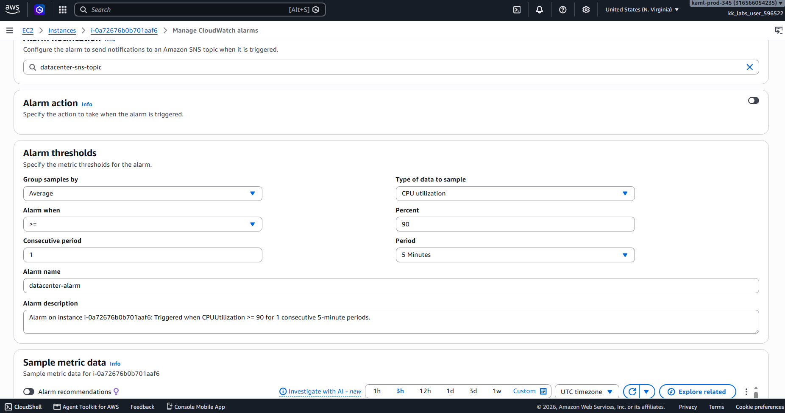
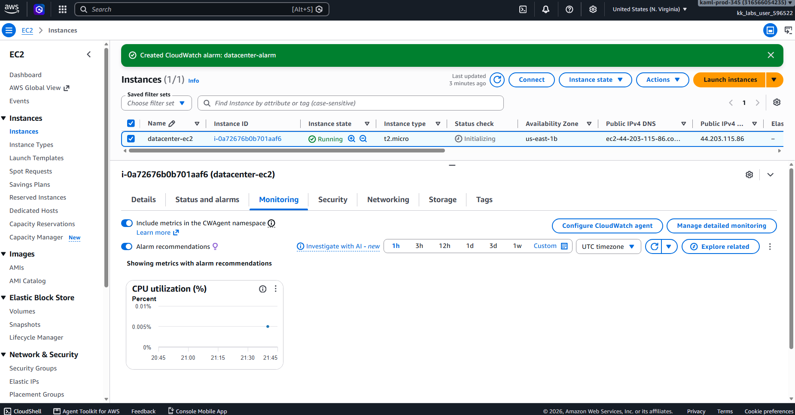

# Day 25: Setting Up an EC2 Instance and CloudWatch Alarm

After logging in, I created an ec2 instance,

I clicked on Manage CloudWatch Alarms after creating my ec2 instance, then I configured it as demanded

Finally my CloudWatch is created successfully

