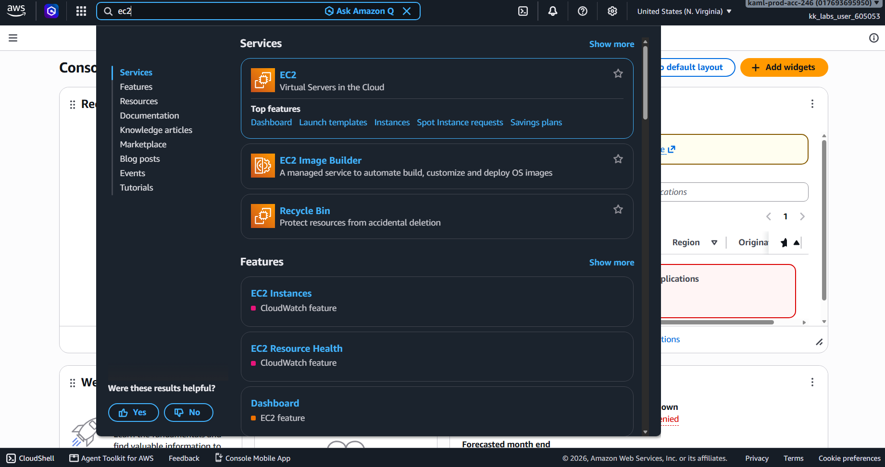
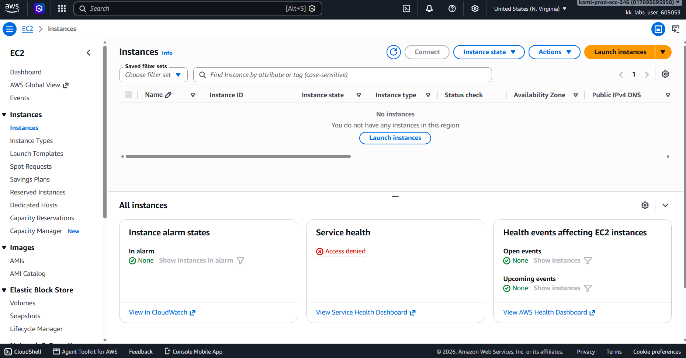
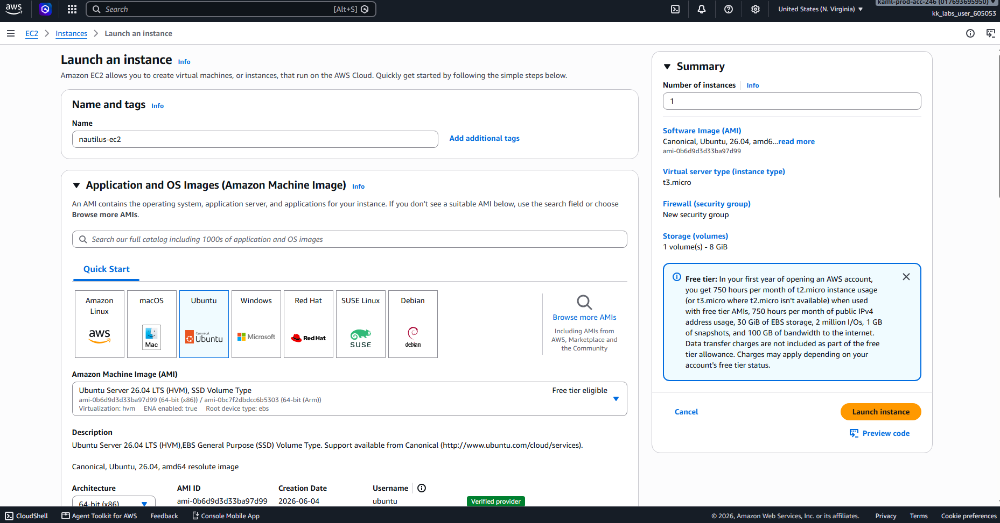
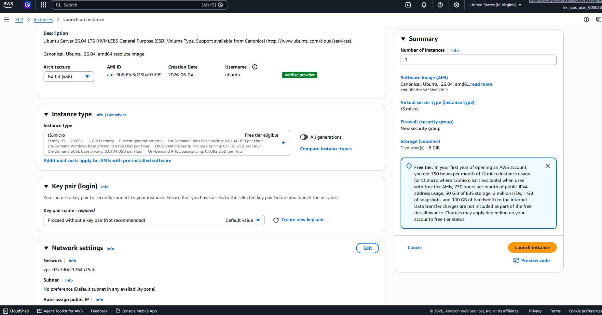
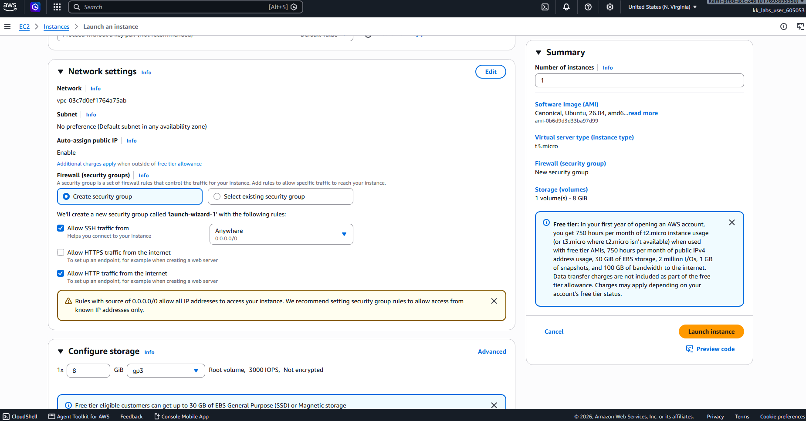
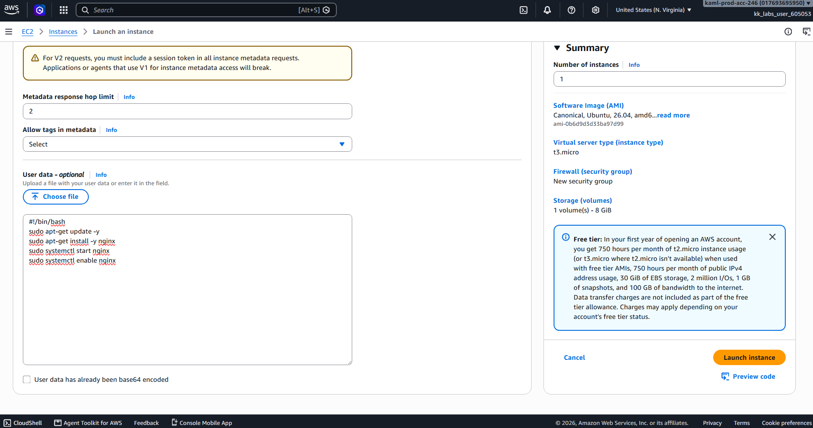
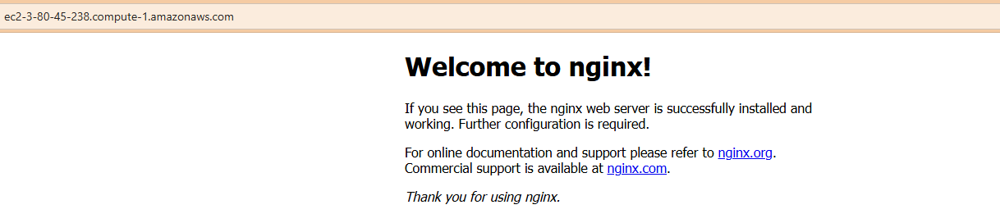

# Day 26: Configuring an EC2 Instance as a Web Server with Nginx

After logging in, I created an ec2 instance,

I added this script to install, start and enable nginx service from the dtart of my ec2 instance

My nginx server is accessible using my ec2 instance dns address

