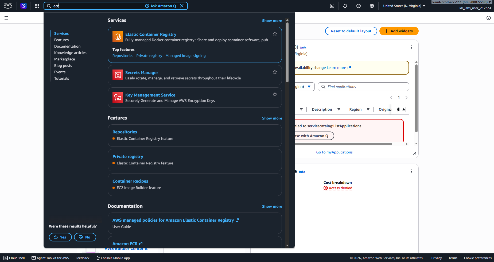
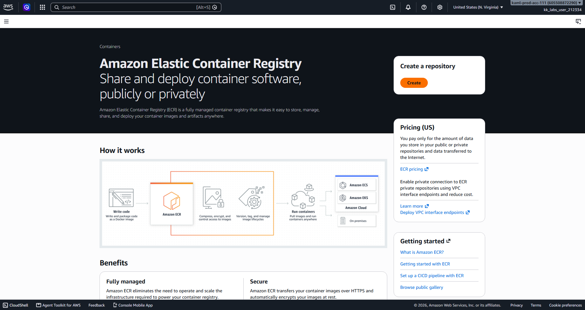
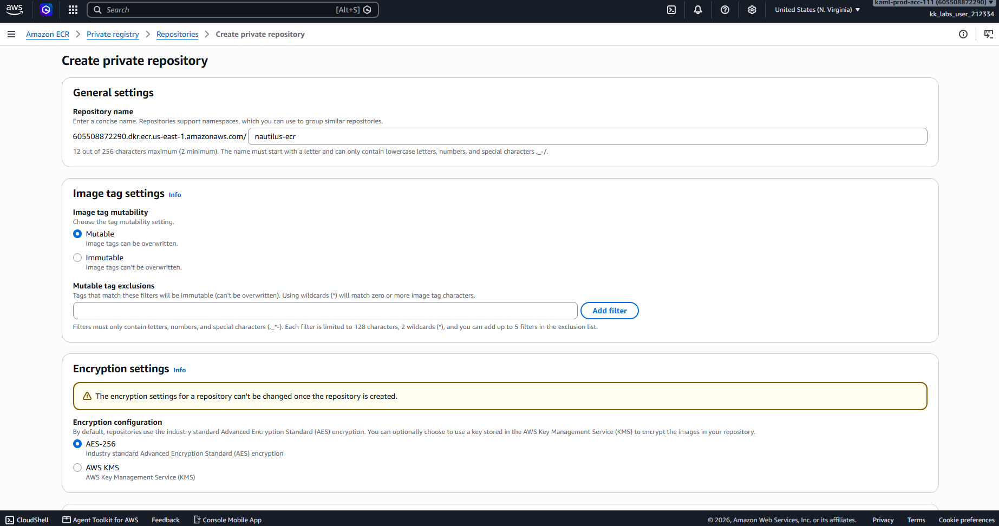
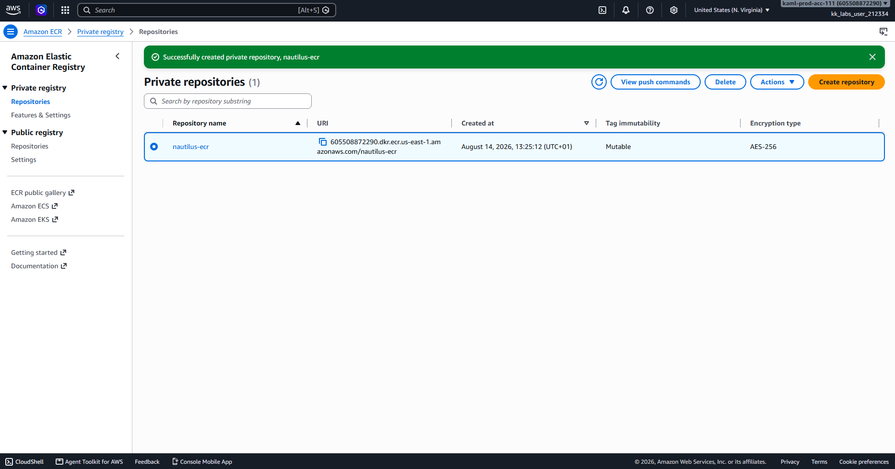
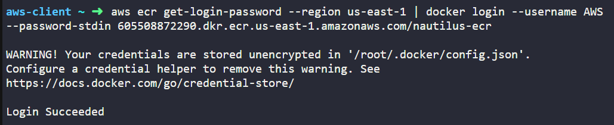
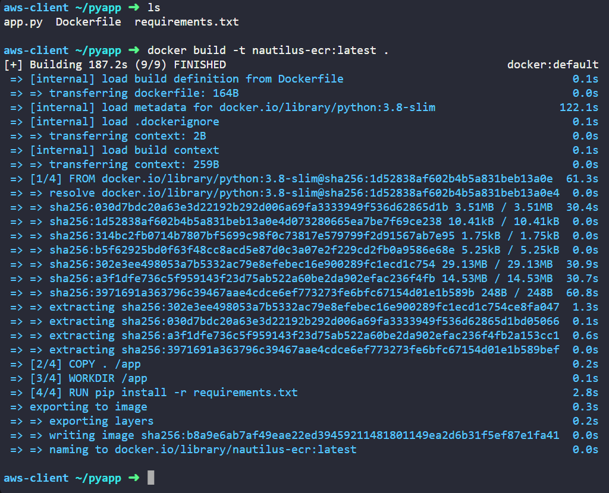
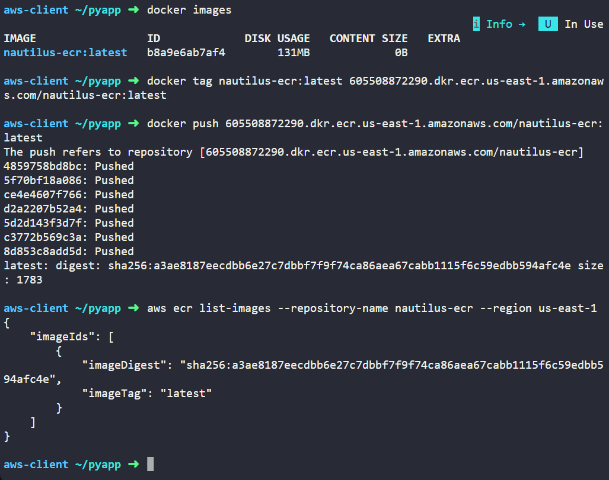

# Day 28: Creating a Private ECR Repository

I created a new ecr repository

In as-client, I linked my docker application with my ecr repository that I just created

I build ny new docker image

I tagged my new docker image to my ecr repository, then pushed it, then I verified that my image is pushed successfully to my ecr repository

