# Day 29: Establishing Secure Communication Between Public and Private VPCs via VPC Peering

I created a new peering connection between default vpc and my private one

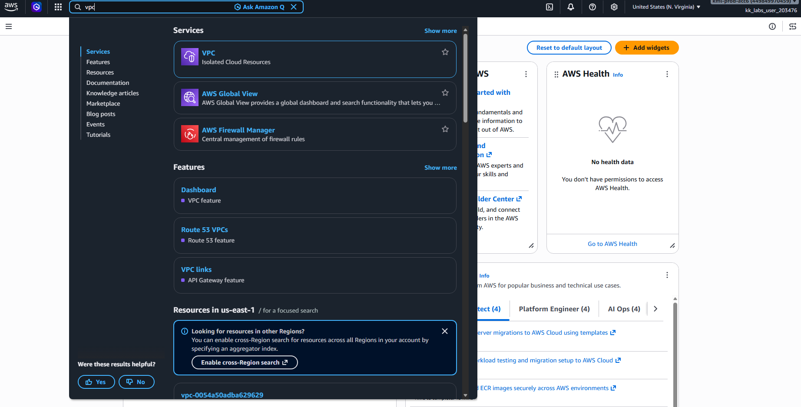

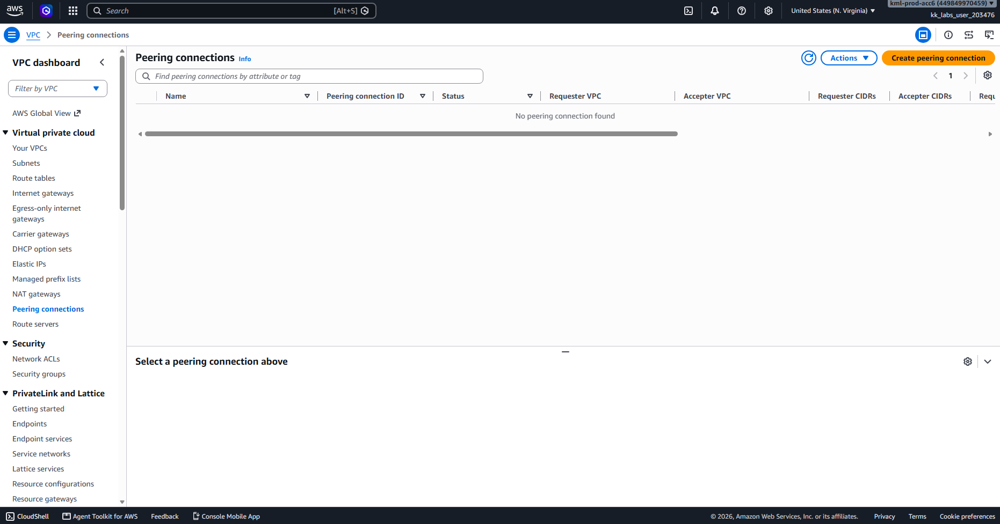

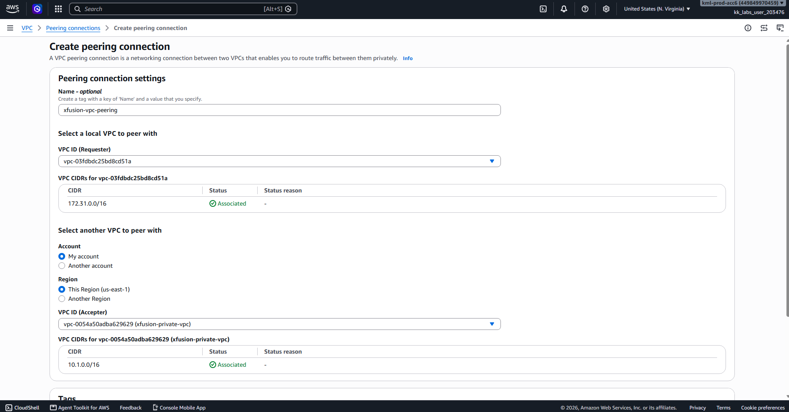

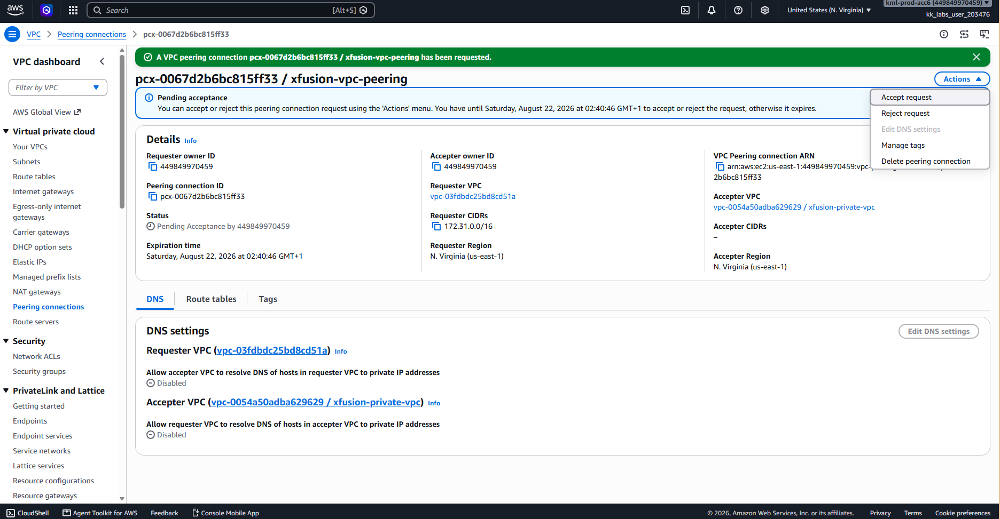

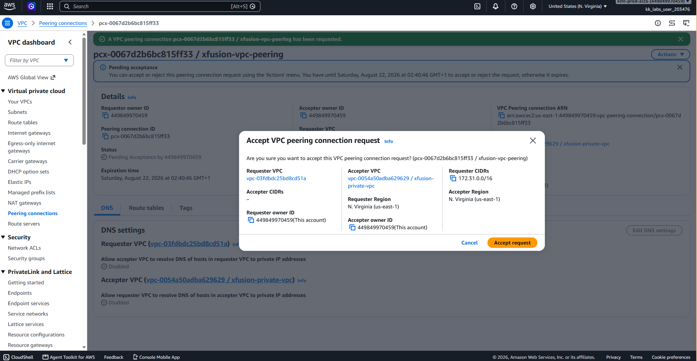

I added it to route tables for both VPCs

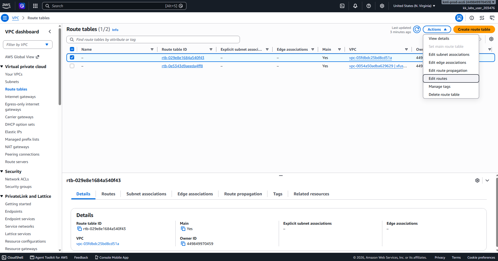

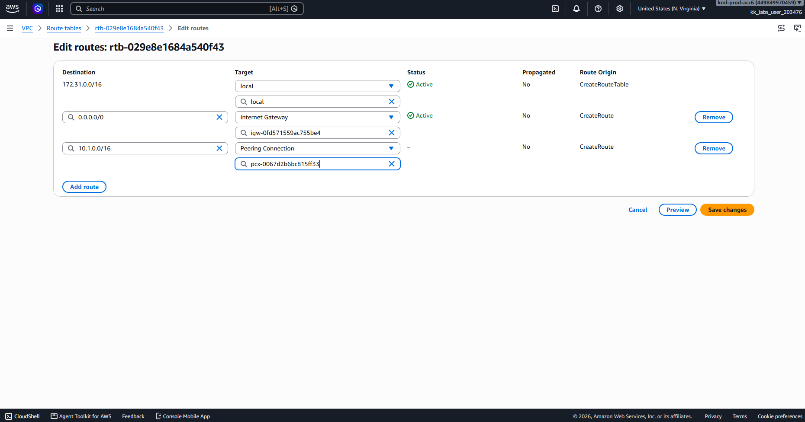

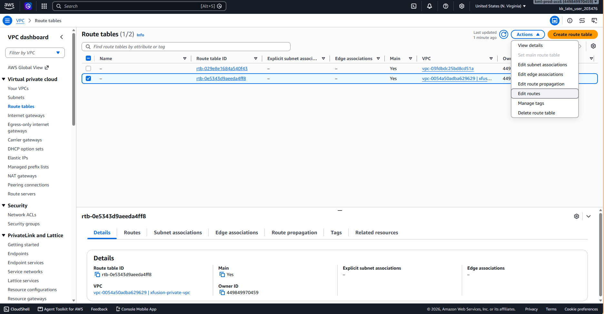

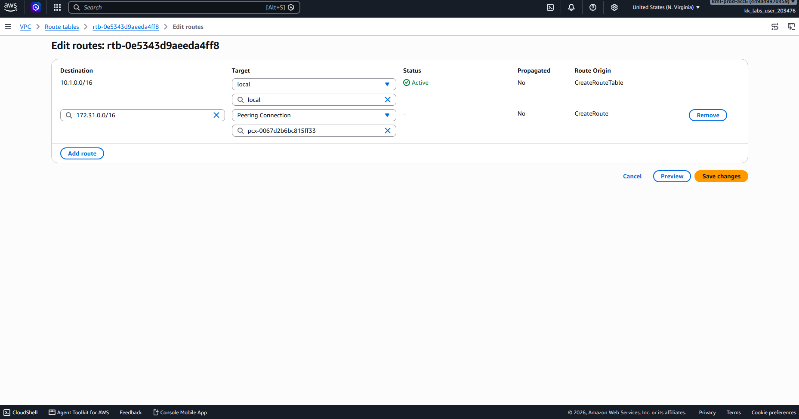

I changed security rules for security groups of both ec2 instances; I added ssh inbound rule for public ec2 instance, and icmp for private ec2 instance

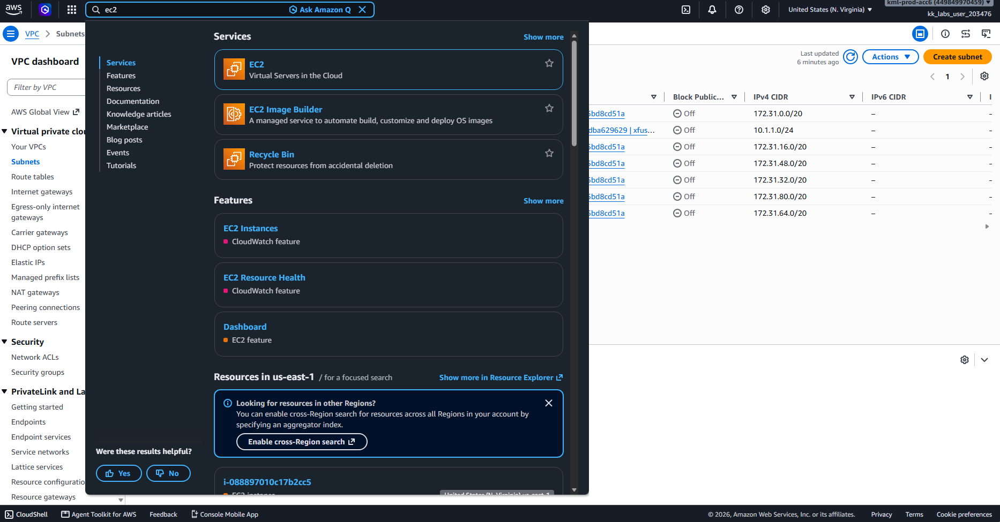

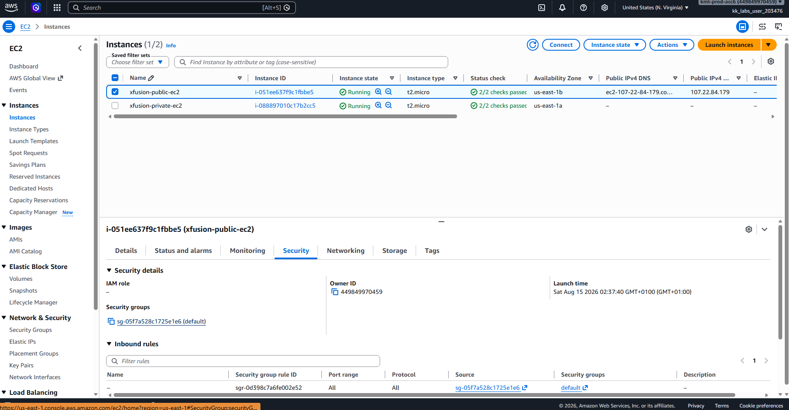

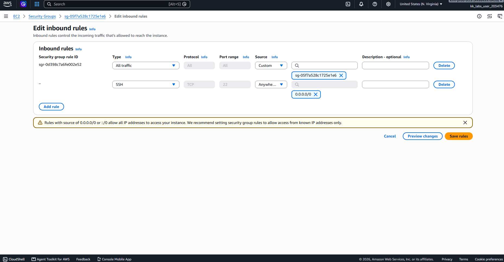

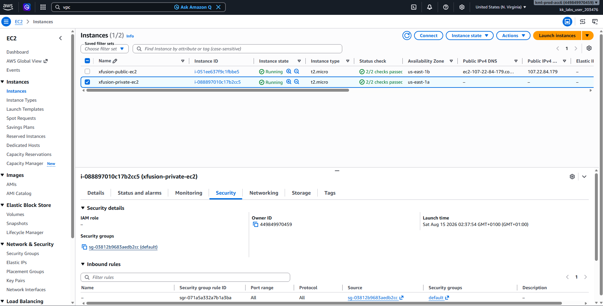

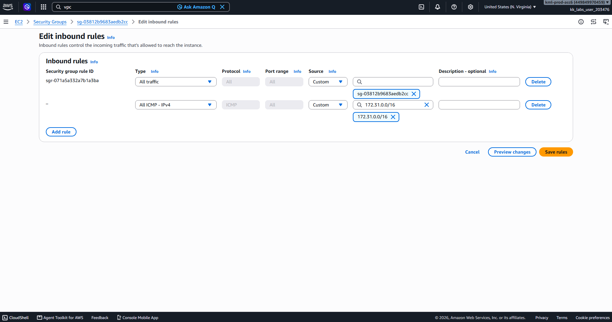

To establish ssh connection, I copied my aws-client public key to my public ec2 instance ~/.ssh/authorized_keys file

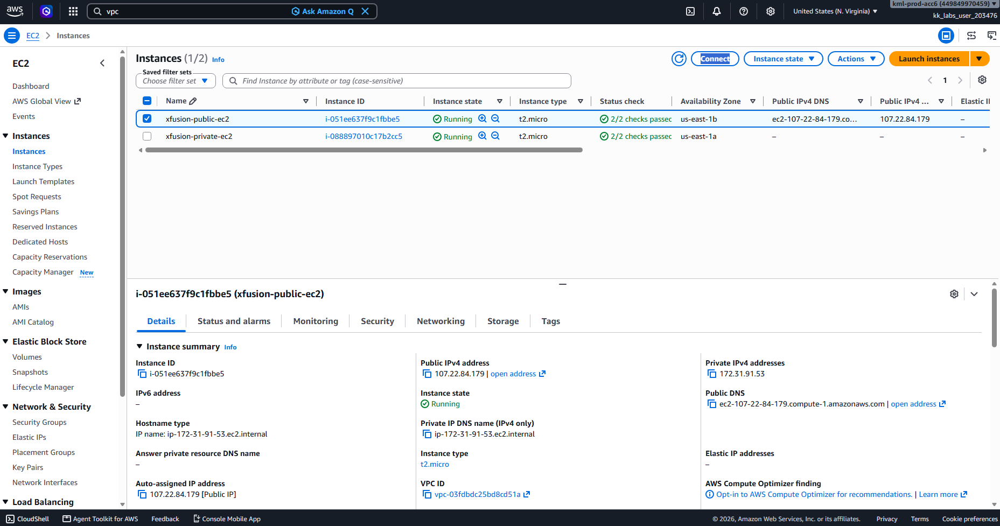

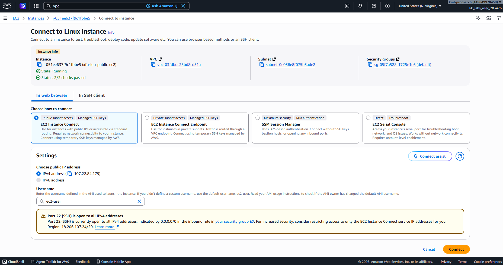

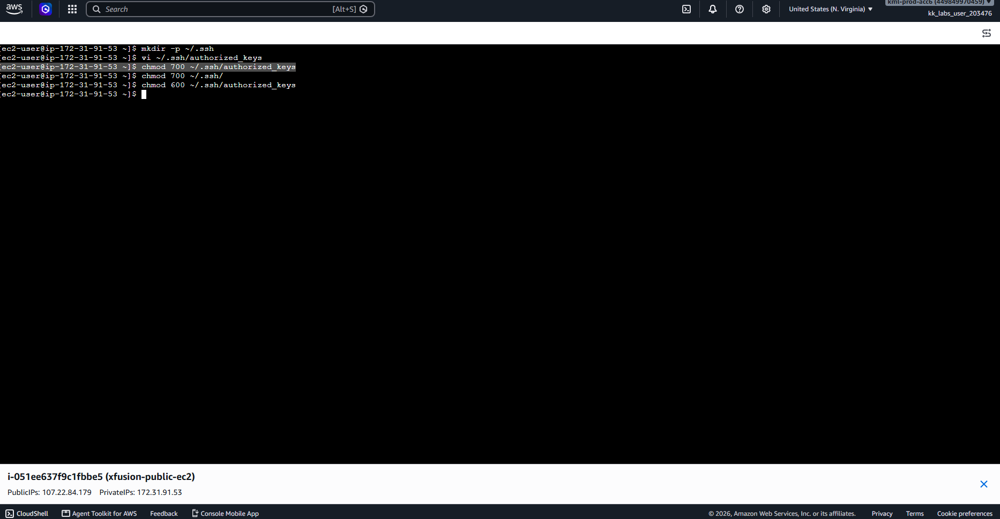

I was able to make a ssh connection to public ec2 instance, and I was able to ping my private ec2 instance from public one using private ipv4 address of my private ec2 instance

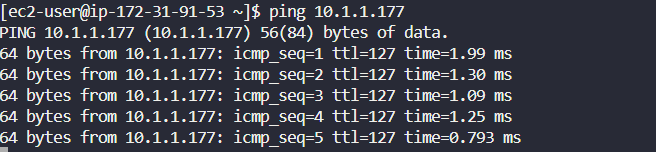

