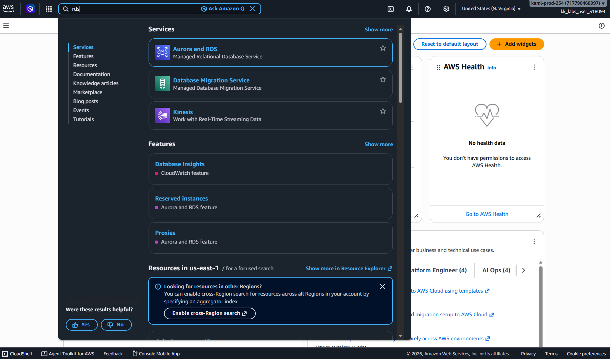
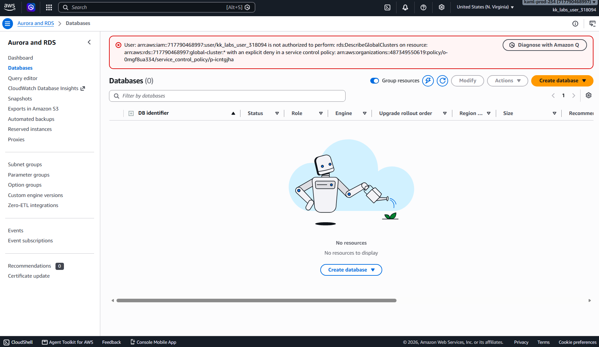
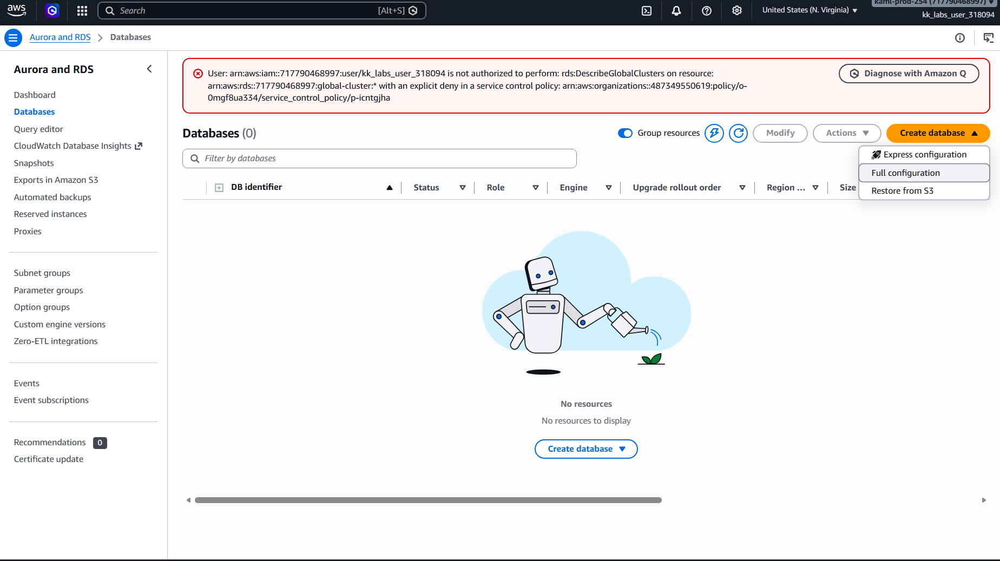
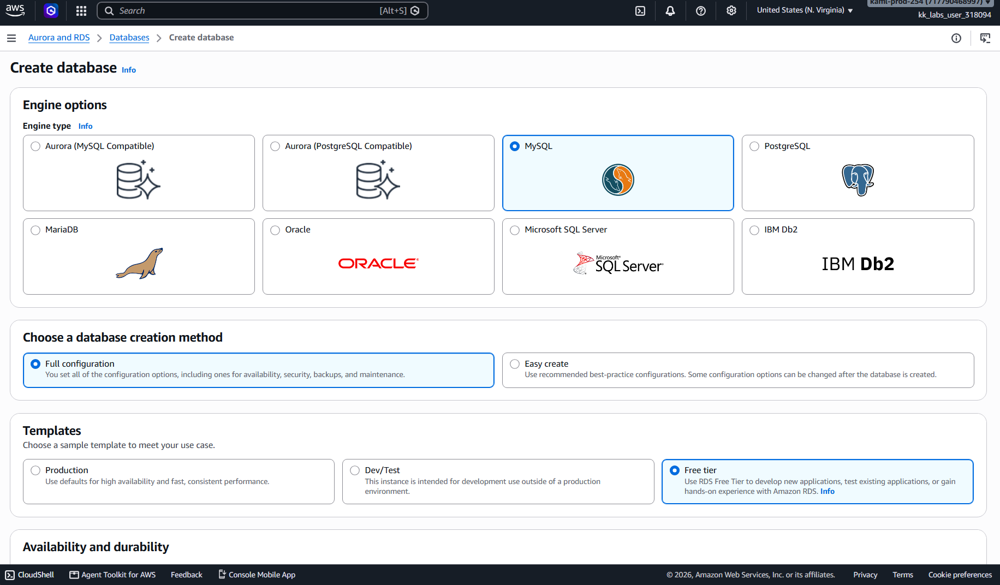
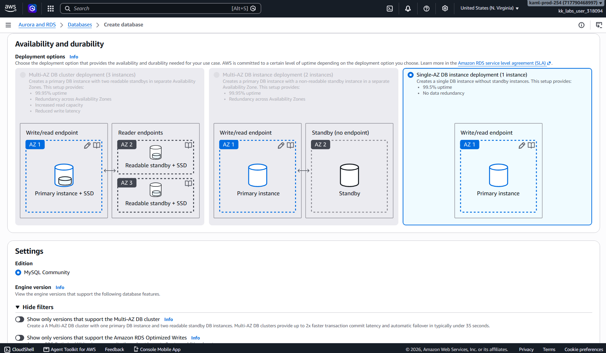
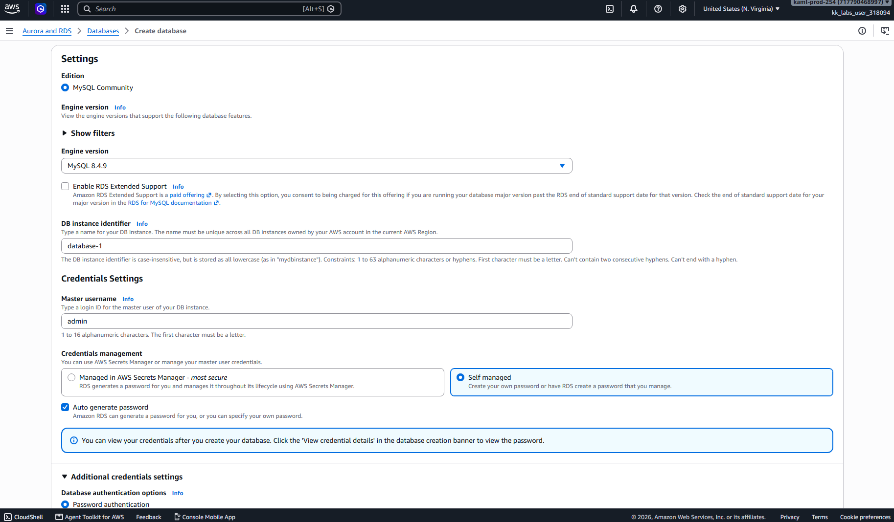
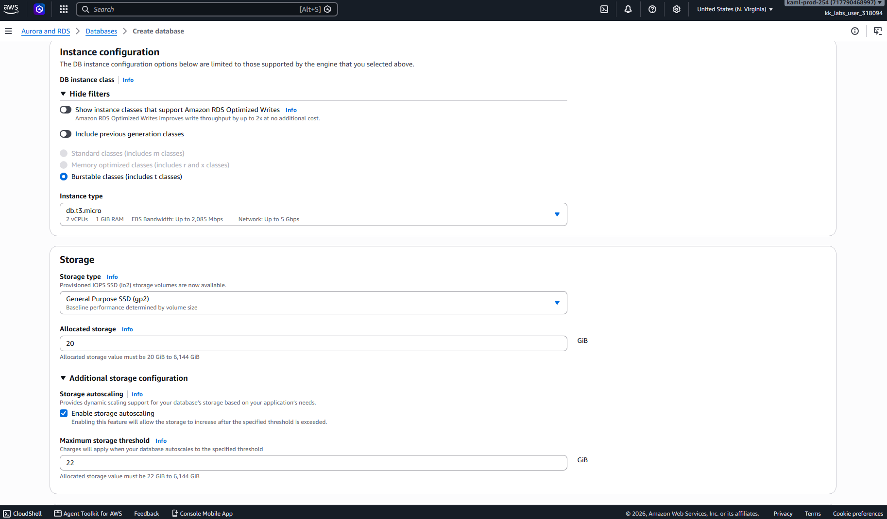
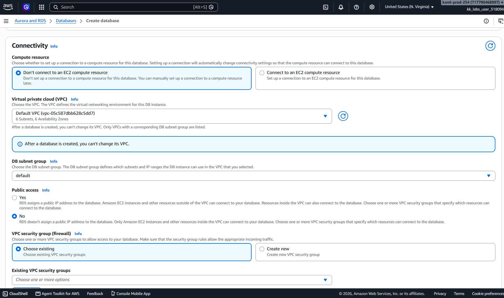
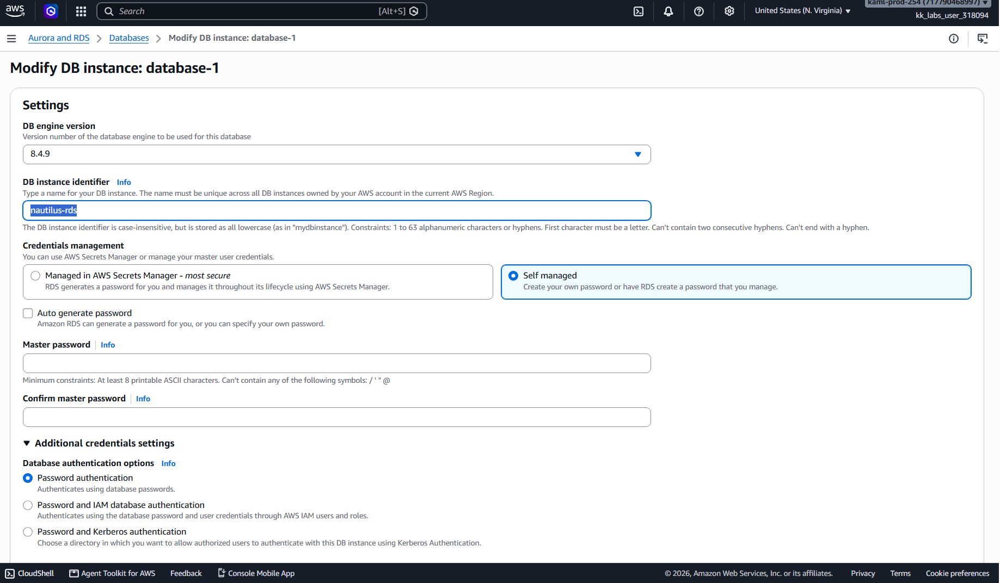
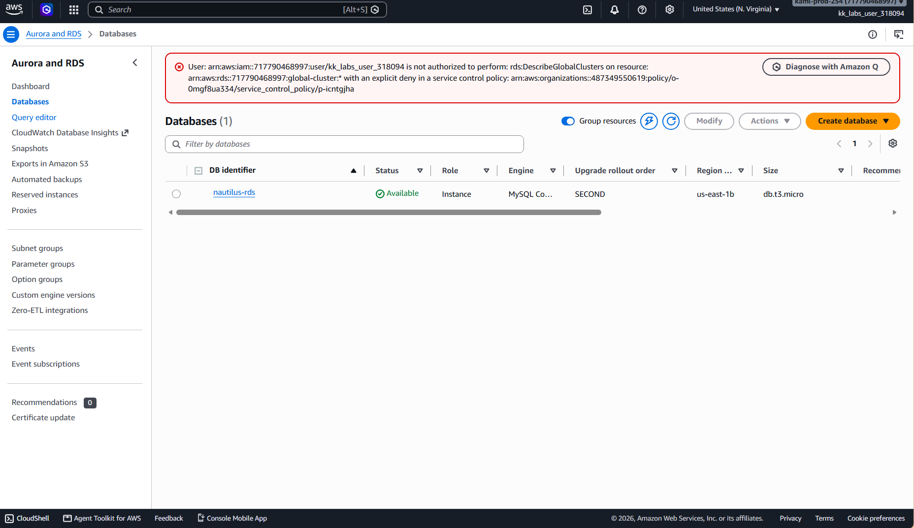

# Day 31: Configuring a Private RDS Instance for Application Development

I created a new rds instance, with demanded configuration

Here, I renamed my rds to the demanded name, then saved the changes

I waited for some minutes, then my rds became available

