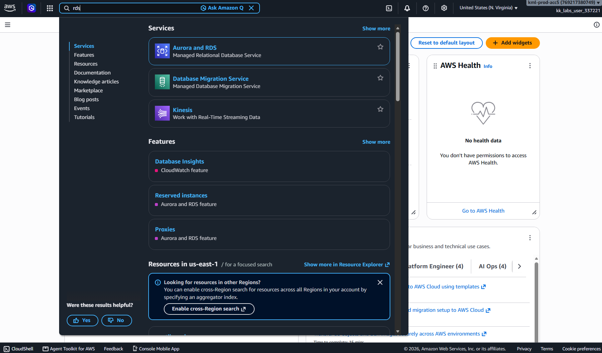
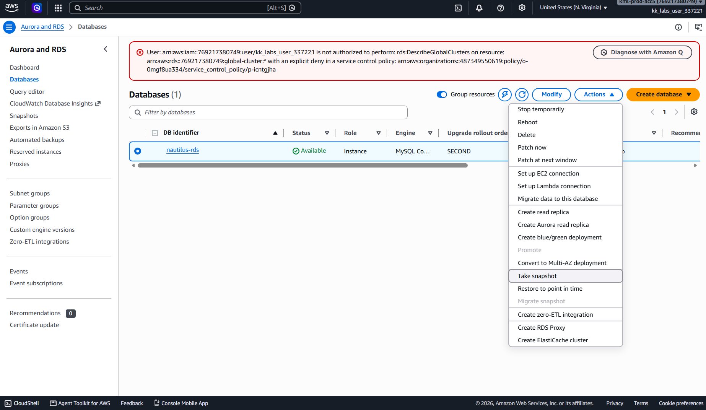
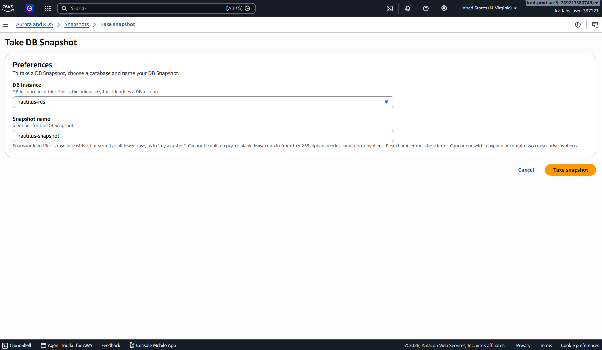
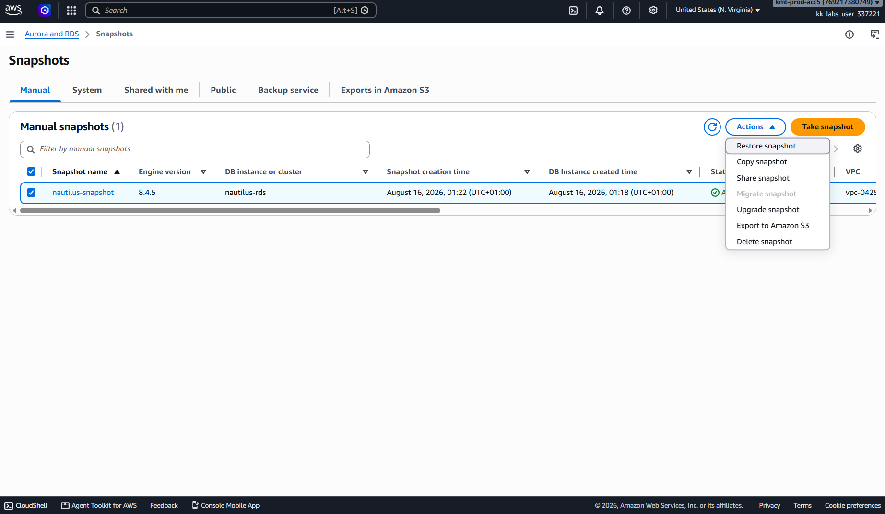
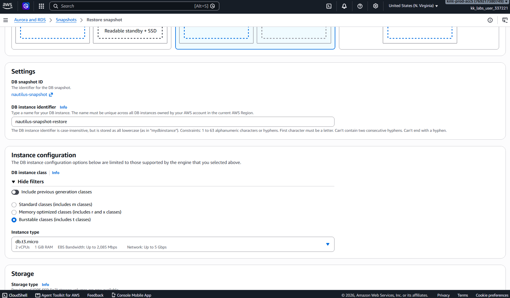
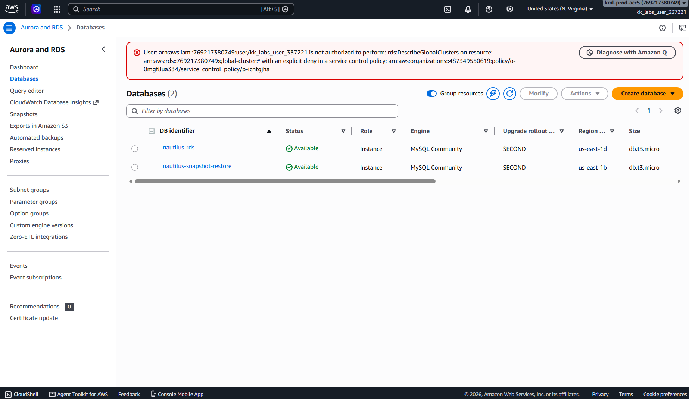

# Day 32: Snapshot and Restoration of an RDS Instance

I created a snapshot of my rds

I restored my new snapshot to a new rds with demanded configuration

I waited some minutes until my new rds becomes available.

