# Day 33: Create a Lambda Function

I created a new iam role, and I associated a basic lambda execution permission

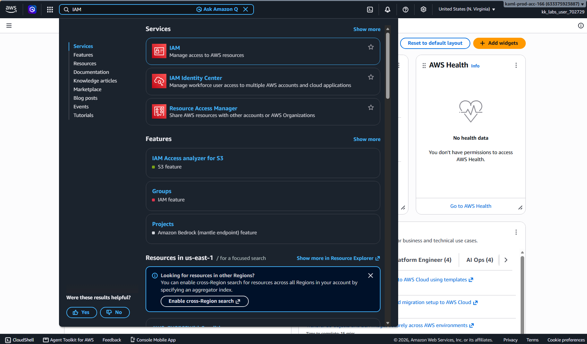

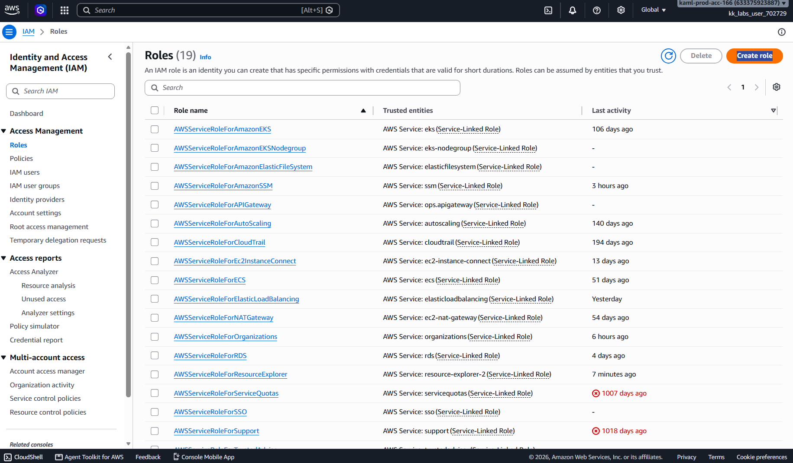

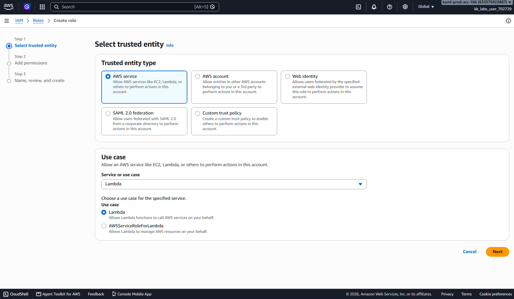

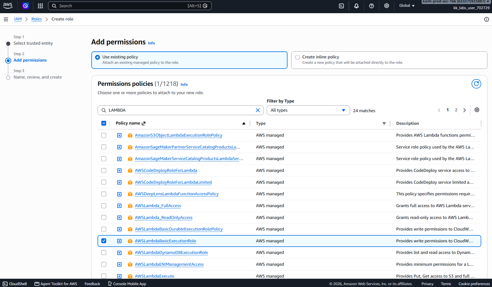

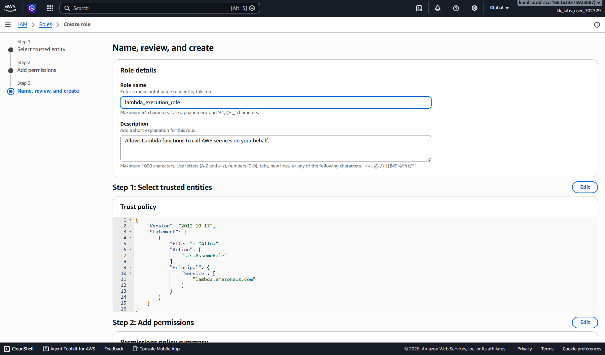

I created a new lambda function and I associated my new role to it

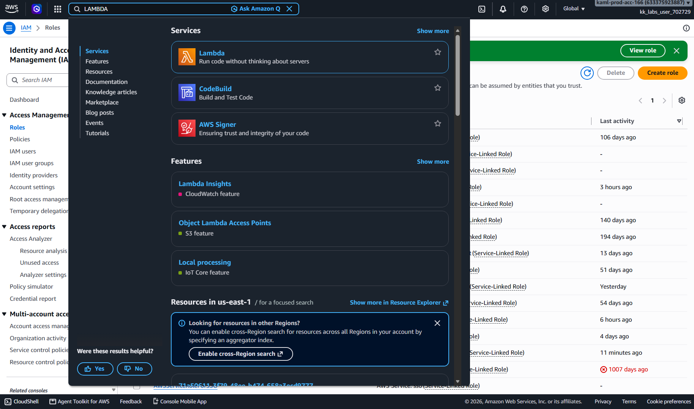

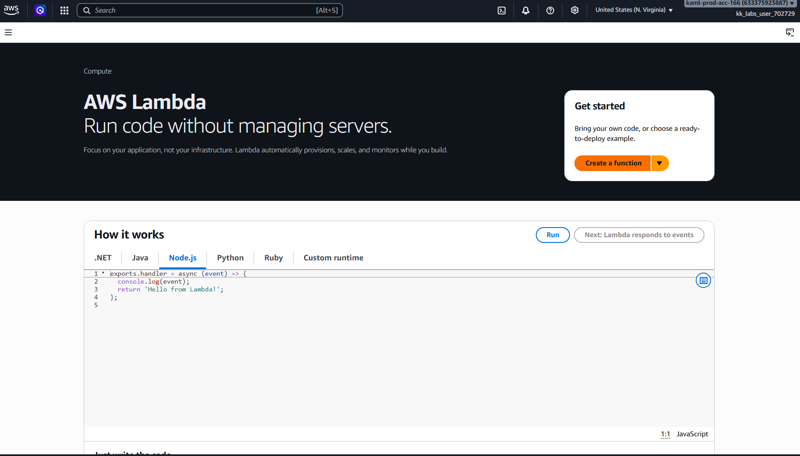

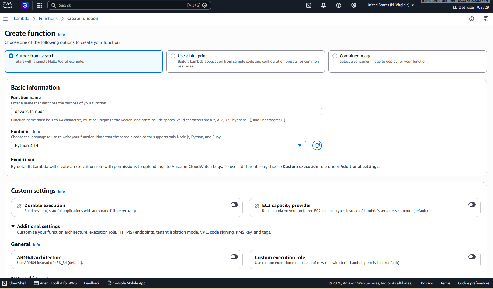

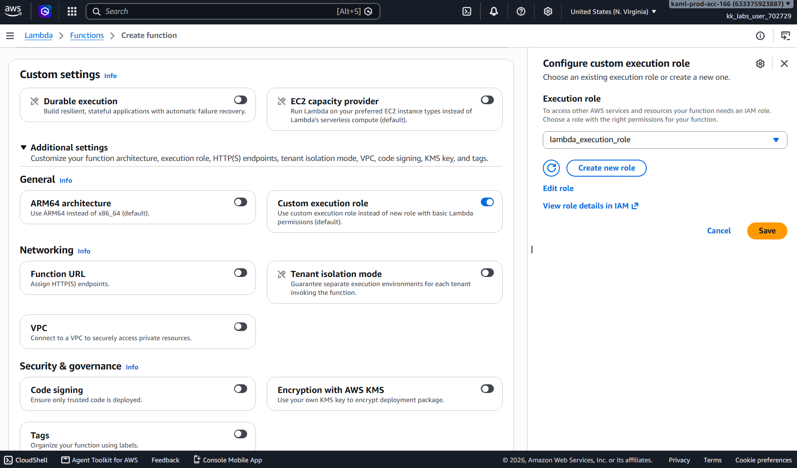

I deployed a simple python program to it, then I tested it

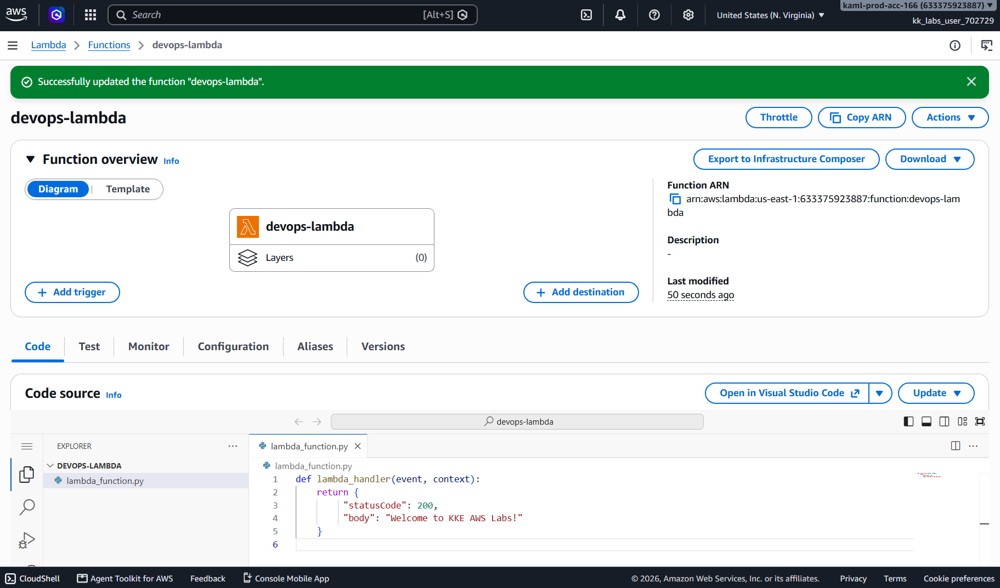

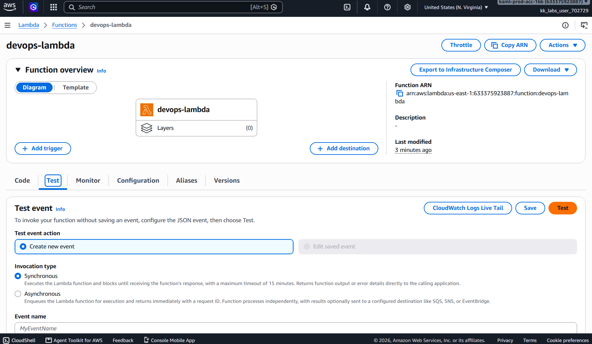

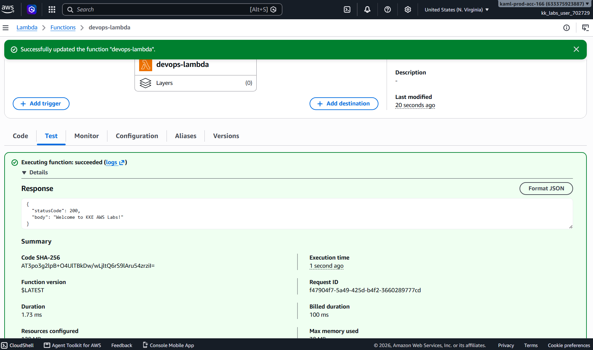

