# Day 35: Deploying and Managing Applications on AWS

I created a new rds instance with demanded configuration

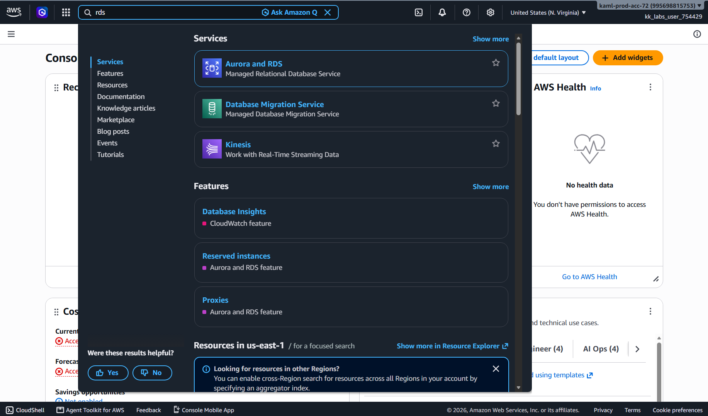

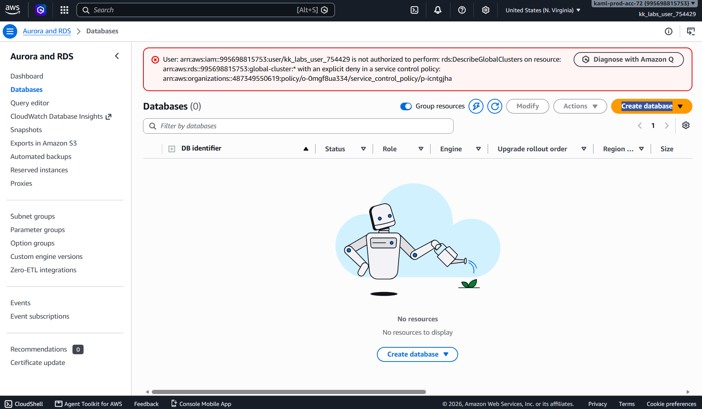

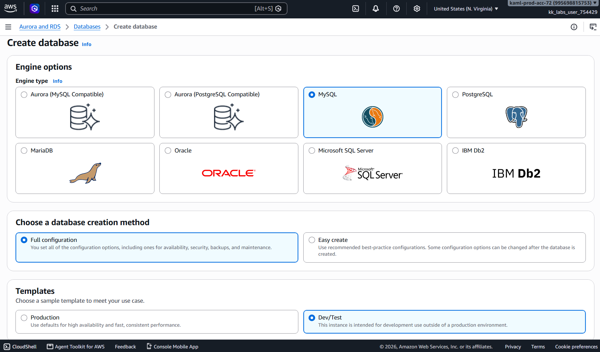

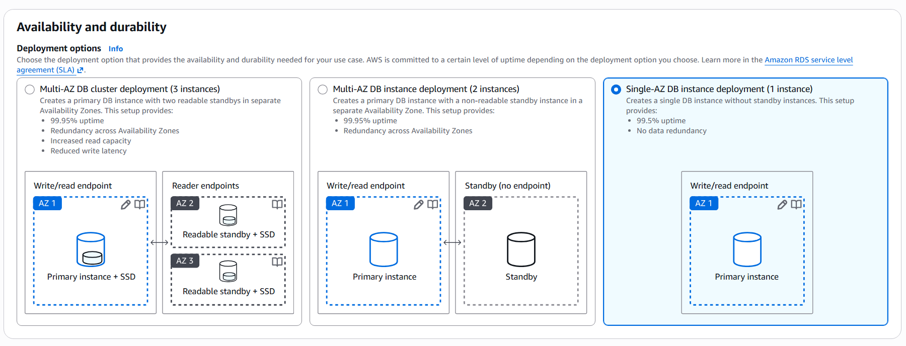

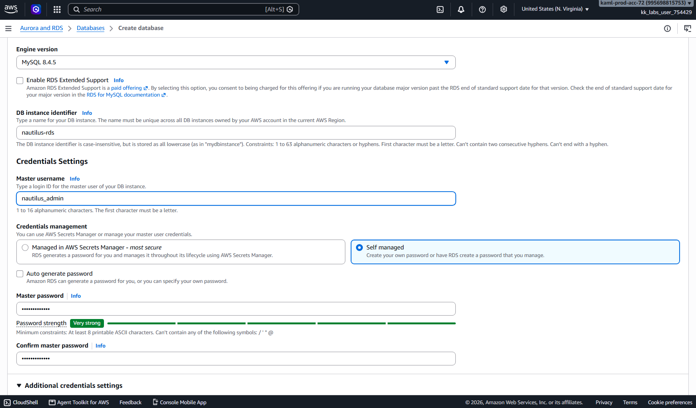

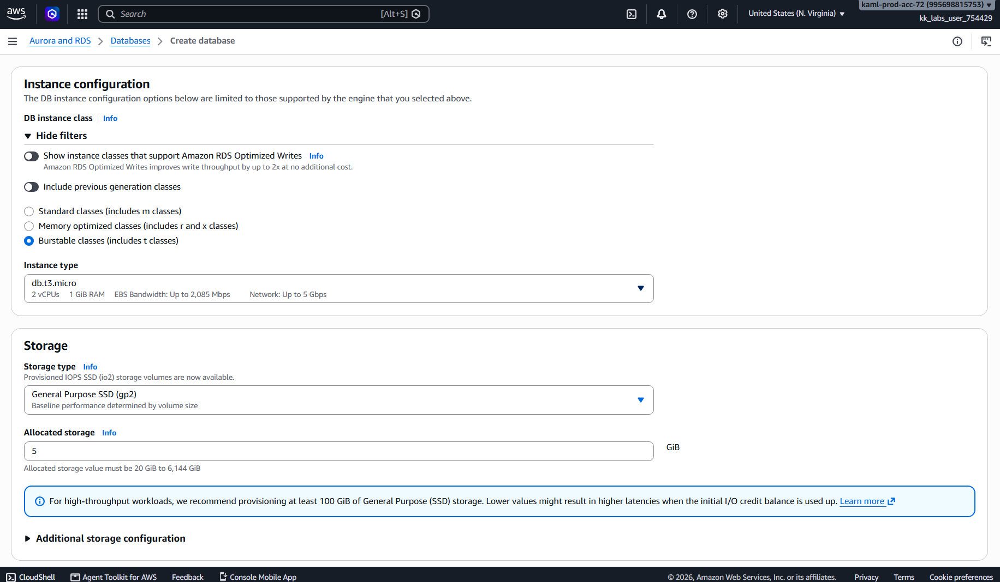

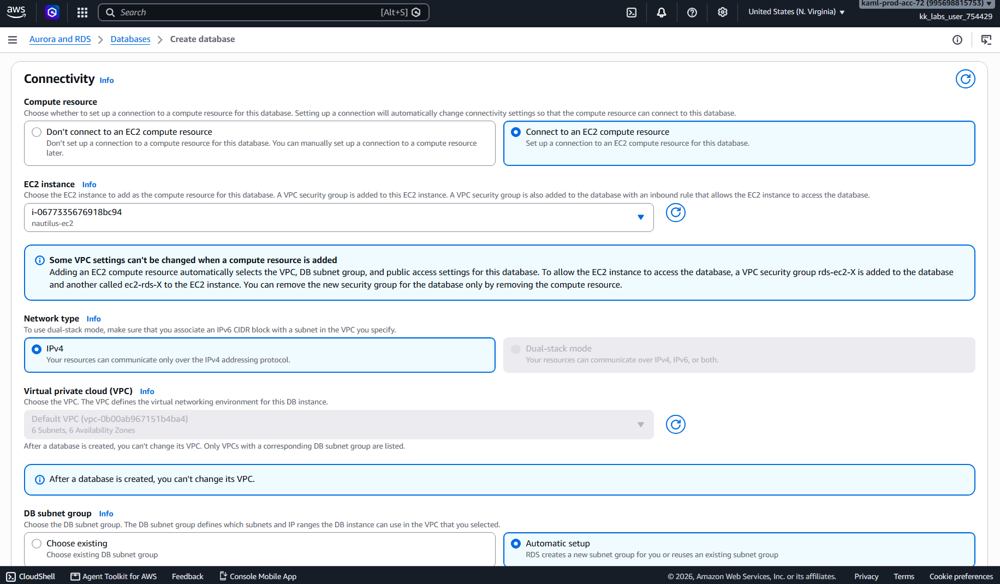

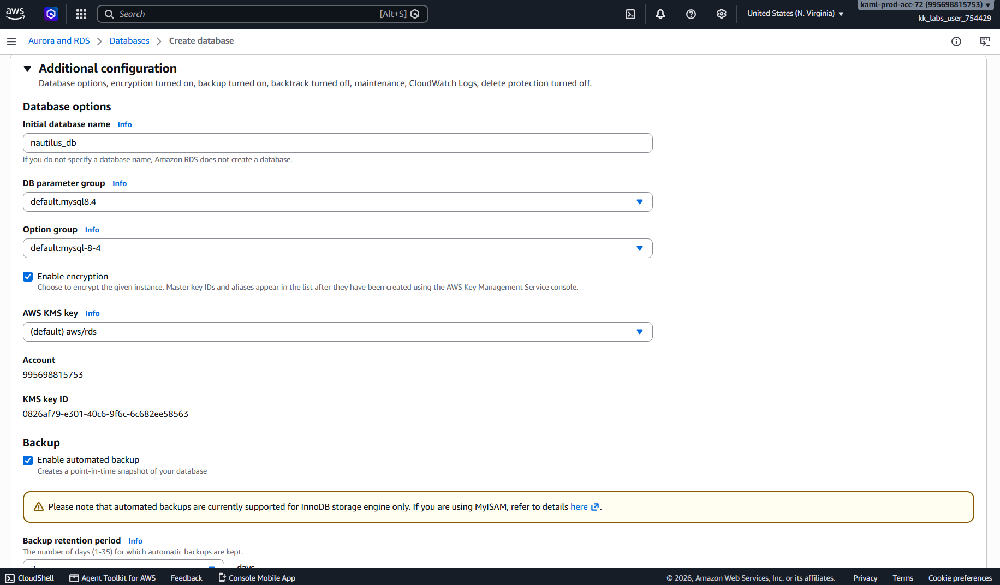

I change inbound rules of my ec2 instance's security group to allow http and ssh requests 

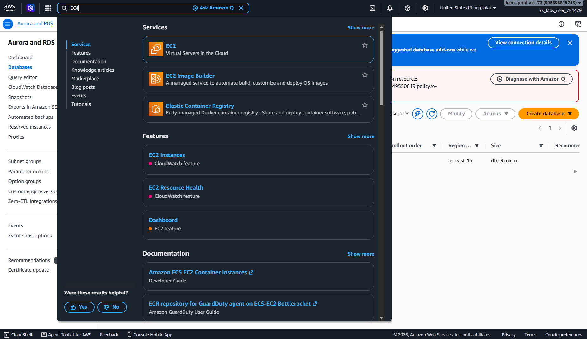

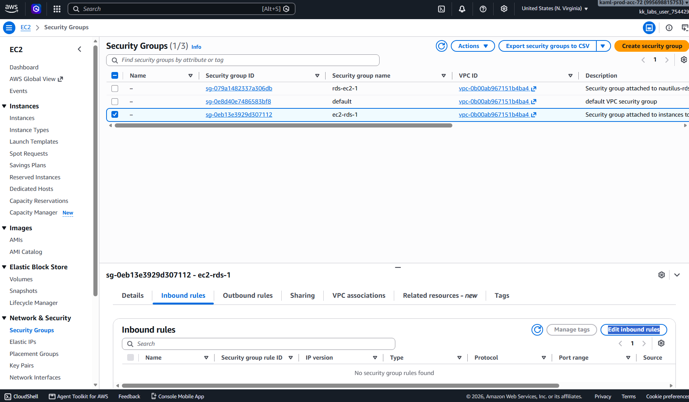

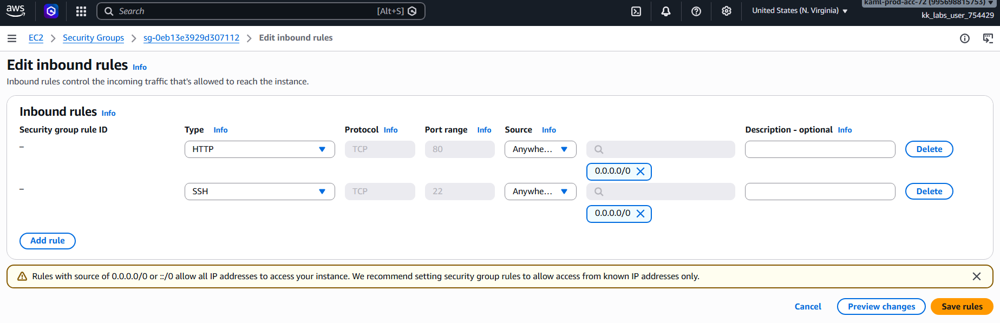

I created a passwordless connection between aws-client and my ec2 instance

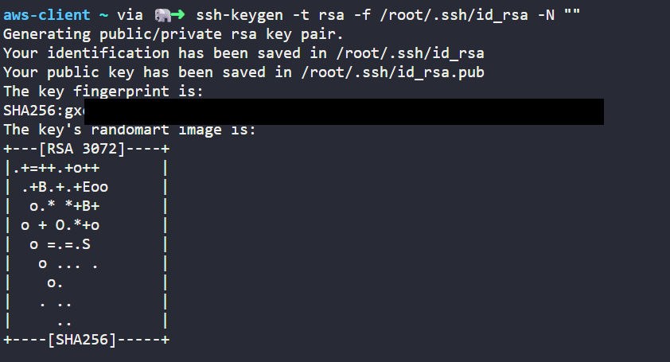

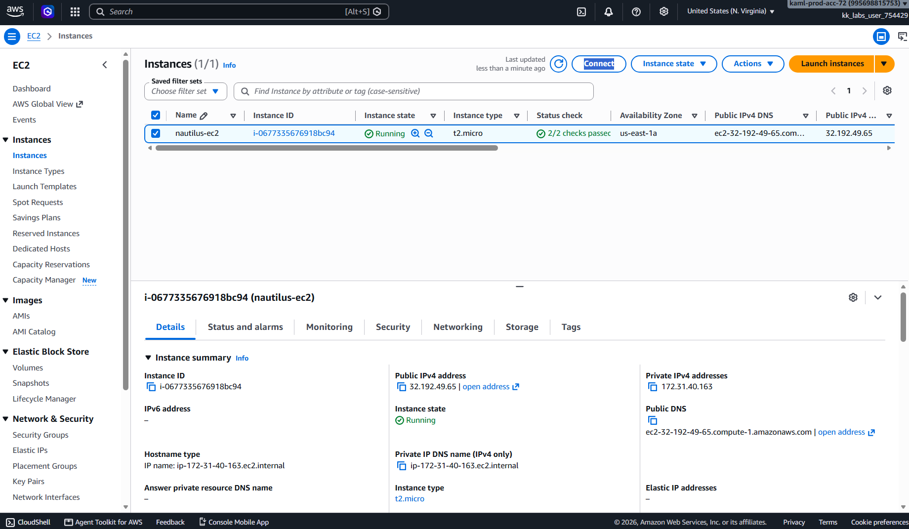

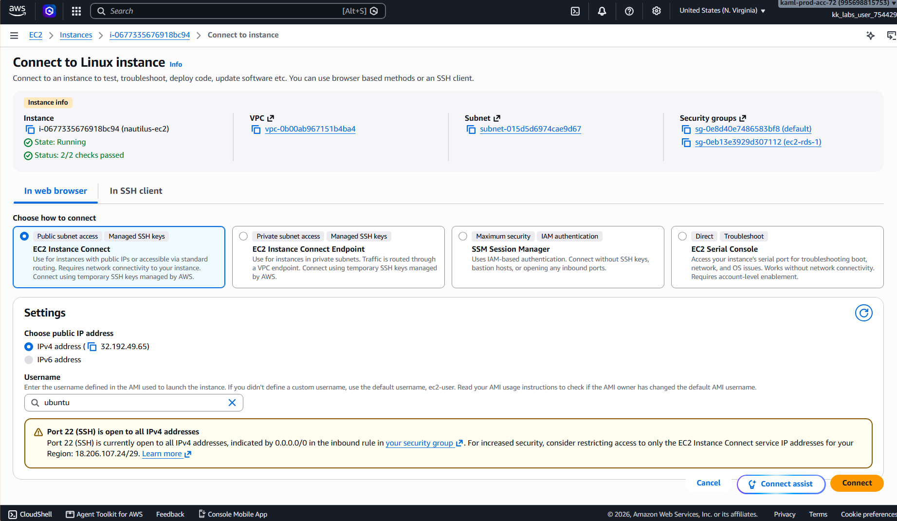

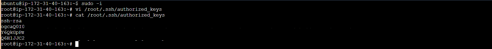

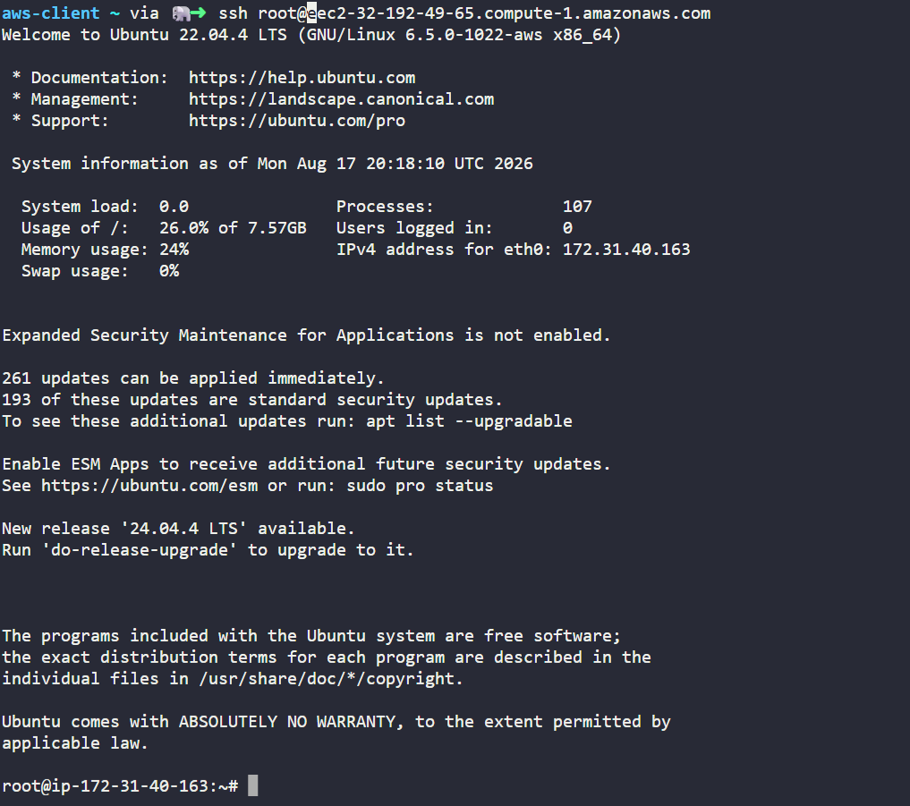

I copied index.php file from aws-client to my ec2 instance, then I changed its database credentials with my newly created database

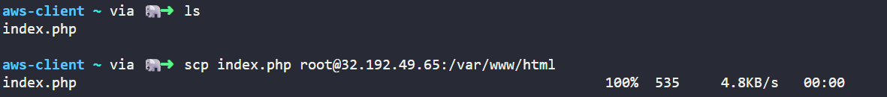

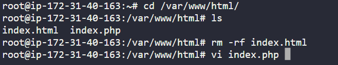

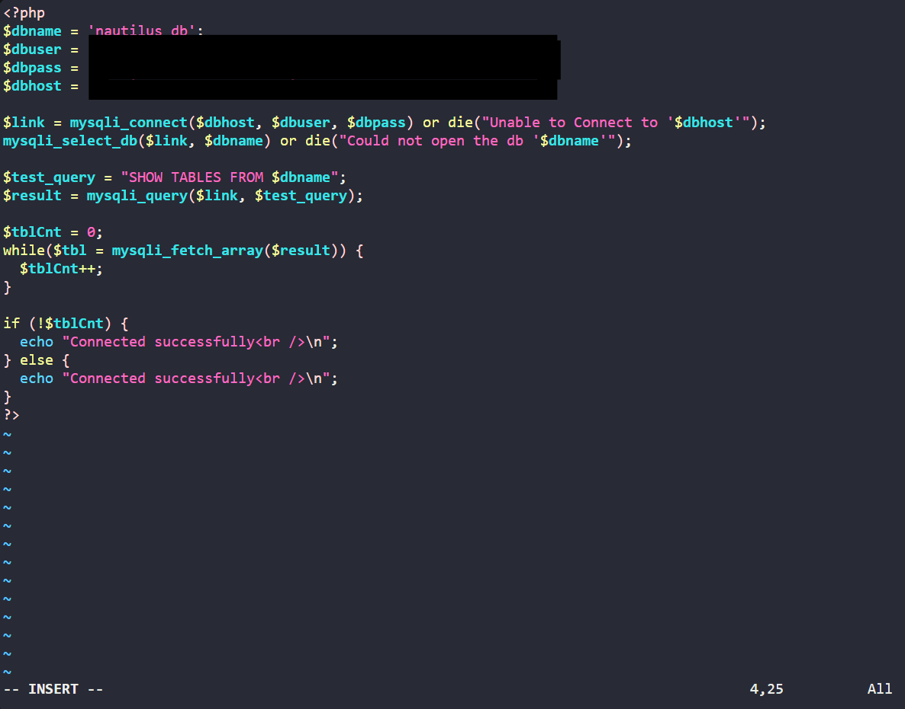

After saving the changes, I did a curl request to localhost, which showed that my database is connected successfully to my ec2 instance

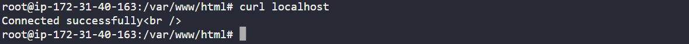
