# Day 36: Load Balancing EC2 Instances with Application Load Balancer

I created a new security group for my ec2 instance

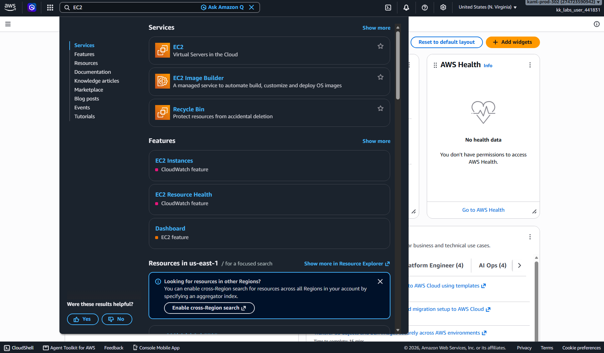

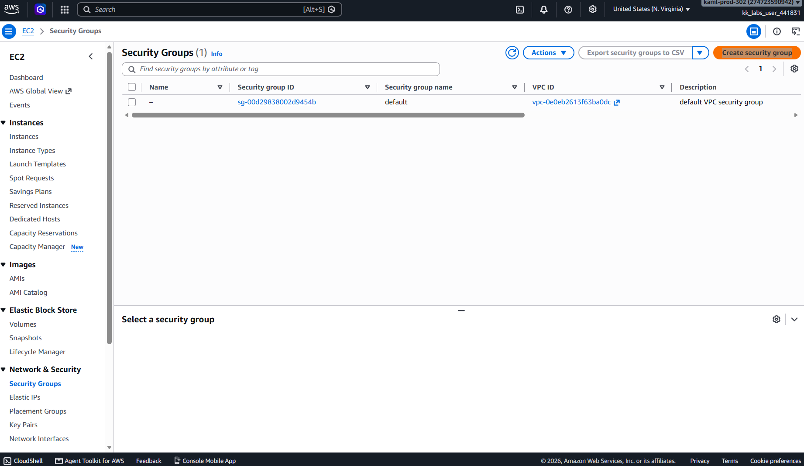

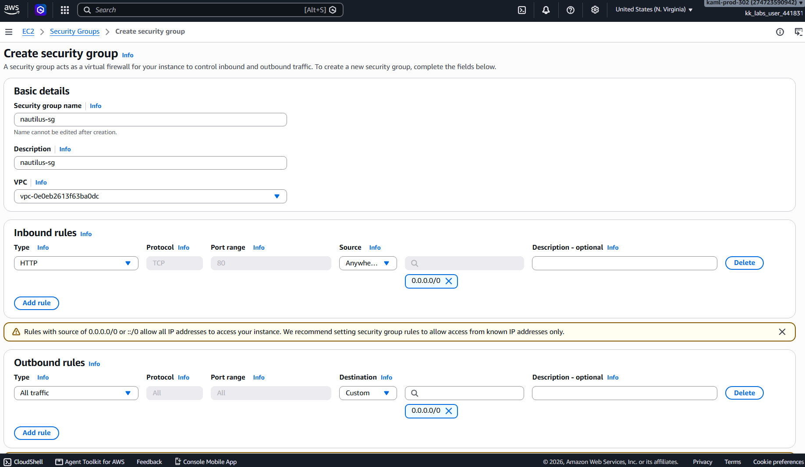

Then, I created my ec2 instance with demanded configuration

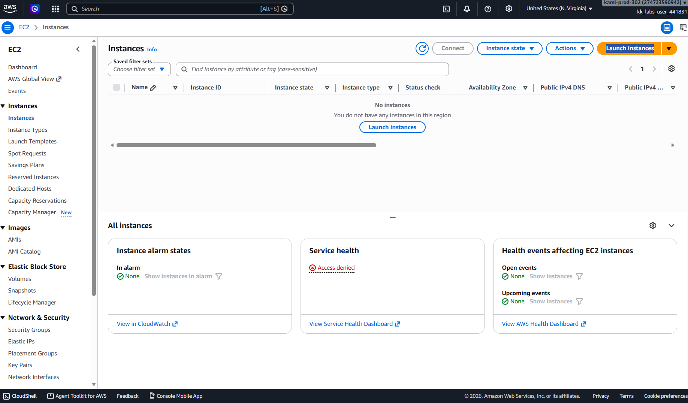

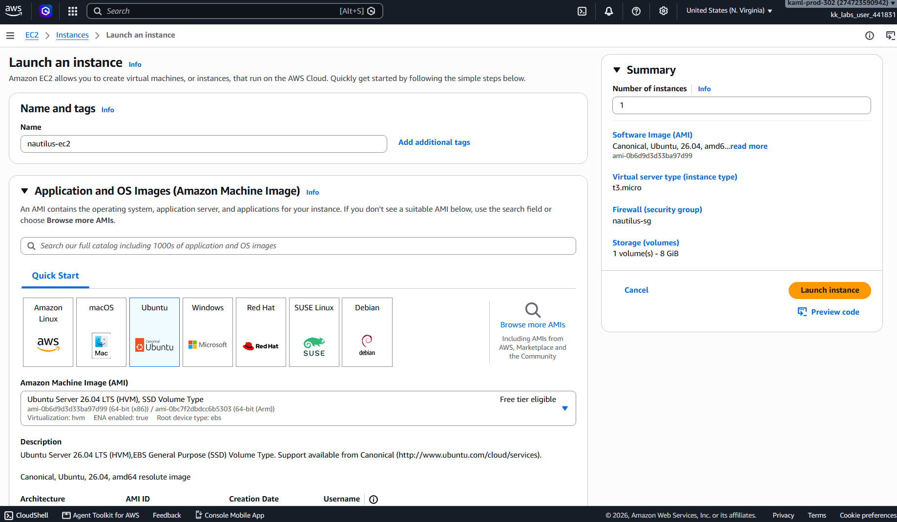

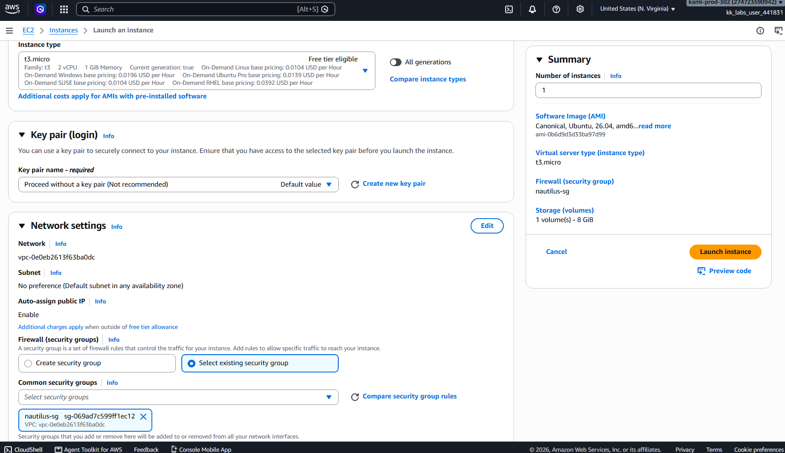

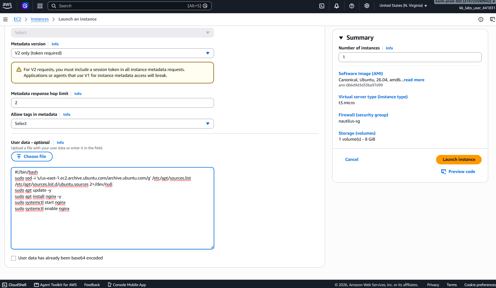

Then, I created a new target group, that includes my ec2 instance

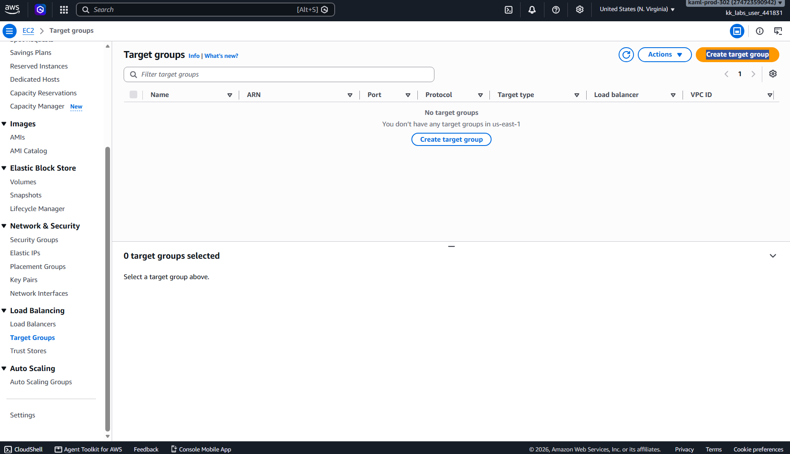

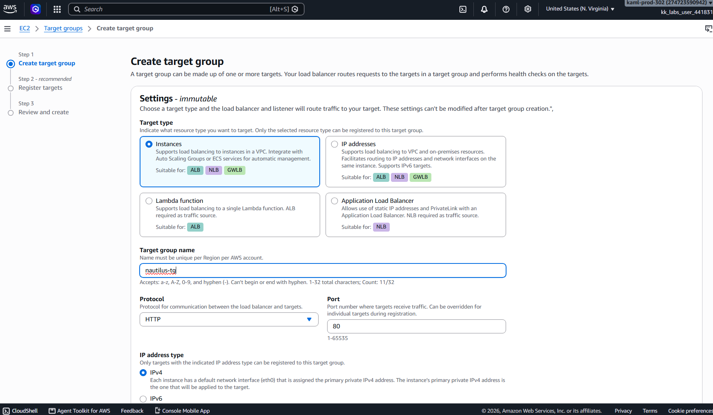

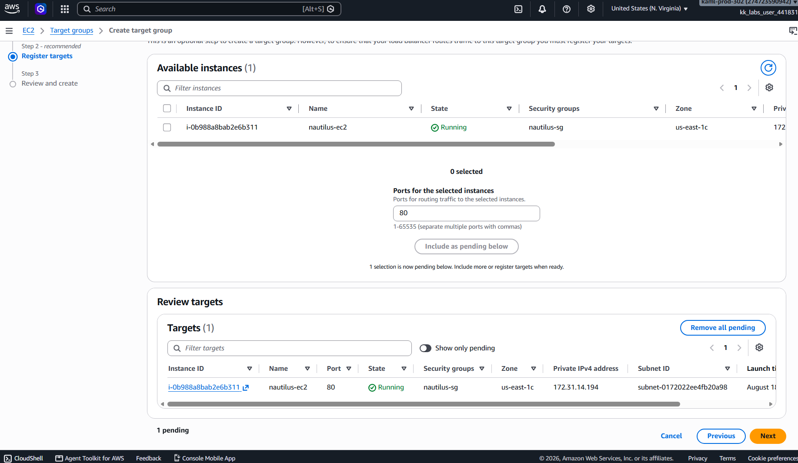

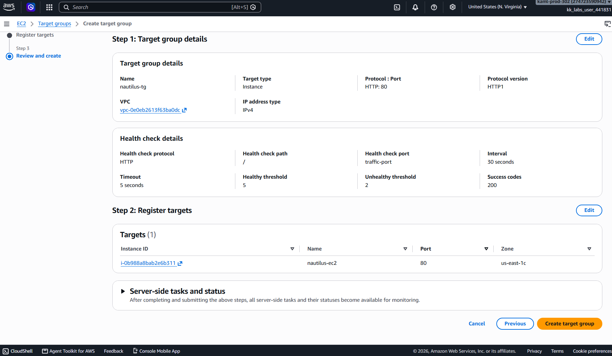

After that, I created my new application load balancer, for my target group (ensure that your application load balancer is in the availability zone of your ec2 instance), and I changed inbound rules of default security group to accept http requests

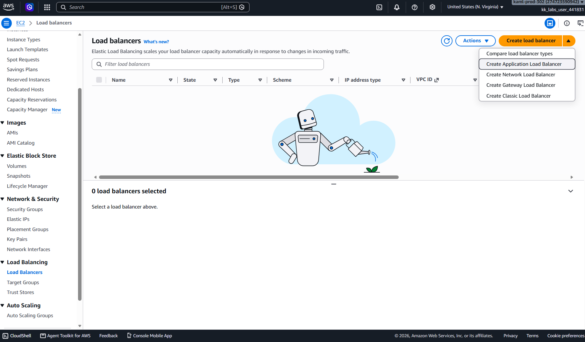

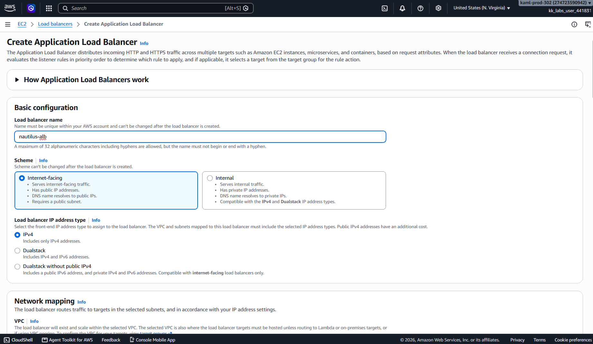

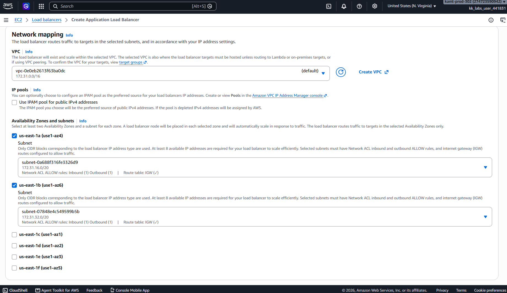

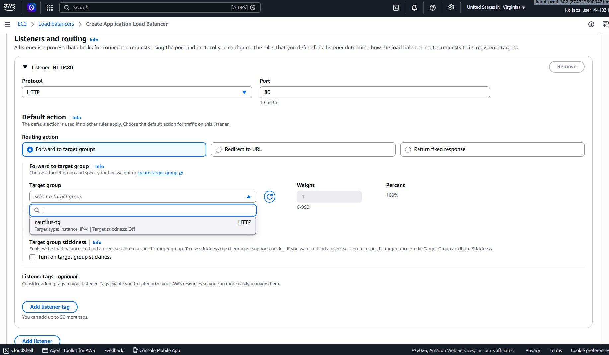

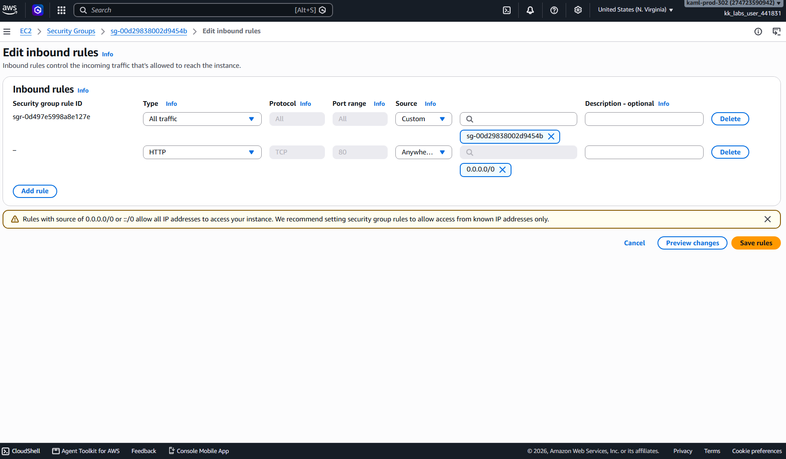

After waiting for some minutes, my target group status went healthy, which means my load balancing setup was successful.

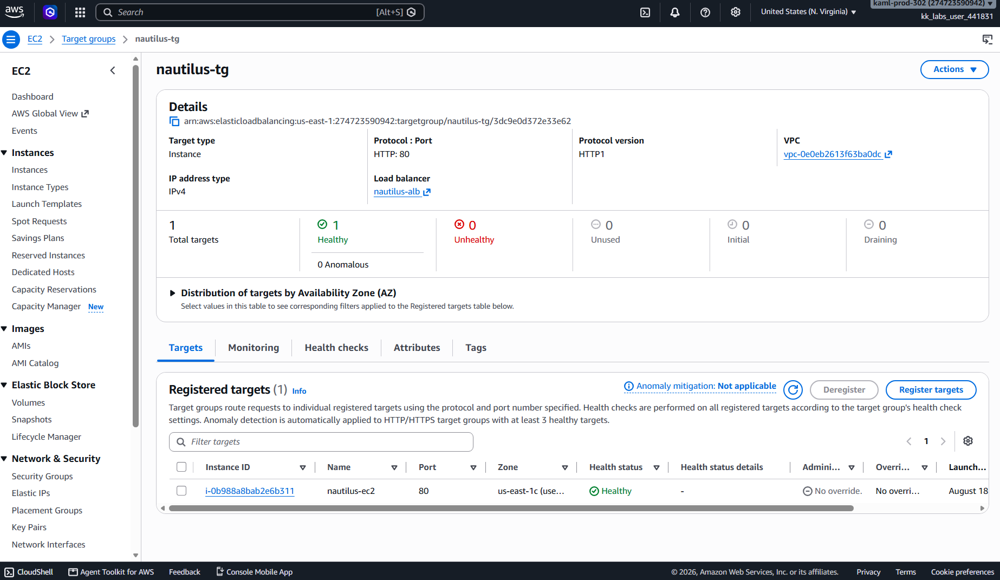
