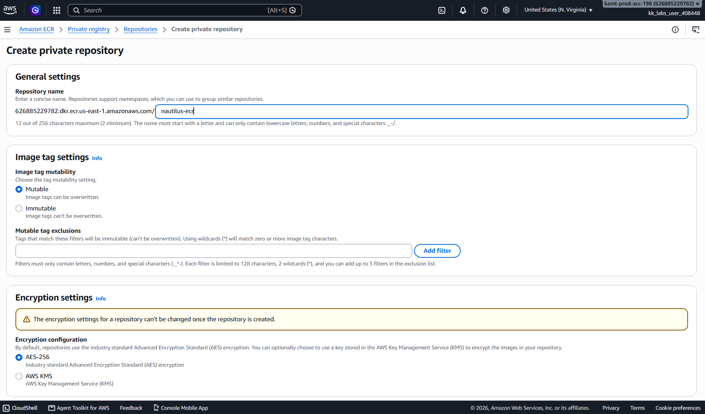
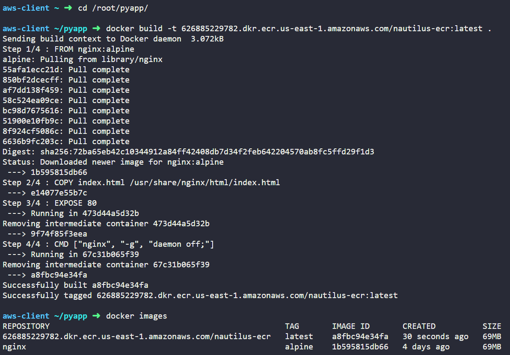
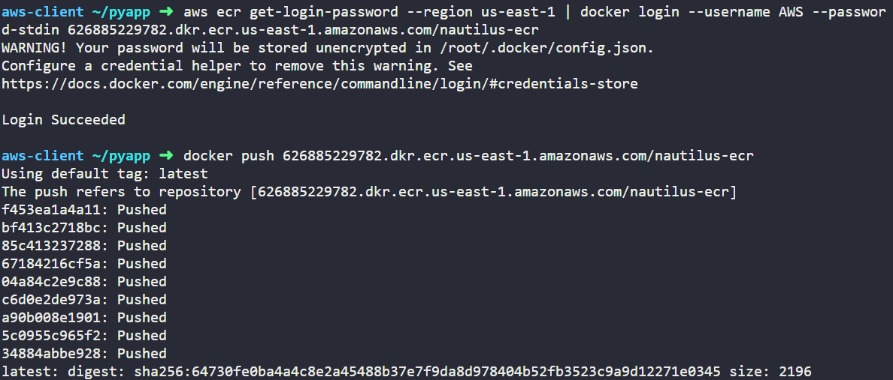
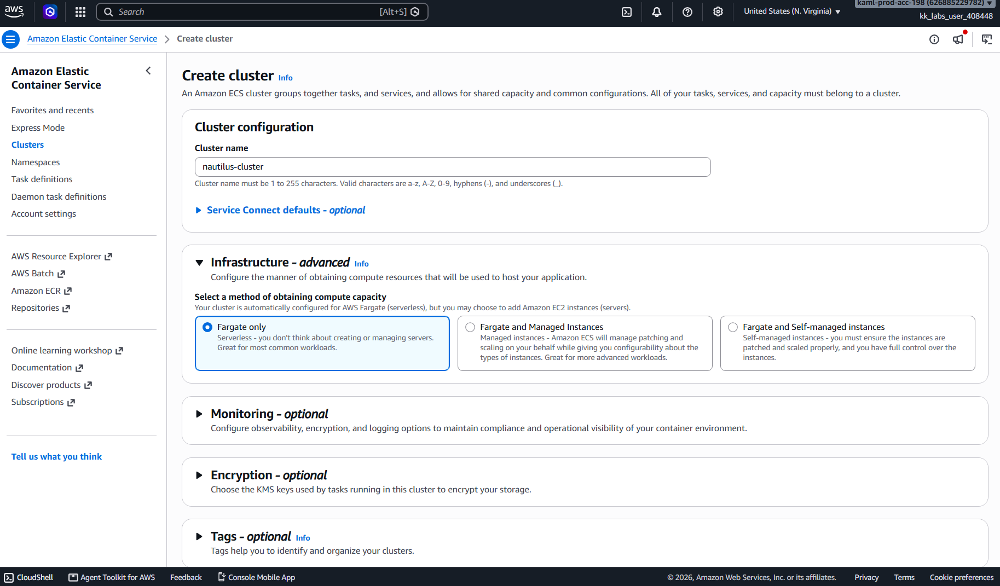
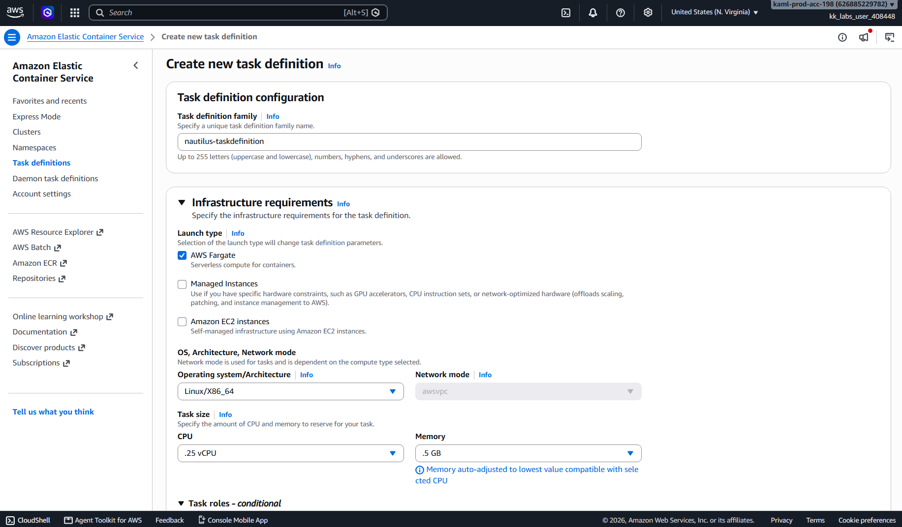
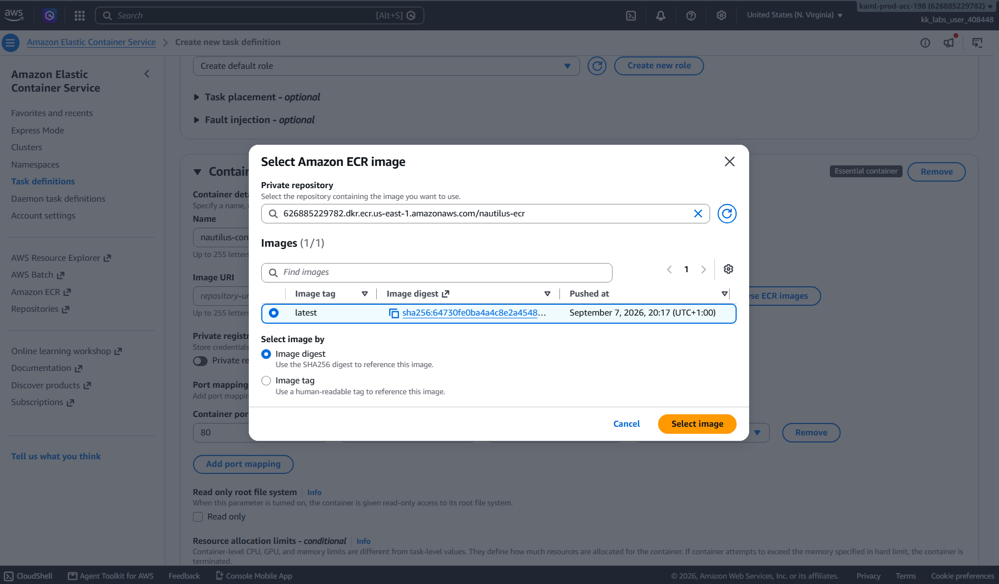
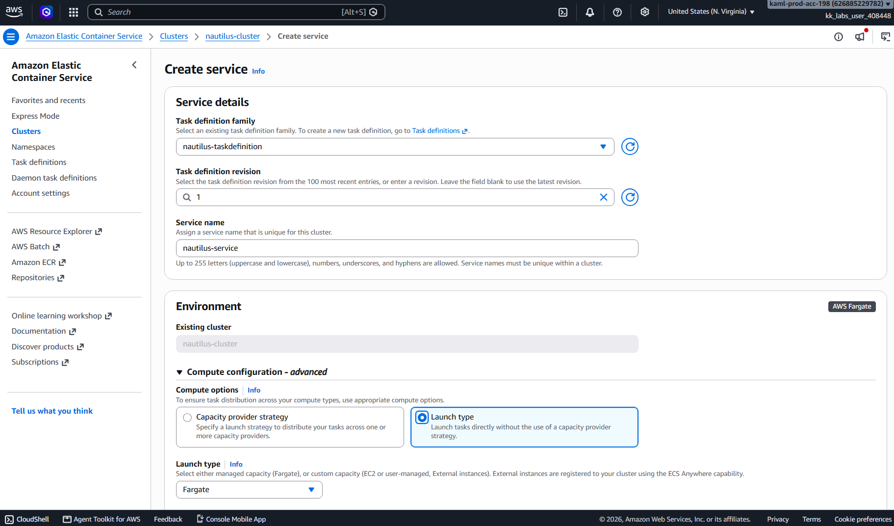
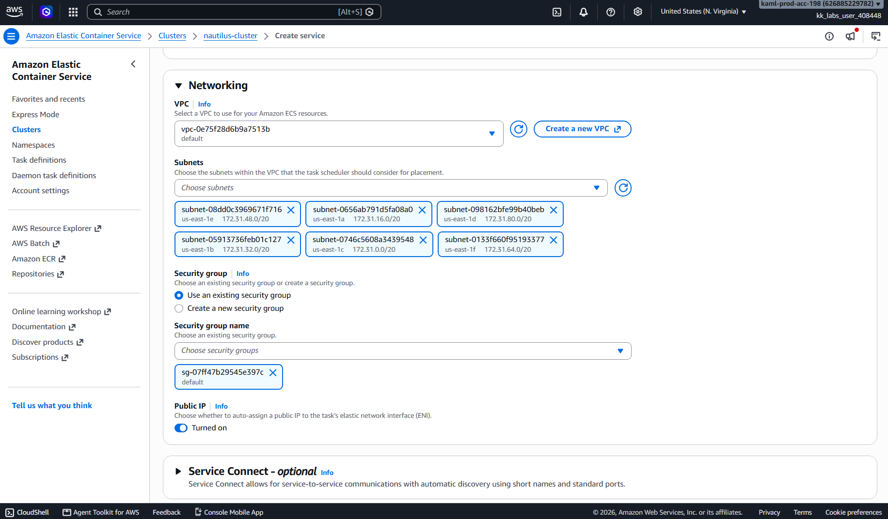
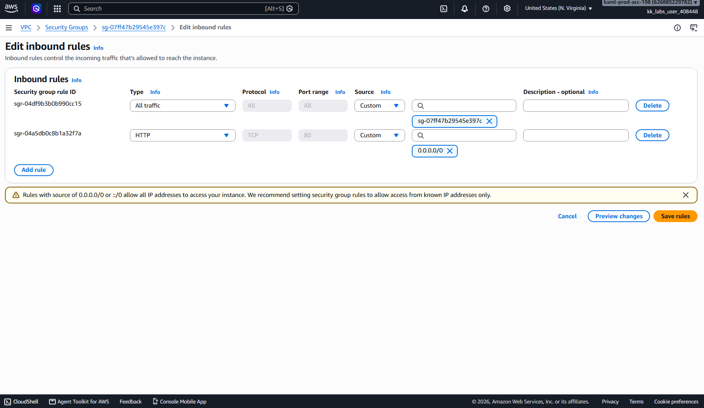
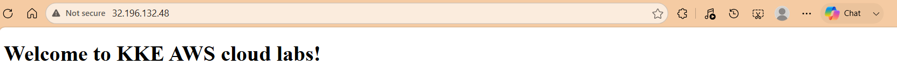

# Day 38: Deploying Containerized Applications with Amazon ECS

I created a new ecr 

Then I built my image

I linked docker to my ecr, then I pushed my image

I created a new cluster

Then a new Task definition for my image

Whitin my cluster, I created a new service

I changed inbound rules of default security group, to allow http requests

Using public address of my service, I had access to my nginx server showing this message

