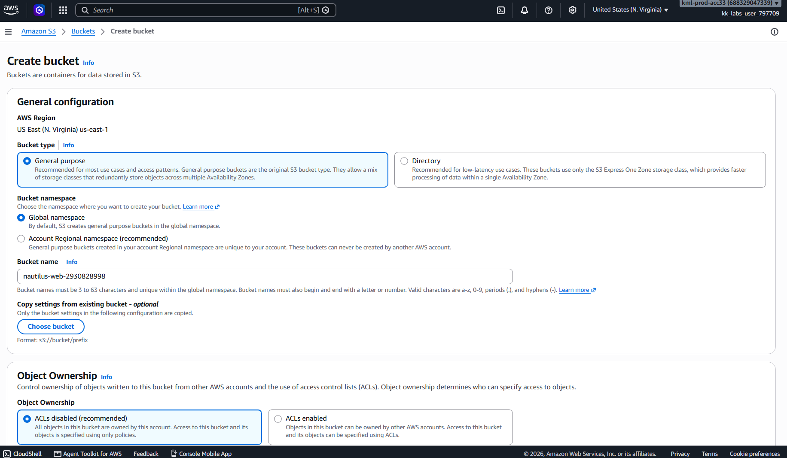
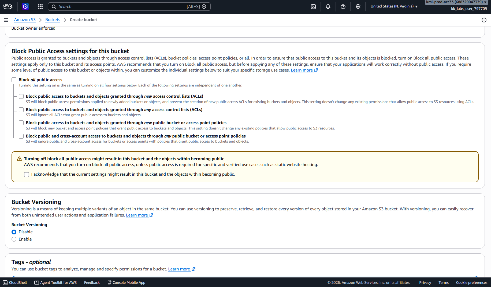
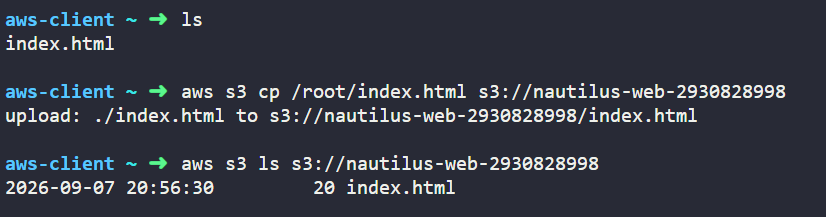
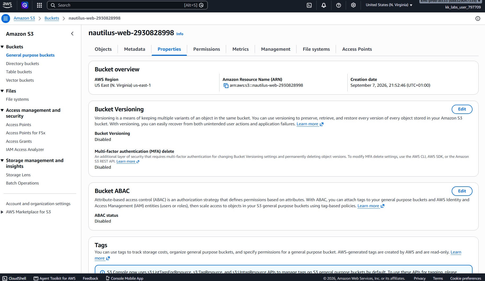
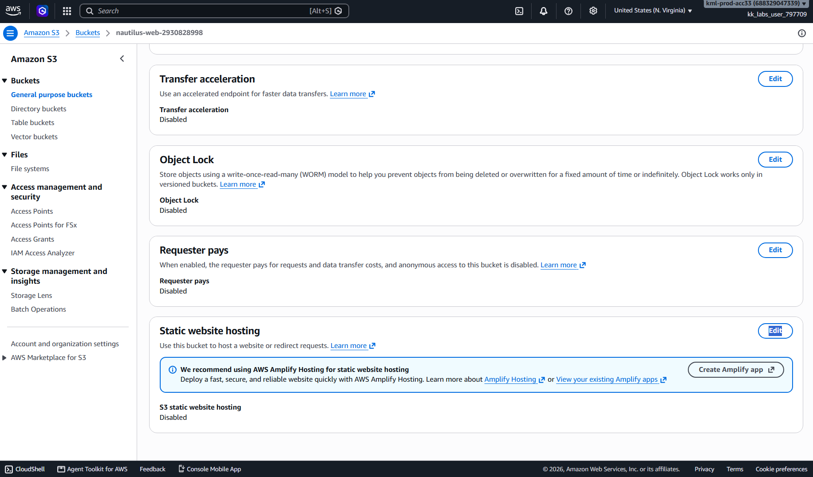
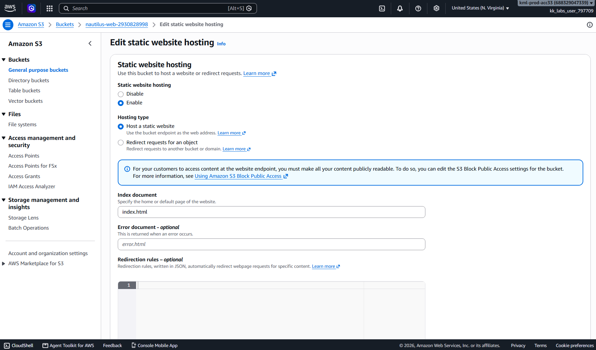
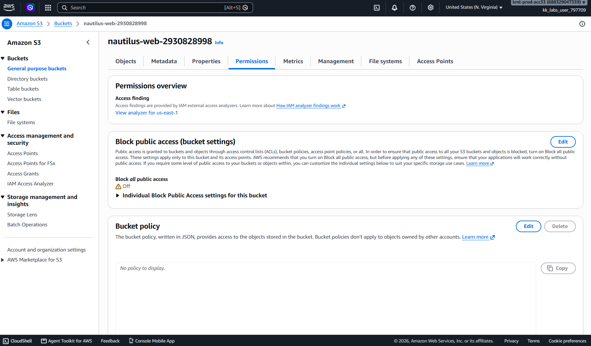
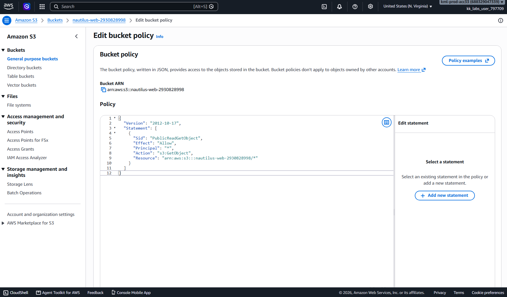
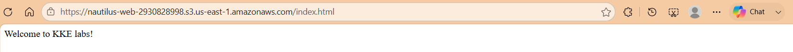

# Day 39: Hosting a Static Website on AWS S3

I created a new s3 bucket 

Then I copied my html file to it

After that, I enable static website hosting of my bucket

I changed my bucket policy to allow public to read its objects

Using public address of my bucket, I accessed to my html page succeessfully

