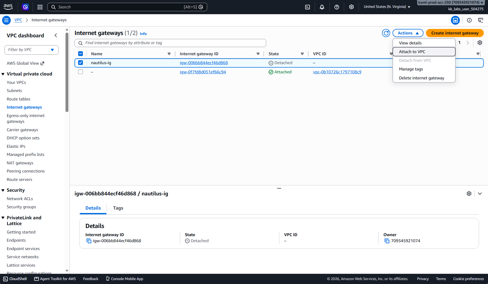
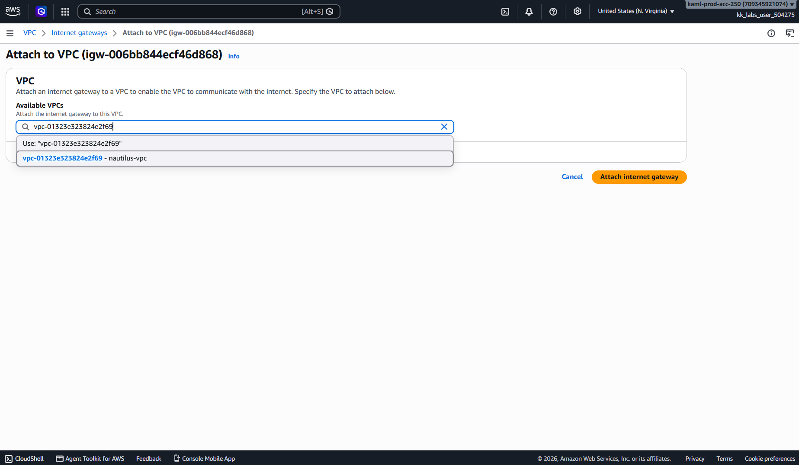
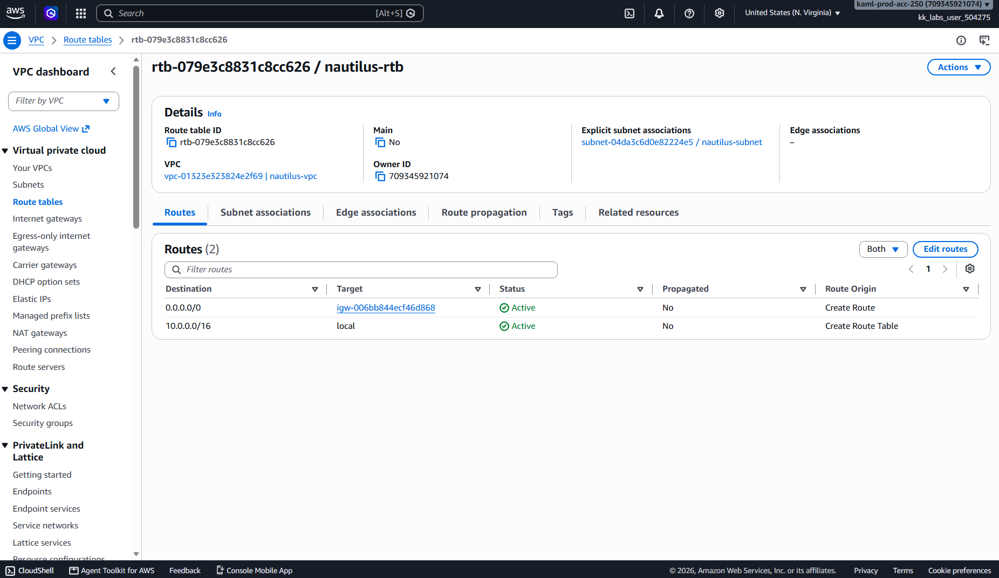
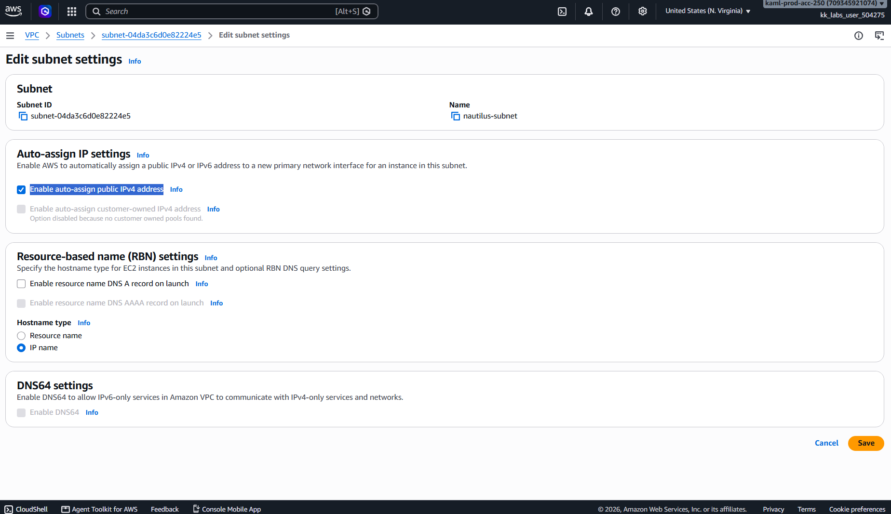
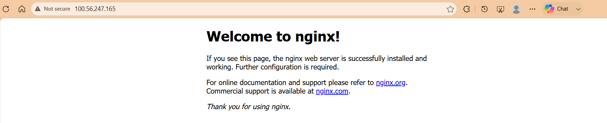

# Day 40: Troubleshooting Internet Accessibility for an EC2-Hosted Application

I attached my igw to default vpc

I added it to my routue table

I enabled auto-assign public ipv4 address in my subnet

My ec2 instance was successfully accessible

