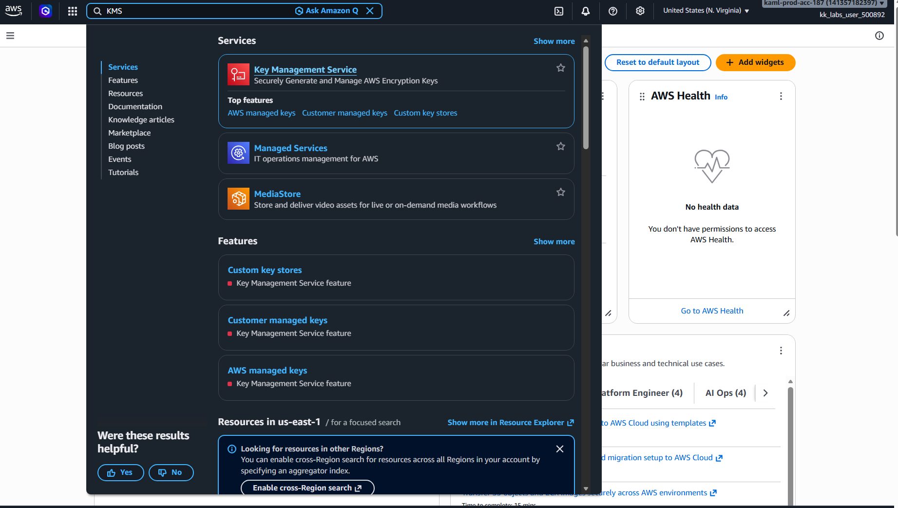
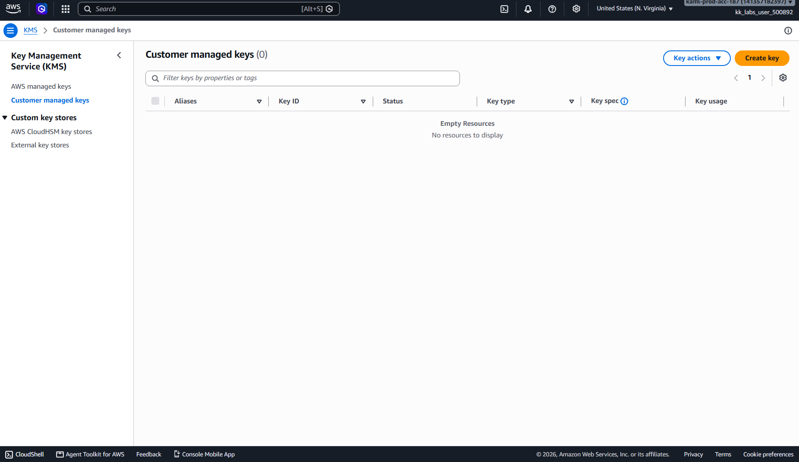
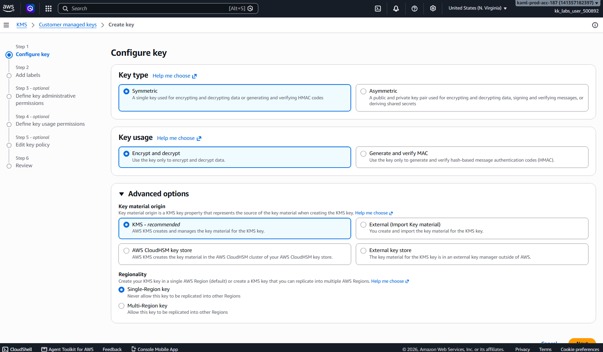
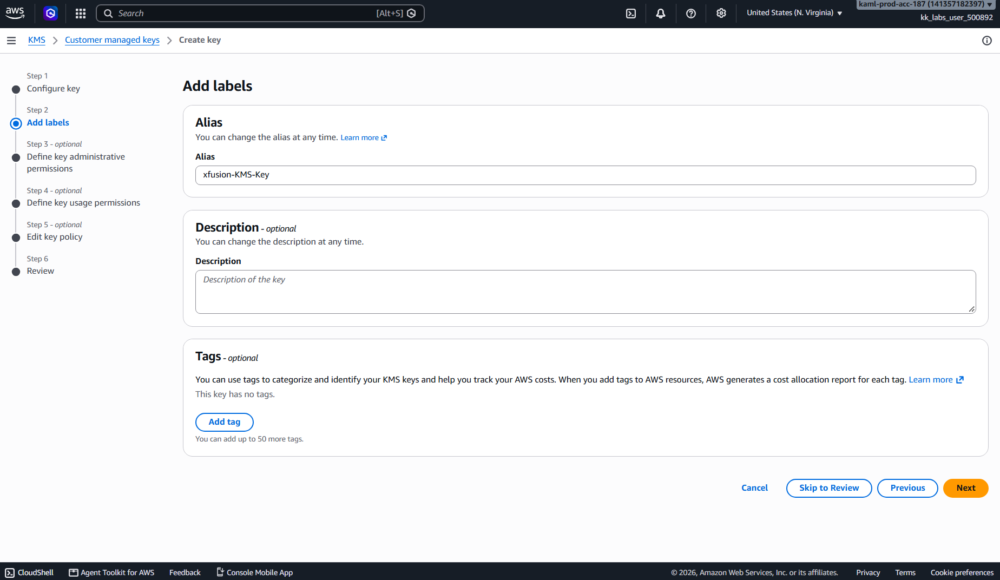
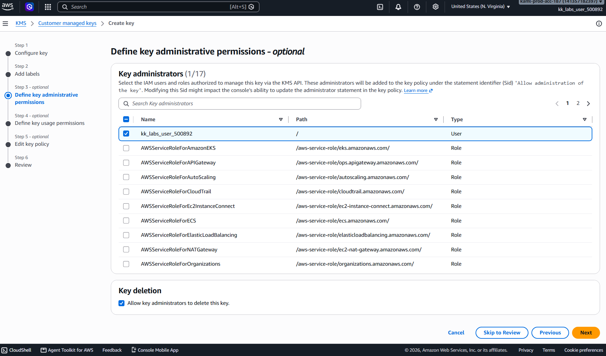
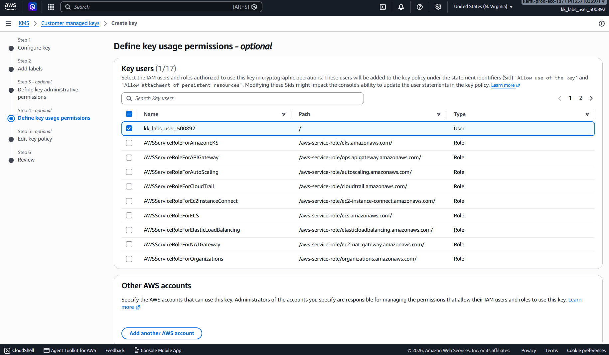
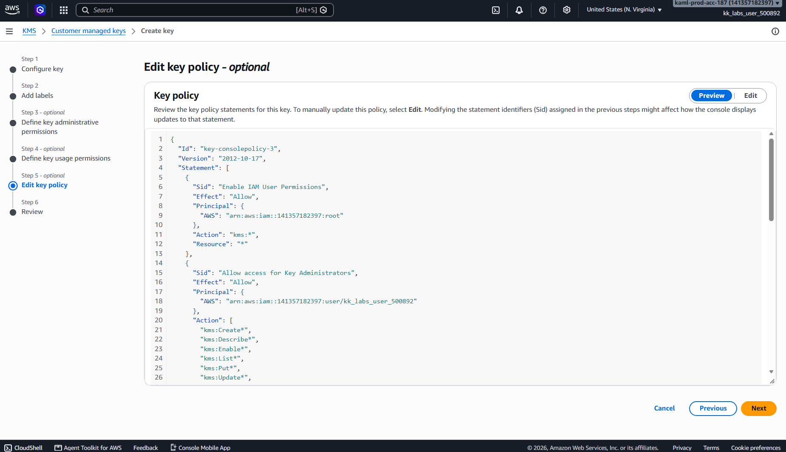
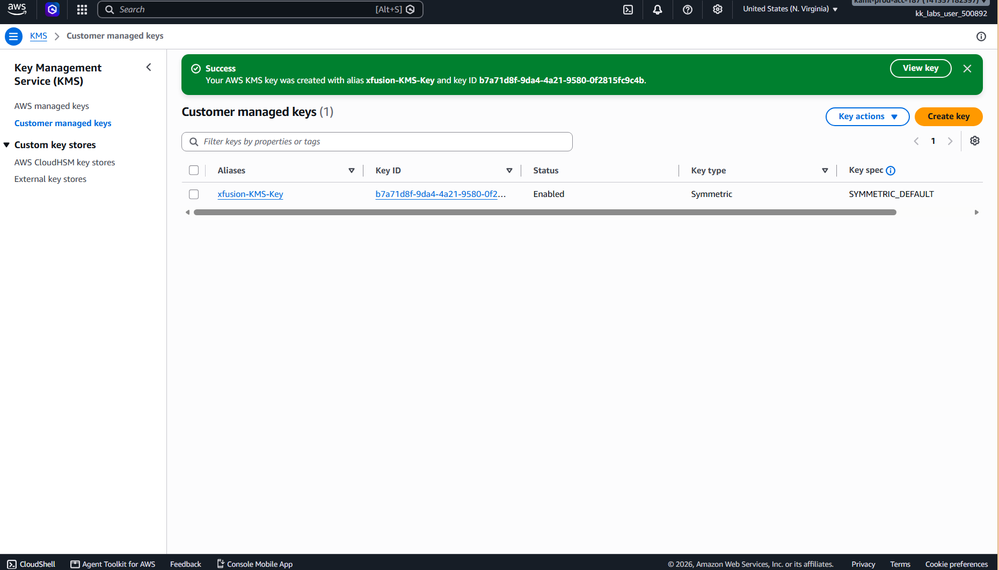
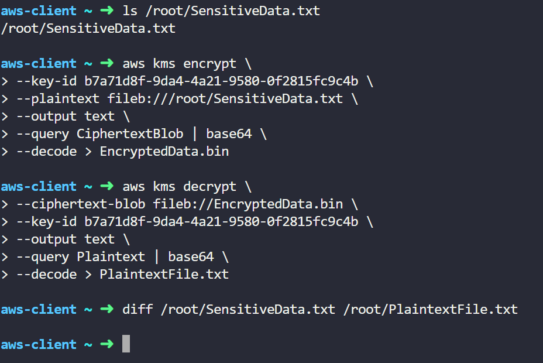

# Day 41: Securing Data with AWS KMS

I created a new KMS key 

after that, I encrypted my txt file using my key then decrypted it, and tested if there's any difference between original and decrypted file

