# Day 43: Scaling and Managing Kubernetes Clusters with Amazon EKS

I created a IAM role to attach it to my eks clustser
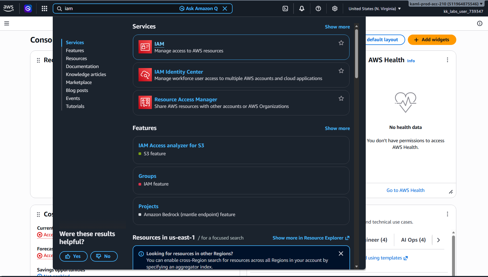

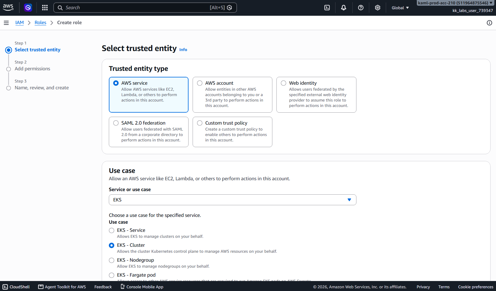

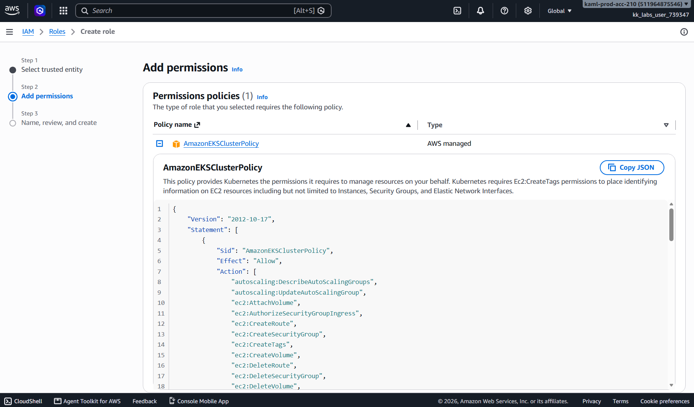

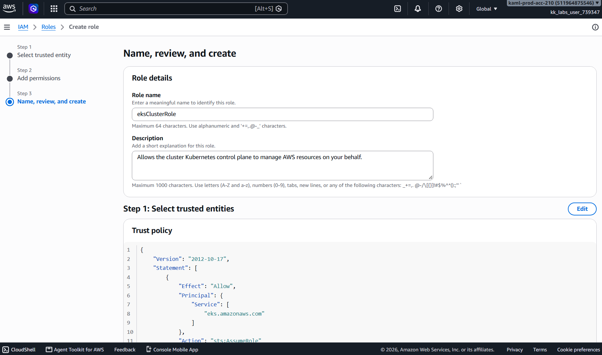

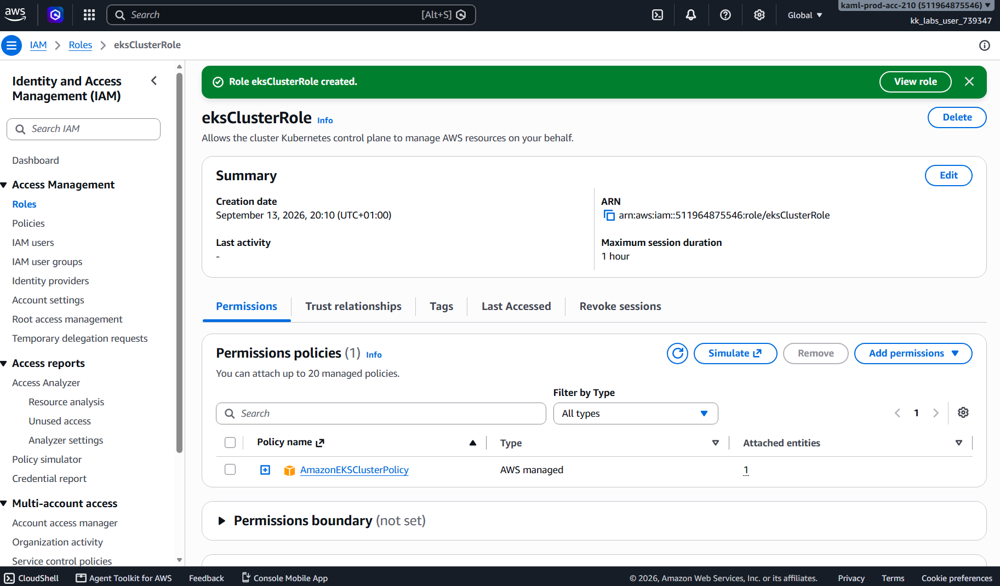

Then I created my new eks cluster, and I attached my newly created IAM role to it

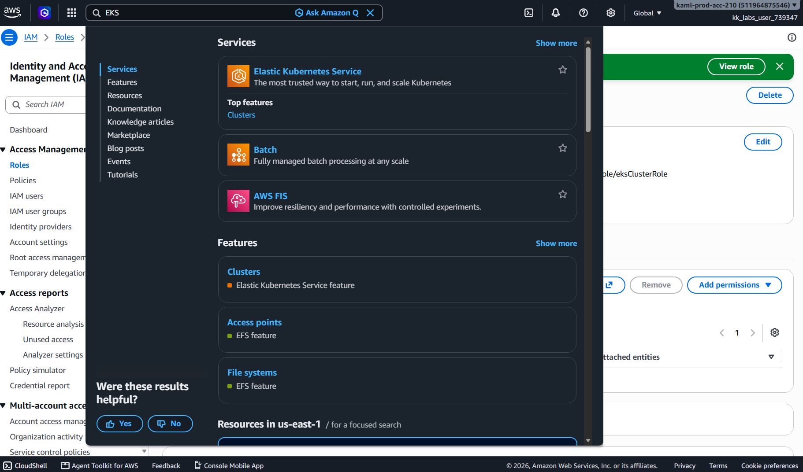

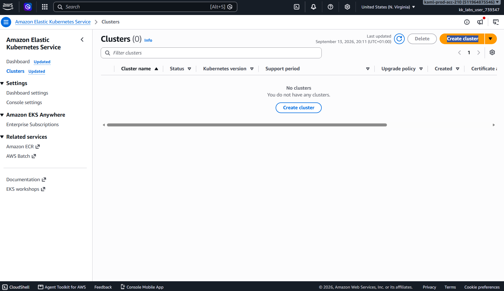

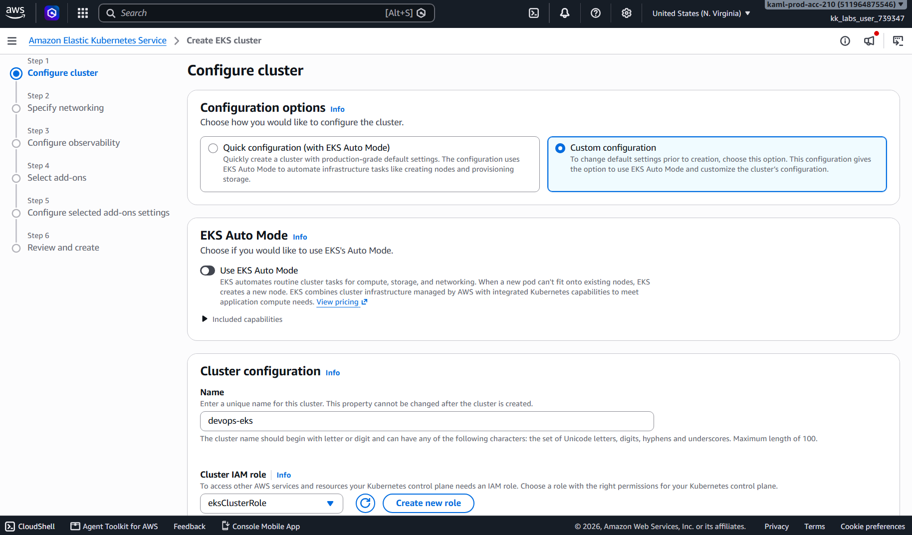

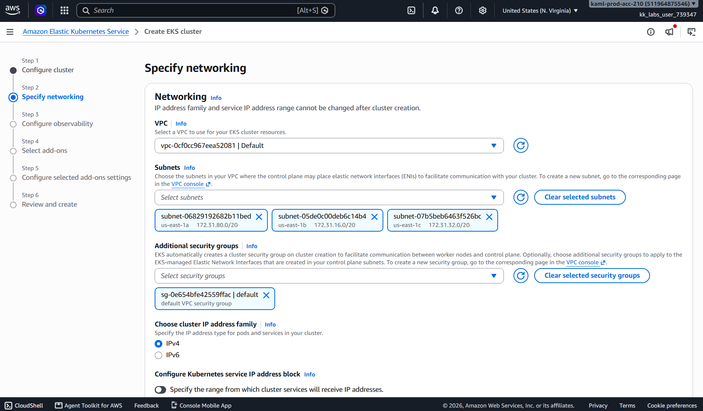

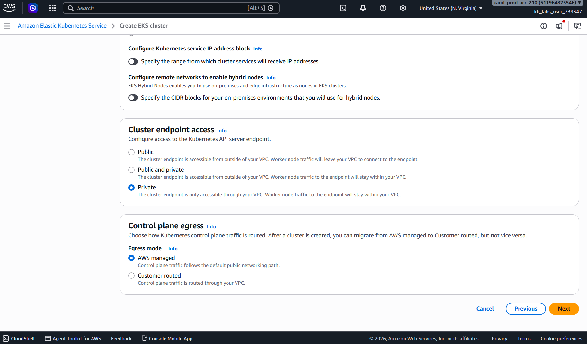

I waited until my cluster is in active status, verified its configuration, then validated the challenge

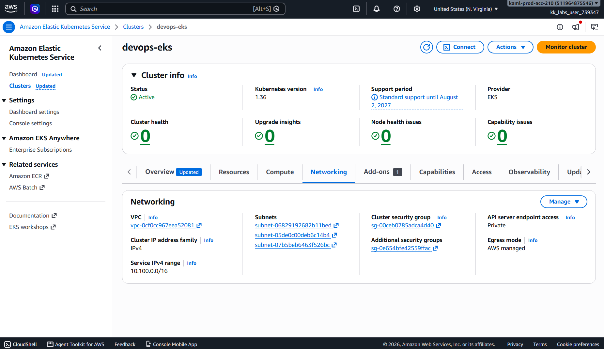

