# Day 45: Configure NAT Gateway for Internet Access in a Private VPC

I created a new public subnet 
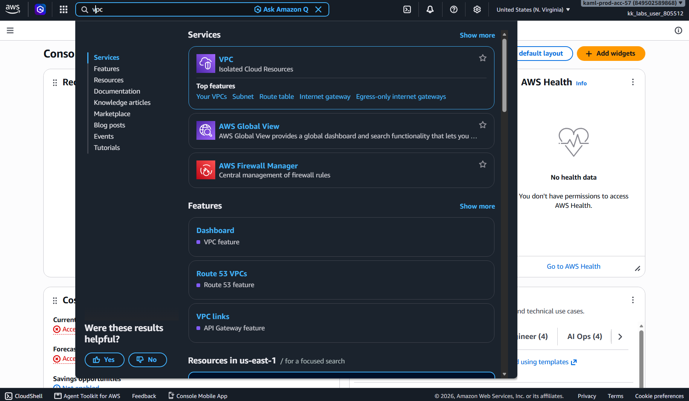

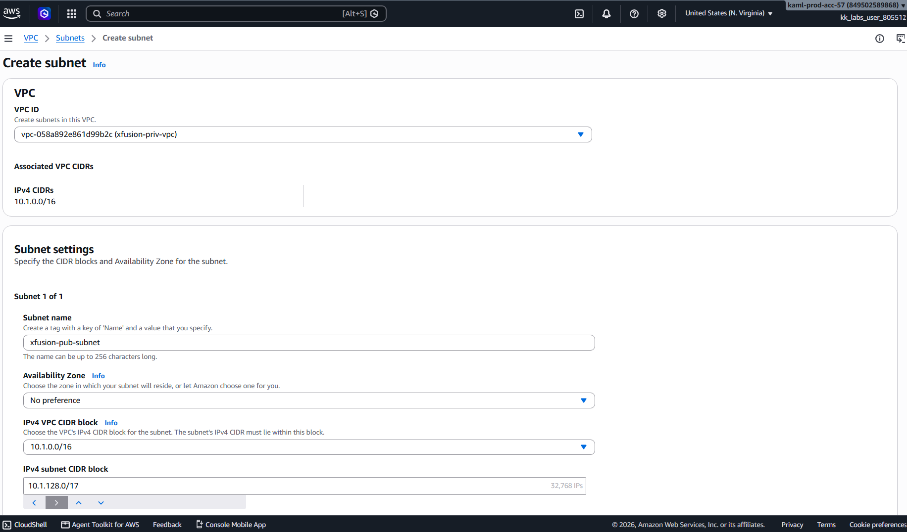

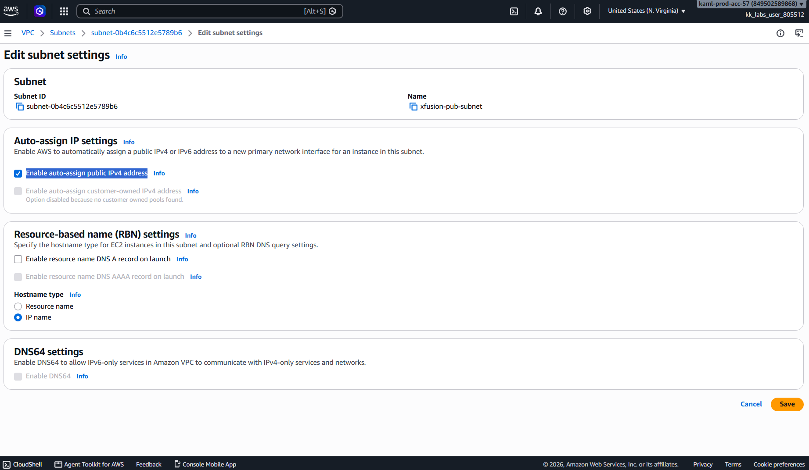

Then, I created a new internet gateway, and I associated it with private vpc

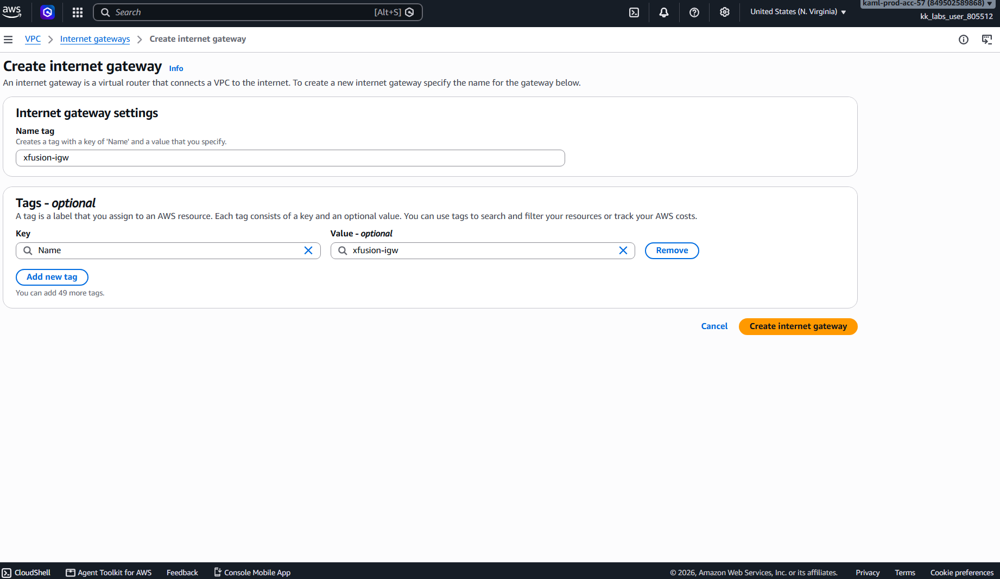

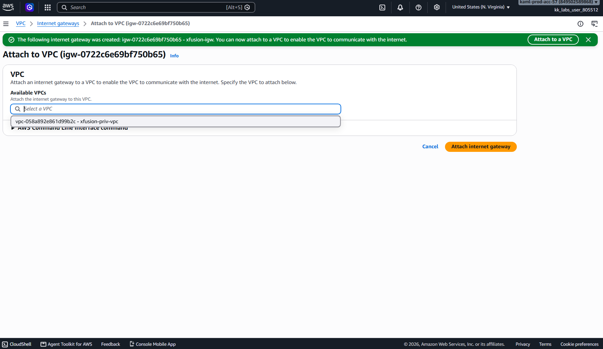

Then I create new public route table, I added my new internet gateway, then I associated it to my public subnet

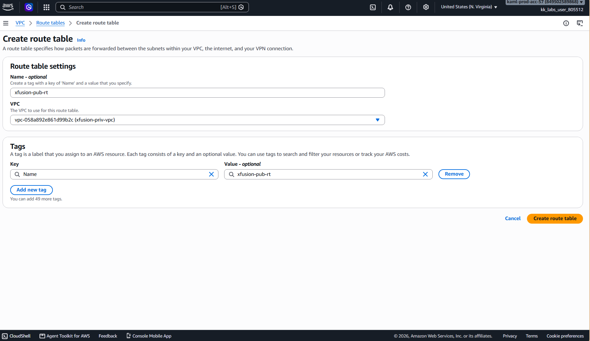

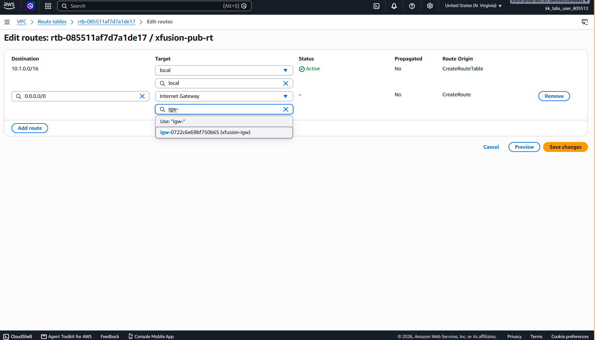

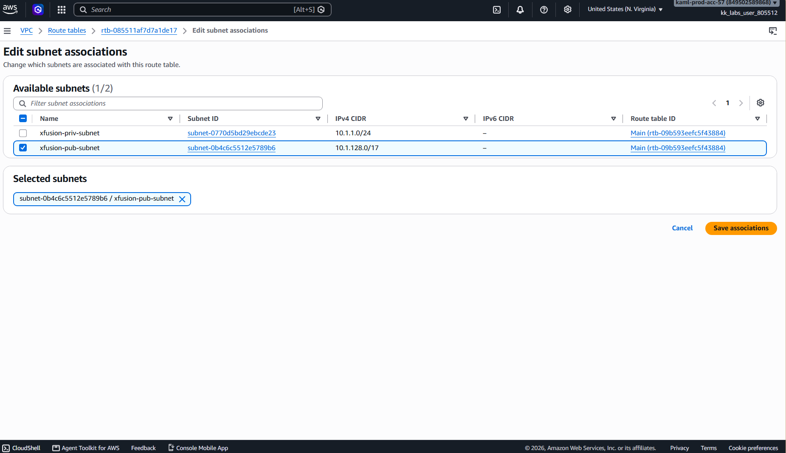

I created a new NAT Gateway, and I waited until it's on available state

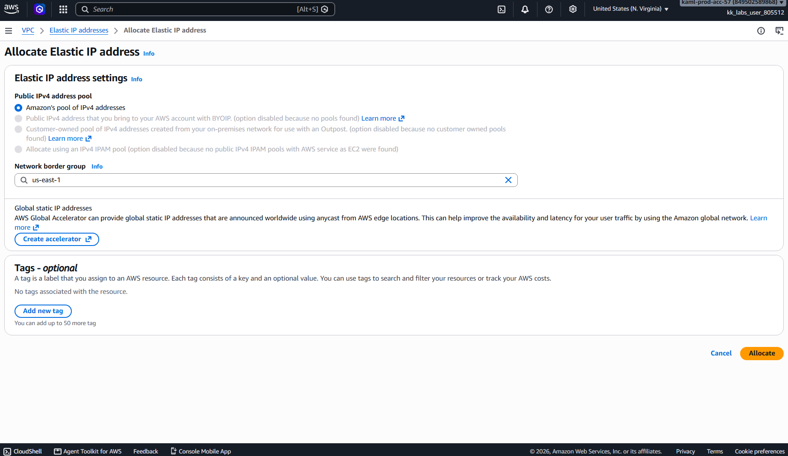

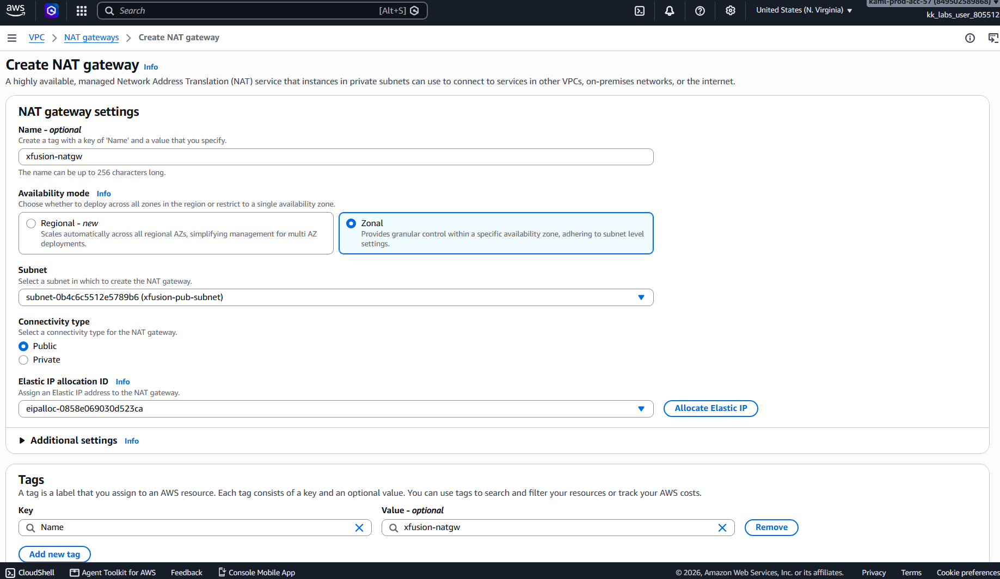

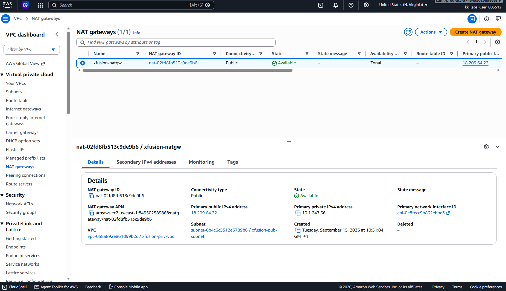

I created a new private route table, then I associated it with private subnet, and I added NAT Gateway to its routes

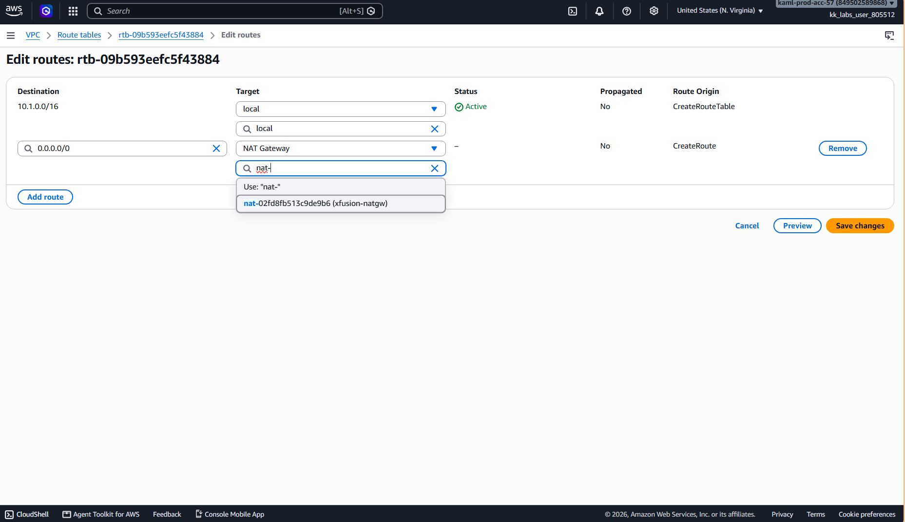

Finally, the txt file wa uploaded successfully in my s3 bucket.

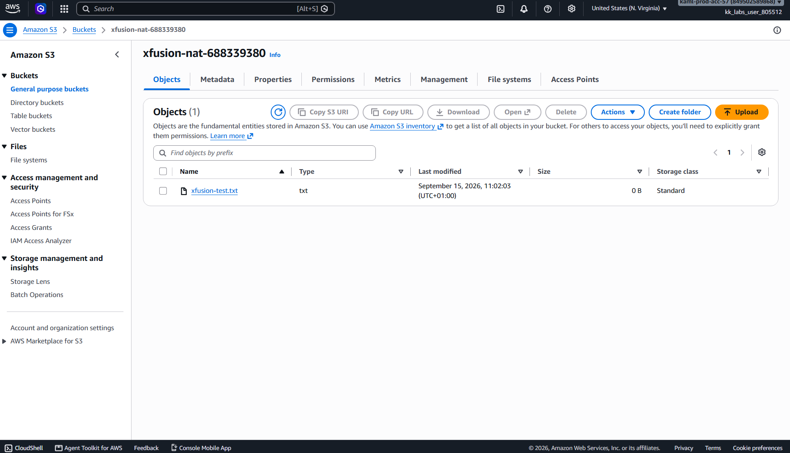
