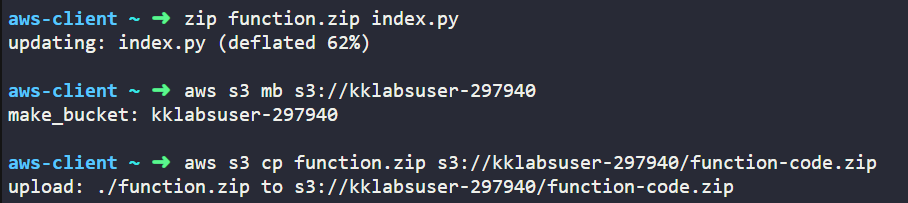
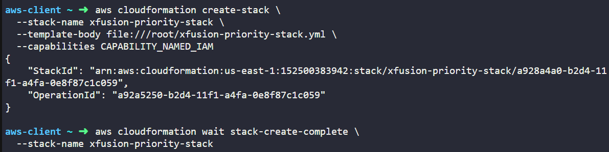
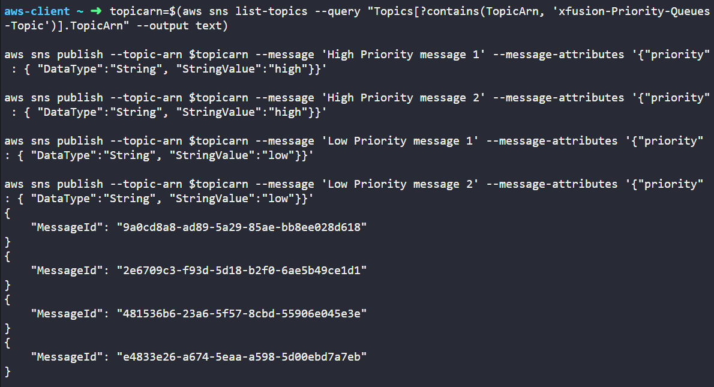
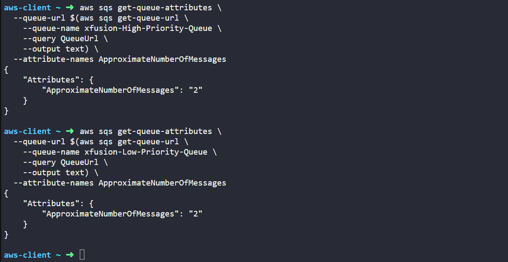

# Day 47: Integrating AWS SQS and SNS for Reliable Messaging


I created a CloudFormation template using xfusion-priority-stack.yml file in /root/ directory

```
AWSTemplateFormatVersion: '2010-09-09'
Description: Priority Queue Processing Stack
Resources:
  
  HighPriorityQueue:
    Type: AWS::SQS::Queue
    Properties:
      QueueName: xfusion-High-Priority-Queue
      VisibilityTimeout: 60

  LowPriorityQueue:
    Type: AWS::SQS::Queue
    Properties:
      QueueName: xfusion-Low-Priority-Queue
      VisibilityTimeout: 60

  PriorityQueuesTopic:
    Type: AWS::SNS::Topic
    Properties:
      TopicName: xfusion-Priority-Queues-Topic

  HighPrioritySubscription:
    Type: AWS::SNS::Subscription
    Properties:
      TopicArn: !Ref PriorityQueuesTopic
      Protocol: sqs
      Endpoint: !GetAtt HighPriorityQueue.Arn
      FilterPolicy:
        priority:
          - high

  LowPrioritySubscription:
    Type: AWS::SNS::Subscription
    Properties:
      TopicArn: !Ref PriorityQueuesTopic
      Protocol: sqs
      Endpoint: !GetAtt LowPriorityQueue.Arn
      FilterPolicy:
        priority:
          - low 

  HighPriorityPolicy:
    Type: AWS::SQS::QueuePolicy
    Properties:
      Queues:
        - !Ref HighPriorityQueue
      PolicyDocument:
        Statement:
          - Effect: Allow
            Principal: "*"
            Action: SQS:SendMessage
            Resource: !GetAtt HighPriorityQueue.Arn
            Condition:
              ArnEquals:
                aws:SourceArn: !Ref PriorityQueuesTopic
                
  LowPriorityPolicy:
    Type: AWS::SQS::QueuePolicy
    Properties:
      Queues:    
        - !Ref LowPriorityQueue
      PolicyDocument:
        Statement:
          - Effect: Allow
            Principal: "*"  
            Action: SQS:SendMessage
            Resource: !GetAtt LowPriorityQueue.Arn
            Condition:
              ArnEquals:
                aws:SourceArn: !Ref PriorityQueuesTopic

  LambdaExecutionRole:
    Type: AWS::IAM::Role
    Properties:
      RoleName: lambda_execution_role
      AssumeRolePolicyDocument:
        Version: '2012-10-17'
        Statement:
          - Effect: Allow
            Principal:
              Service: lambda.amazonaws.com
            Action: sts:AssumeRole
      ManagedPolicyArns:
        - arn:aws:iam::aws:policy/service-role/AWSLambdaBasicExecutionRole
        - arn:aws:iam::aws:policy/AmazonSQSFullAccess
        - arn:aws:iam::aws:policy/AmazonSNSFullAccess

  PriorityLambdaFunction:
    Type: AWS::Lambda::Function
    Properties:
      FunctionName: xfusion-priorities-queue-function
      Runtime: python3.9
      Handler: index.lambda_handler
      Role: !GetAtt LambdaExecutionRole.Arn
      Timeout: 5
      Environment:
        Variables:
          high_priority_queue: !Ref HighPriorityQueue
          low_priority_queue: !Ref LowPriorityQueue
      Code:
        S3Bucket: kklabsuser-297940
        S3Key: function-code.zip
```

I created a s3 bucket then I uploaded the script into it



I deployed to CloudFormation template 



I published the messages given in lab, then I verified priority order 






