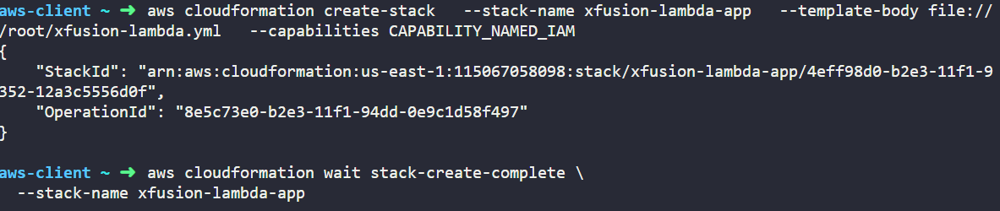
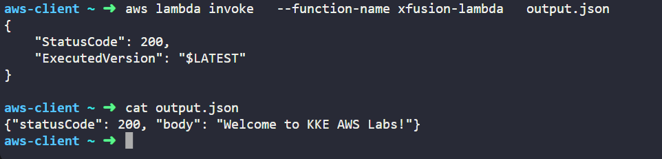

# Day 47: Integrating AWS SQS and SNS for Reliable Messaging


I created a CloudFormation template using xfusion-priority-stack.yml file in /root/ directory

```
AWSTemplateFormatVersion: '2010-09-09'
Description: Xfusion Lambda Application Stack

Resources:

  LambdaExecutionRole:
    Type: AWS::IAM::Role
    Properties:
      RoleName: lambda_execution_role
      AssumeRolePolicyDocument:
        Version: '2012-10-17'
        Statement:
          - Effect: Allow
            Principal:
              Service: lambda.amazonaws.com
            Action: sts:AssumeRole
      ManagedPolicyArns:
        - arn:aws:iam::aws:policy/service-role/AWSLambdaBasicExecutionRole

  XfusionLambdaFunction:
    Type: AWS::Lambda::Function
    Properties:
      FunctionName: xfusion-lambda
      Runtime: python3.9
      Handler: index.lambda_handler
      Role: !GetAtt LambdaExecutionRole.Arn
      Timeout: 10
      Code:
        ZipFile: |
          def lambda_handler(event, context):
              return {
                  "statusCode": 200,
                  "body": "Welcome to KKE AWS Labs!"
              }
```

I deployed the CloudFormation template



Then I tested it 




