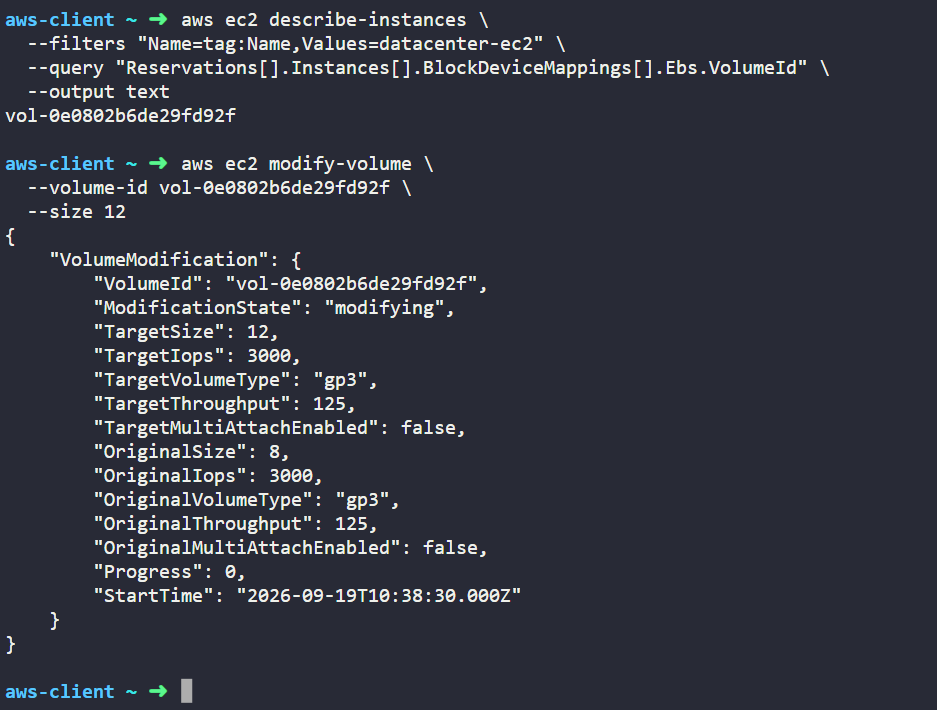
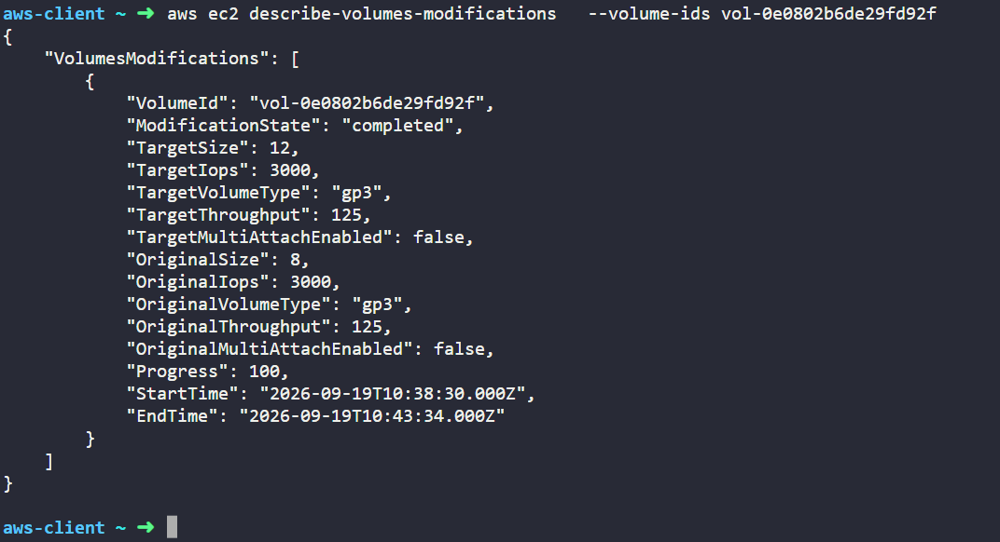
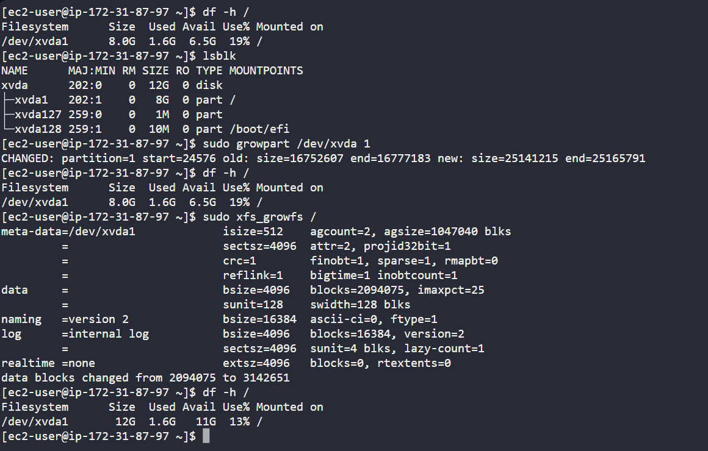

# Day 50: Expanding EC2 Instance Storage for Development Needs

I modified my gp3 volume to 12 gb using aws cli, and waited until this modification is completed

I connected to my ec2 instance, then I stratched the partition 1 to fill the remaining 4 gb in the physical xvda disk, then I expanded the XFS filesystem itself.

